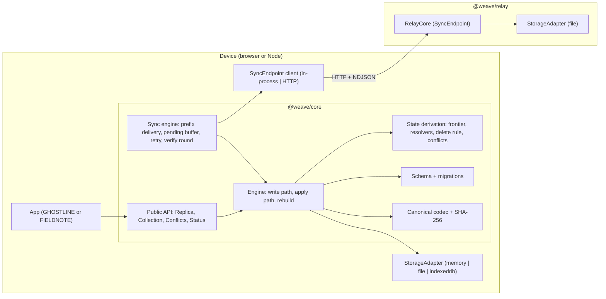
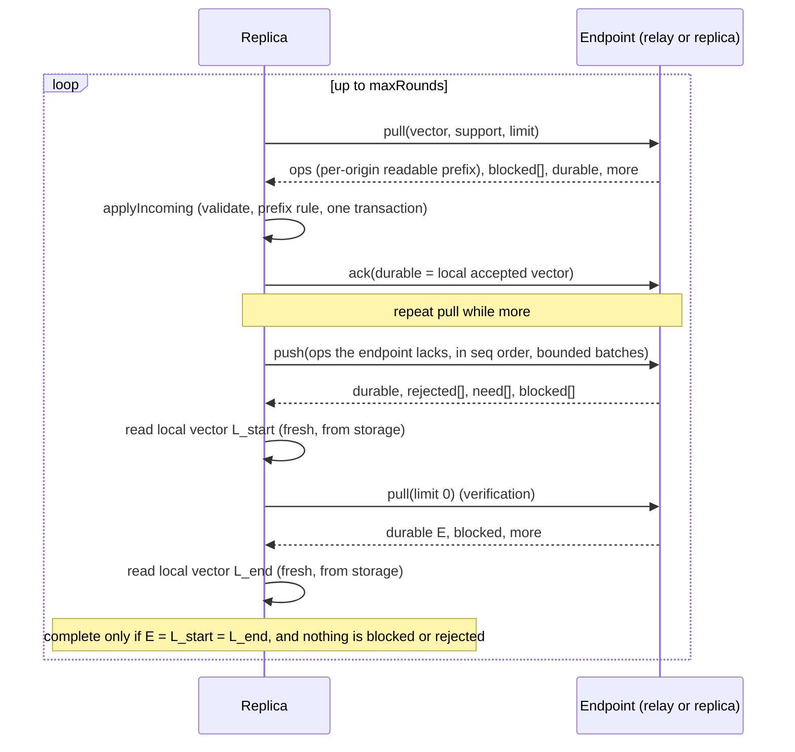

# Design: WEAVE, an Offline-First Application Foundation

This document describes how the approved requirements (`requirements.md`, R1 to R20, D1 to D8, A1 to A7) are built. Section numbers like R6.2 and D5 refer to that file. Every MVP criterion has a home in this design. [ADV] items are described only as far as needed to keep the MVP interfaces compatible with them.

Revision note: this version has mandatory write idempotency keys (7.2), all-or-nothing batch validation with per-origin isolation for both pulls and pushes (7.3), exact acknowledgement rules (10.3), a hardened file adapter that fails closed on corruption and never steals a live lock (9.1), a verified sync point (8.2), notification recovery from the conflict history (6.1), non-overlapping ownership (18.2), and a precise separation of buffered and accepted ops (3.5). The public API has asynchronous return types (7.1). Every name used here is also defined in `requirements.md` (section 14).

## 1. Architecture summary

WEAVE is an **operation-log replication library**.

- Every write becomes one immutable, hash-protected **op**. A replica's data is the set of ops it has **accepted** (ops waiting in the pending buffer do not count, 3.5).
- Application state (records, field values, conflicts) is **derived** from that set by a pure function. Arrival order never matters.
- Replicas exchange ops through **version vectors**. A durable **relay server** stores and forwards ops so devices that are never online together still converge.
- Conflicts are resolved per field by a **pure resolver** that sees the whole field frontier (D5).
- Storage and transport are **adapters** behind small interfaces. The core imports neither.

The core does not use a general-purpose CRDT library, an event-sourcing framework, or a server that decides outcomes (ADR-0001 explains what is adopted and what is not).

### 1.1 Technology choices

| Item | Choice | Why |
|---|---|---|
| Language | TypeScript 5.x, `strict`, `exactOptionalPropertyTypes`, `noUncheckedIndexedAccess`, ES2022 | R11.1, R20.1 |
| Runtime | Node.js 22 LTS (pinned in `.nvmrc` and `engines`), evergreen browsers | R20.2, R20.3 |
| Package manager | npm workspaces with `package-lock.json` | No extra tool, reproducible with `npm ci` |
| Runtime dependencies | **None** in every shipped package | R11.5. Hashing uses `globalThis.crypto.subtle`. HTTP uses `node:http` and `fetch`. IndexedDB is native. |
| Dev dependencies | `typescript`, `vitest`, `fast-check`, `eslint` + `typescript-eslint`, `prettier`, `@playwright/test`, `vite` (apps only), `typedoc`, `tsx` | Each one is justified in ADR-0011 |
| Build | `tsc --build` project references, ESM only, `exports` maps per package | Reproducible, no bundler for libraries |
| Apps | Vite + vanilla TypeScript (no UI framework) | Keeps apps small (R13, R14) |
| State derivation | Full per-record recomputation (decided, ADR-0013) | Order independence by construction |

### 1.2 Repository layout

```
WEAVE/
  .kiro/                    specs, steering, hooks (committed, R19.2)
  .github/workflows/ci.yml
  docs/
    architecture.md  protocol.md  threat-model.md  kiro-crew.md  demo-plan.md
    adr/0001-... to 0013-...
    diagrams/*.md           (Mermaid)
    guides/                 custom-storage.md custom-transport.md custom-resolver.md migrations.md storage-recovery.md
  packages/
    core/        @weave/core        engine, schema, resolvers, canonical codec, sync engine, protocol types
      src/contracts  src/canonical  src/ops  src/schema  src/resolvers  src/state
      src/engine     src/sync       src/diagnostics  src/index.ts  src/protocol.ts
    storage/     @weave/storage     memory, file (Node), indexeddb (browser) as subpath exports
    transport/   @weave/transport   in-process and HTTP client as subpath exports
    relay/       @weave/relay       relay server library + CLI (R4a)
    testing/     @weave/testing     conformance suites, fault injection, simulators, generators (dev only)
  apps/
    ghostline/   web app + scripted demo
    fieldnote/   web app + scripted demo
  tests/         cross-package property, integration, relay and browser tests
  scripts/       check-boundaries.mjs, check-license.mjs, bench.mjs, demo runners
  OWNERS  LICENSE (MIT)  README.md  CHANGELOG.md  package.json  tsconfig.base.json  .nvmrc
```

`@weave/core` has two entry points: `@weave/core` (the public API, `src/index.ts`) and `@weave/core/protocol` (`src/protocol.ts`: wire types, op verification, the `SyncEndpoint` interface; used by the relay, the transport package and adapter authors). Apps may import only `@weave/core`, `@weave/storage/*` and `@weave/transport/*` (R14a.1).

## 2. Components and boundaries



Boundary rules (enforced by `scripts/check-boundaries.mjs` and ESLint):

| Rule | Check |
|---|---|
| `@weave/core` imports no `node:*` module and no other package | Import scan |
| Engine code never calls `Date.now`, `new Date`, `performance.now` or `Math.random` (A5) | ESLint `no-restricted-globals`/`no-restricted-properties`. Time and randomness come from injected `Clock` and `Random` objects. Only `wallTime` display values and retry timers use the clock. |
| Apps import only the public entry points and contain none of the identifiers `lamport`, `context`, `sha256`, `canonical`, `versionVector`, `frontier`. Amendment (0.1.x, PR #1 review): apps may **read** the documented public field `ConflictRecord.frontier` (property access `x.frontier` only), because notice and conflict-history views must show the competing ops; declaring, importing or otherwise naming `frontier` stays forbidden | Boundary script (R14a.1) |
| The relay never imports resolver, schema or migration modules | Import scan (R4a.6) |

## 3. Data model

### 3.1 Identifiers

- `ReplicaId`: 128-bit random value written as 26 base32 characters (`[a-z2-7]`), created once on first open and stored at `meta/replica`. Collection names match `[A-Za-z][A-Za-z0-9_]{0,63}`. Record IDs are 128-bit random hex strings. Mutation IDs match `[A-Za-z0-9_.:-]{1,128}`. All of these are ASCII, so UTF-16 and UTF-8 ordering give the same result for keys (needed because IndexedDB orders string keys by UTF-16 code unit).
- Field names are any non-empty strings without NUL; they only appear inside canonical JSON.
- **Cloned-storage guard.** Copying a replica's storage to a second device would break A1. The relay and every replica reject a second op with the same `(replicaId, seq)` and a different hash as an integrity error (R2.7), and the status reports `REPLICA_ID_REUSE`. A browser replica also takes a Web Lock on its database name, so two tabs cannot write as one replica.

### 3.2 Op (D1, D2)

```ts
type JsonValue = null | boolean | number | string | JsonValue[] | { [k: string]: JsonValue };
type VersionVector = Readonly<Record<ReplicaId, number>>;   // highest contiguous accepted seq per replica
interface OpId { replicaId: ReplicaId; seq: number }

interface OpPayload {            // the exact object that is hashed (D2)
  replicaId: ReplicaId;
  seq: number;                   // 1, 2, 3, ... per replica, no gaps
  lamport: number;               // 1 + max lamport over all ACCEPTED ops held at write time
  context: VersionVector;        // writer's full ACCEPTED vector at write time
  collection: string;
  recordId: string;
  kind: 'set' | 'delete';        // 'restore' is rejected with NOT_SUPPORTED (ADV)
  schemaVersion: number;
  fields: Record<string, JsonValue>;   // {} for delete
}
interface Op extends OpPayload {
  hash: string;                  // lowercase hex SHA-256 of canonical(OpPayload)
  wallTime?: number;             // display only, not hashed, never read by the engine
}
```

- A record create is a `set` op that contains every required field. An update is a `set` with only the changed fields.
- `context` is stored, sent and hashed in full in the MVP; this matches D2, which makes compact storage an optional later optimization that must reconstruct the full vector before validation, hashing, transmission and ordering. No MVP code has a compact form.
- Causal relation (D3) is computed directly: `A happens-before B  <=>  B.context[A.replicaId] >= A.seq`. WEAVE does **not** assume causal delivery or transitive coverage. Everything below is defined so it is correct without that assumption.
- Total order (D4): compare `lamport`, then `replicaId` by code point (equals UTF-8 byte order), then `seq`.

### 3.3 Wire and storage form of an op

An op is always serialized with the canonical encoder (section 4). The result is **one line of text** (canonical JSON contains no raw newline). Storage and the wire use the same text, so the relay can store and forward ops byte-for-byte (R4a.6). A receiver parses the line, recomputes `canonical(parsed)`, and rejects the op if it differs from the received line (non-canonical input). It then recomputes the hash.

Unknown properties on an op are rejected (strict structure check, R16.1).

### 3.4 Storage key layout

All values are strings (canonical JSON or an op line). Keys are ASCII and sort byte-wise.

| Key | Value | Purpose |
|---|---|---|
| `meta/replica` | `{replicaId}` | identity |
| `meta/state` | `{vector, maxLamport, commit}` | version vector and Lamport maximum of **accepted** ops, commit counter |
| `meta/schema` | `{collection: version}` | schema version the derived state was built at |
| `op/<origin>/<seq:12 digits>` | op line | the op log (accepted ops only) |
| `rop/<collection>/<recordId>/<origin>/<seq:12>` | `""` | per-record op index |
| `rec/<collection>/<recordId>` | `DerivedRecord` JSON | materialized state (R1.3) |
| `mut/<mutationId>` | `MutationRecord` JSON | idempotency key to resulting op (R5.4) |
| `pend/<origin>/<seq:12>` | op line | pending buffer for sequence gaps; **not** part of the op log (3.5) |
| `peer/<peerId>` | `PeerEntry` | peer registry and acknowledgements |
| `notified/<conflictId>` | `""` | live-notification marks (D8) |

```ts
interface DerivedRecord {
  deleted: boolean;
  fields: Record<string, { value: JsonValue; frontier: OpId[] }>;  // empty if deleted
  conflicts: ConflictRecord[];                                     // current conflicts only
  conflictHistoryIds: string[];                                    // every conflict ID of this record's history log, open and superseded (6.1)
}
interface MutationRecord { payloadHash: string; opId: OpId; recordId: string }
interface PeerEntry {
  ackVector: VersionVector;      // what the PEER has confirmed holding durably (see 10.3 for the relay side, 8.2 for the client side)
  support: Record<string, number> | '*';
  lastSyncWall?: number;         // display only: wall time of the last sync with this peer that ended `complete`; written ONLY by a complete sync, never by a partial or failed one
  lastResult?: SyncResult;       // result of the most recent sync with this peer, whatever its status
}
```

### 3.5 Pending buffer and causal metadata (D1, D2)

Ops in `pend/` have passed validation but have a gap before them in their origin's sequence. They are **not accepted**:

- They are not in `op/` or `rop/`, and they do not appear in `meta/state.vector`.
- They do not contribute to `maxLamport`, the version vector, the `context` of any local op, `rec/`, any hash (state, op-set or conflict-view), the per-peer `pendingOps` count, or any acknowledgement (neither the vector a replica sends in `ack` nor the one a relay records).
- Two counts exist and are never mixed: `ReplicaStatus.pendingBuffer` is the number of ops in `pend/` (buffered, not accepted); `peers[id].pendingOps` is the number of **accepted** ops that peer's `ackVector` does not cover. A buffered op raises only `pendingBuffer`.
- **Identity covers the buffer.** An incoming `(replicaId, seq)` is checked against `op/` and `pend/`. The same hash is a duplicate; a different hash is `INTEGRITY_CONFLICT`; a pending entry is inserted only if absent and is never replaced (7.3, A3). The relay, which has no buffer, applies the same check against `op/` inside its push transaction.
- **Promotion.** When a gap is filled, the buffered ops that become contiguous are **promoted** from `pend/` to `op/` in the same transaction as the op that filled it (7.3, Phase B and Phase C). Until then they are not accepted; from that commit on they count everywhere listed above, and `pendingBuffer` falls by the number promoted. Promotion is not treated as a duplicate (the `pend/` entry is the expected source).
- A local write made while ops sit in the buffer has a `context` and `lamport` computed from accepted ops only. It is concurrent with the buffered ops, which is correct because the writer did not hold them.
- When a gap is filled, the buffered ops become contiguous, are accepted in one transaction (7.3), and from that moment count everywhere above.
- On open, if any collection's code version changed since the last run, the buffer is discarded; the ops are requested again by the next sync. The buffer is bounded (default 5,000 ops per origin); ops beyond the bound are dropped and re-requested.

## 4. Canonical encoding and hashing (D7)

Module `core/src/canonical/`.

1. **Validate** (`assertSupported(value)`): allows `null`, booleans, strings without lone surrogates, finite numbers (integers within ±(2^53 - 1)), arrays, and plain objects (prototype is `Object.prototype` or `null`, string keys, own enumerable properties). `-0` is converted to `0`. Anything else (`undefined`, `NaN`, `Infinity`, `bigint`, `symbol`, function, `Date`, `Map`, `Set`, typed array, class instance, cycle) throws `UNSUPPORTED_VALUE` with the JSON path of the offending value. Depth (default 32) and total size (default 64 KiB per op) are enforced.
2. **Encode** (`encodeCanonical(value): string`): RFC 8785. Object keys are sorted with the default JS string sort (UTF-16 code unit order, as RFC 8785 requires). Numbers use `String(n)` (ECMAScript form). Strings use `JSON.stringify`, which matches RFC 8785 escaping (lowercase `\u00xx` for control characters, no escaping of non-ASCII). Output has no whitespace. UTF-8 bytes are produced with `TextEncoder`.
3. **Hash** (`sha256Hex(text)`): `crypto.subtle.digest('SHA-256', utf8(text))`, hex lowercase. Available in Node 22 and browsers, so no dependency.
4. **WEAVE-defined ordering** (`compareUtf8(a, b)`): compares by code point, which equals UTF-8 byte order. Used for replica IDs, state-hash entry order, set-union elements, string `min`/`max`, and sorted op-ID lists. Property-name sorting inside canonical JSON never uses it.
5. **Hash inputs.**
   - Op hash: `sha256Hex(encodeCanonical({replicaId, seq, lamport, context, collection, recordId, kind, schemaVersion, fields}))`.
   - State hash: hash of `encodeCanonical([[collection, recordId, deleted, fieldsObject], ...])` sorted by `(collection, recordId)` with `compareUtf8`. For a deleted record `fieldsObject` is `{}`.
   - Op-set hash: hash of `encodeCanonical(sortedOpHashes)`, sorted with `compareUtf8` (hex strings). Only accepted ops are included.
   - Conflict-view hash: hash of `encodeCanonical(sorted [conflictId, resolvedValue] pairs of open conflicts)`.
   - Mutation payload hash: `sha256Hex(encodeCanonical({collection, kind, recordId: recordId ?? null, fields}))` (7.2).

Test vectors live in `packages/core/test/canonical/vectors.json` (input, expected canonical text, expected hash). They include property names U+E000 and U+10000 (UTF-16 order puts U+10000 first), `-0`, nested objects, empty containers, numbers such as `1e21` and `0.1`, and set-union output. The same file is loaded by a Vitest test in Node and by a Playwright test in Chromium (R15.10). A second browser engine (Firefox) is added to the Playwright matrix if CI time allows.

## 5. Schema, resolvers, migrations

### 5.1 Defining collections (R8.1, R11.1)

```ts
const requests = defineCollection({
  name: 'requests',
  version: 1,
  fields: {
    title:     f.string({ required: true }),
    details:   f.string(),
    tags:      f.set(f.string()),                       // resolver: set-union
    claimedBy: f.string({ resolver: 'last-writer-wins' }),
    state:     f.rank(['open', 'fulfilled'], { required: true }),   // resolver: max-rank
  },
});
```

`f.*` builders carry a TypeScript type, a runtime validator, and a resolver choice. Record types are inferred (`InferRecord<typeof requests>`). Field builders: `string`, `number`, `boolean`, `json` (any D7 value), `set(inner)`, `rank(values)`. The resolver defaults to `last-writer-wins`; `number` and `string` accept `'max'` or `'min'`.

`f.rank(values)` requires distinct values of one primitive type (R6.5). The validator rejects any value outside the list.

Validation on local write (R8.2): type check of each given field, required fields present on create, `assertSupported` on the whole `fields` object. On a received op the replica checks types of the fields that are present (after migration to the current version) and the D7 rules; required-field presence is not re-checked because partial `set` ops are valid.

### 5.2 Resolvers (R6.3 to R6.6)

```ts
interface FrontierEntry<V = JsonValue> { opId: OpId; lamport: number; replicaId: string; seq: number; value: V }
type Resolver<V = JsonValue> = (entries: readonly FrontierEntry<V>[], ctx: { rankMap?: readonly V[] }) => V;
```

Contract: the result depends only on the multiset of entries, never on array position. Built-ins:

| Resolver | Rule |
|---|---|
| `last-writer-wins` | the entry with the greatest `(lamport, replicaId, seq)` by explicit comparison of those fields |
| `max` / `min` | numeric comparison for numbers, `compareUtf8` for strings; the schema guarantees one type per field |
| `set-union` | union of all arrays; dedupe by canonical encoding; sort by `compareUtf8` of the encoding |
| `max-rank` | the value with the highest index in `rankMap` (values are distinct, so there are no ties between different values) |

The engine hands entries in D4 order as a convenience. Because built-ins ignore position, the property tests (section 12) call them directly with permuted arrays (R15.3). Custom resolvers and the `assertResolverDeterministic` helper are [ADV]; the registry accepts them already but `defineCollection` only enables the built-in names in the MVP.

### 5.3 Migrations: upgrade on read (R8.3 to R8.6)

- A collection definition carries `version: N` and `migrations: { [from: number]: (fields) => fields }` for each step `from -> from + 1`.
- Stored ops are never rewritten (R3.2). When the engine derives a record, each op's `fields` go through the chain from `op.schemaVersion` to the current version. The function receives a deep-frozen copy of `{fields, collection, recordId, fromVersion}` and returns the next fields object. It has no other inputs.
- `meta/schema` records the version the derived state was built at. On open, if the code's version is greater, the engine **rebuilds** every record of that collection (section 7.4) inside one storage transaction. If any migration throws or returns a value that fails the new schema, the transaction aborts, `meta/schema` is unchanged and `open` fails with `MIGRATION_FAILED` (R8.4).
- If the code's version is lower than `meta/schema`, `open` fails with `SCHEMA_DOWNGRADE`. (The log may contain ops this code cannot read, and local writes already used the newer version.)
- A `location -> {site, zone}` migration (FIELDNOTE) maps one field of an op to two. Frontiers are therefore computed per **migrated** field name, which is why the derived index is rebuilt on upgrade and not patched.
- Migration guide (`docs/guides/migrations.md`) states the contract: deterministic, total, input-only; no clocks, randomness, I/O, globals or other records. Tests: repeatability, chain, cross-replica hash equality and frozen-input mutation (R15.12). The guide says plainly that tests are evidence, not a proof of purity.

## 6. State derivation (D5, D6, D8)

The central function is pure and lives in `core/src/state/derive.ts`:

```ts
deriveRecord(ops: readonly Op[], schema: CollectionSchema): DerivedRecord
```

Input: **all** accepted ops of one record (read through the `rop/` index). Steps:

1. Sort ops by D4.
2. `deleted = ops.some(o => o.kind === 'delete')` (D6 MVP: delete wins, permanent).
3. For every `set` op, compute `migrated = migrate(o)`. Build, for each migrated field `f`, the list `L_f` of `(op, value)`.
4. For each field: `maxCtx[r] = max over ops in L_f of op.context[r]` (missing entries count as 0). The **frontier** is `{ A in L_f : maxCtx[A.replicaId] < A.seq }`. This is exactly D5: an op is excluded when some other op in the set that sets the same field has it in its context. It needs no transitivity or causal-delivery assumption. (An op's own context covers `seq - 1` of its own replica, so an op never excludes itself.)
5. `value = resolver(frontier entries)`. The frontier has size 1 or more.
6. Field conflict (D8): frontier size >= 2 gives `conflictId = sha256(canonical([collection, recordId, "field", field, sortedFrontierOpIds]))`. Sorting uses D4 order of the frontier ops, written as `replicaId:seq` strings.
7. Delete conflict: for each delete op `D`, collect set ops `S` with `D.context[S.replicaId] < S.seq` and `S.context[D.replicaId] < D.seq` (concurrent). If any exist, `conflictId = sha256(canonical([collection, recordId, "delete", sortedOpIds([D, ...S])]))`.
8. Visible fields are the resolved values, or `{}` when deleted.

Why recompute per record from the full op set: it makes "state is a function of the op set" true by construction (R6.1, R7.2). A late op simply re-runs the function. Cost is O(ops in the record x replicas), small for the target apps. The benchmark scenario (R20.5) is 10,000 ops over 500 records. **Full per-record recomputation is the MVP design;** incremental frontier maintenance is a recorded later optimization (ADR-0013) and is not built now.

### 6.0 Record operation history (R2.5)

`collection.history(recordId)` is the operation history of one record. It is **not** the conflict history of 6.1: it lists every accepted op of the record, including ops that lost a conflict and ops of a deleted record.

- Pure function `buildOpHistory(ops: readonly Op[]): OpHistoryEntry[]` in `core/src/state/opHistory.ts`. It sorts the record's accepted ops by D4 and, for each op `A`, computes `concurrentWith` as the IDs of the other ops `B` of the same record where `A.context[B.replicaId] < B.seq` and `B.context[A.replicaId] < A.seq` (D3 in both directions, no transitivity assumed). The list is in D4 order. `fields` are returned as written; `schemaVersion` tells the caller which version they use.
- The engine reads the record's ops through the `rop/<collection>/<recordId>/` index, then calls the function. Buffered (`pend/`) ops never appear. The result is a function of the accepted op set only, so equal op sets give equal histories regardless of arrival order.
- A record with only sequential edits has empty `concurrentWith` lists; concurrent edits list each other; a mixed history lists exactly the concurrent subsets. An unknown record ID returns `[]`.
- The same helper's concurrency test (`A` versus `B`) is reused by `deriveRecord` step 7 (delete conflicts), so there is one definition of "concurrent".

### 6.1 Conflict view, history and notifications (D8, R6.11 to R6.13)

- **Current view**: `DerivedRecord.conflicts` collected over all records (`await db.conflicts.current()`), read from the stored derived records (a scan of `rec/`).
- **History log**: `await db.conflicts.history({collection?, recordId?})` reads one record's ops (or each record's, when only a collection is given) and replays them in D4 order. After adding each op, it computes the field frontiers of the prefix with the same step-4 function. Each frontier of two or more ops that has not been seen yet in this replay produces a conflict record. Status is `open` when its `conflictId` is among the current conflicts, else `superseded`. Delete conflicts replay the same way (an intermediate set `{D, S1}` that later grows to `{D, S1, S2}` appears as a superseded record, and the final set is `open`). The replay is a pure function of the op set, so equal op sets give equal logs. Nothing is stored for the log.
- **Stored history IDs.** Whenever `rec/` is written, the engine also computes the record's history log (the replay above) and stores every conflict ID in it, open or superseded, as `DerivedRecord.conflictHistoryIds`. This is derived data, rewritten in the same transaction as `rec/` and rebuilt by `rebuild()`. It exists so that a conflict that was created and superseded inside one committed batch (A and B concurrent, C's op follows both) is still known after a restart, although the current view no longer shows it.
- **Notifications** (at-most-once, D8). After the ops commit (step 1), the engine takes `conflictHistoryIds` of the touched records (not only their current conflicts), removes those present in `notified/`, writes the rest to `notified/` in one small transaction (step 2), then emits one event per newly written ID (step 3). Each event carries the conflict's status (`open` or `superseded`) at emission time. At open, a repair pass scans `rec/`, collects every `conflictHistoryIds` entry absent from `notified/` (including superseded ones), and applies steps 2 and 3 to them. This covers a crash between step 1 and step 2. A crash between 2 and 3 loses that notification and never repeats it. Docs state that delivery is at-most-once; apps build UI from the view and log.

## 7. Engine

### 7.1 Public API and return types (R11)

Every call that touches storage returns a `Promise`, because the storage interface is asynchronous. Only `subscribe` and the diagnostics hook registration are synchronous.

```ts
const replica = await createReplica({
  storage,                       // StorageAdapter
  collections: [requests],       // CollectionDefinition[]
  logger,                        // optional
  clock, random,                 // optional, default to platform; tests inject fakes
});

const col = replica.collection(requests);            // typed handle
// mutationId is REQUIRED on every write: one stable ID per user intent, persisted by the caller before the first attempt
const w = await col.create({ title: 'Need a ride', state: 'open' }, { mutationId: 'form-123' });
await col.update(w.recordId, { claimedBy: 'sam' }, { mutationId: 'claim-456' });
await col.delete(w.recordId, { mutationId: 'del-789' });
const rec = await col.get(w.recordId);               // RecordView<T> | undefined (live records only)
const rows = await col.query({ where: { state: 'open' }, orderBy: 'title' });   // RecordView<T>[]
const ops = await col.history(w.recordId);           // OpHistoryEntry[]: every op of the record in D4 order, deleted records included (R2.5)
const unsubscribe = replica.subscribe(listener);     // sync; local writes and sync changes, labelled source: 'local' | 'sync'

await replica.conflicts.current();                   // Promise<ConflictRecord[]>
await replica.conflicts.history({ collection, recordId });   // Promise<ConflictRecord[]>
const result = await replica.sync(endpoint, { maxRounds: 5 });   // Promise<SyncResult>
await replica.status();                              // Promise<ReplicaStatus>
await replica.hashes();                              // Promise<{ state: string; ops: string; conflicts: string }>
await replica.rebuild();                             // Promise<void>, re-derive everything from the op log (R7.4)
replica.endpoint();                                  // SyncEndpoint for direct replica-to-replica sync (R4.3)
await replica.close();
```

Types:

```ts
interface WriteOptions { mutationId: string }                               // required, not optional (R5.4)
interface WriteResult { recordId: string; opId: OpId; replayed: boolean }   // replayed = true when a stored mutationId result was returned
interface RecordView<T> { id: string; value: T; conflicts: ConflictRecord[] }
interface ConflictRecord {
  conflictId: string; kind: 'field' | 'delete';
  collection: string; recordId: string; field?: string;
  frontier: Array<{ opId: OpId; value?: JsonValue }>;   // sorted by D4 order; value present for field conflicts
  resolved?: JsonValue;                                  // present for field conflicts
  status: 'open' | 'superseded';
}
interface OpHistoryEntry {                              // one accepted op of a record (R2.5)
  opId: OpId; kind: 'set' | 'delete';
  lamport: number; schemaVersion: number;
  fields: Record<string, JsonValue>;                   // exactly as written (not migrated); {} for delete
  context: VersionVector;                              // the writer's accepted vector at write time
  concurrentWith: OpId[];                              // ids of the other ops of this record that are concurrent with it (D3), in D4 order
  wallTime?: number;                                   // display only
}
interface ReplicaStatus {
  state: 'idle' | 'syncing' | 'failed';
  vector: VersionVector;
  pendingBuffer: number;                                 // ops in pend/: buffered, NOT accepted (3.5)
  peers: Record<ReplicaId, { ackVector: VersionVector; pendingOps: number; lastResult?: SyncResult; lastSyncWall?: number }>;
}
interface SyncCounts { rounds: number; pulled: number; pushed: number; duplicates: number; promoted: number }
interface RejectedOrigin { origin: ReplicaId; code: ErrorCode; direction: 'pull' | 'push' }   // origin whose atomic batch was rejected by validation or integrity failure (7.3)

// A discriminated union: every `partial` carries exactly one reason code, and the fields that belong to each reason.
type SyncResult = SyncCounts & (
  | { status: 'complete'; settled: VersionVector; blocked: []; rejectedOrigins: [] }            // E == L_start == L_end, nothing blocked or rejected
  | { status: 'partial'; code: 'PEER_SCHEMA_OLDER'; blocked: [BlockedOrigin, ...BlockedOrigin[]]; rejectedOrigins: [] }   // at least one schema-blocked origin (R4.10)
  | { status: 'partial'; code: 'NOT_SETTLED'; blocked: []; rejectedOrigins: []; endpoint: VersionVector; local: VersionVector }   // maxRounds reached, nothing blocked: the last E and L_end seen
  | { status: 'failed'; code: ErrorCode; error: WeaveError; blocked: BlockedOrigin[]; rejectedOrigins: RejectedOrigin[] }          // an error after retries, or a quarantined origin
);

// Reason priority when several conditions hold: failed (any error or rejected origin) > partial PEER_SCHEMA_OLDER (any blocked origin) > partial NOT_SETTLED (vectors still differ after maxRounds) > complete.
```

Quick start (R11.2) is under 30 lines: create two replicas with `memoryStorage()`, write on one with a fixed `mutationId`, `await b.sync(a.endpoint())`, read on `b`. 

**Mutation ID helper (one documented contract).** Randomness is an explicit dependency, never hidden:

```ts
interface Random { randomBytes(length: number): Uint8Array }          // injectable source of randomness
const platformRandom: Random;                                         // exported; backed by globalThis.crypto.getRandomValues
function newMutationId(random: Random): string;                       // exported; 16 random bytes as 26 lowercase base32 characters
replica.newMutationId(): string;                                      // convenience: newMutationId(the Random passed to createReplica)
```

- **One randomness contract for every consumer.** `Random.randomBytes` is the only primitive. Anything that needs a number in `[0, 1)` (retry jitter, 8.4) uses the exported function `randomFloat(random: Random): number`, which is defined deterministically from the bytes: read 8 bytes `b0..b7` as unsigned values in **big-endian** order (`b0` is the most significant byte of the 64-bit integer `b0..b7`, and every byte is read as 0 to 255), compute `hi = ((b0 << 24) | (b1 << 16) | (b2 << 8) | b3) >>> 0` and `lo = ((b4 << 24) | (b5 << 16) | (b6 << 8) | b7) >>> 0`, and return `(hi * 2^21 + (lo >>> 11)) / 2^53`. That keeps the 53 most significant bits, so the result is exactly representable, is never negative, and is always strictly less than 1 (all bytes `0x00` give `0`; all `0xFF` give `(2^53 - 1) / 2^53`). `platformRandom` fills its bytes from `globalThis.crypto.getRandomValues` (in chunks of at most 65,536 bytes); `seededRandom(seed)` in `@weave/testing` is a deterministic generator (SplitMix64 seeded from a 64-bit value) that implements the same `randomBytes`. There is **no `Math.random` fallback** anywhere (ESLint rule, 2); a consumer that needs randomness takes a `Random`.
- `createReplica({ random })` defaults to `platformRandom`. `replica.newMutationId()` calls `newMutationId` with exactly that `Random`, so a replica built with a seeded `Random` produces a deterministic sequence of IDs.
- The package-level `newMutationId(random)` has **no default argument**; callers that need an ID before a replica exists (for example a pending-action record created while the app is still starting) pass `platformRandom` explicitly.
- The documentation says: call it once per user intent and store the result with the intent before calling a write; never call it inside a retry loop.
- **Quick start** uses `replica.newMutationId()` (or a fixed string such as `'form-123'` in the 30-line sample). **Apps** call `replica.newMutationId()`, or `newMutationId(platformRandom)` before a replica exists. **Tests and demos** build replicas with `seededRandom(seed)` from `@weave/testing`, so IDs are reproducible; tests that need an ID without a replica call `newMutationId(seededRandom(seed))`. No code calls `Math.random`.

### 7.2 Local write path and idempotency (R1.3, R5.4)

All mutations run under one in-process async mutex per replica.

**Idempotency key (mandatory).** Every `create`, `update` and `delete` takes a required `WriteOptions.mutationId`. It is required by the TypeScript signature, and validated at runtime (1 to 128 characters of `[A-Za-z0-9_.:-]`); a missing or malformed value fails with `VALIDATION_FAILED` before anything is read or written. The engine never invents an ID, because an engine-generated ID could not be recognised after a crash when the caller retries. Contract for callers: choose the ID once per user intent, persist it with that intent (for example in the app's pending-action record) **before** the first attempt, and reuse the same ID for every retry of that intent. Apps (13), the quick start and the tests all follow this contract.

Steps:

1. Read `mut/<mutationId>` (read-only transaction). If it exists:
   - compute `payloadHash` of the new call (4, item 5); if it equals the stored `payloadHash`, return `{recordId, opId, replayed: true}` from the stored record and stop (no new op, no state change);
   - otherwise fail with `MUTATION_ID_REUSED` and change nothing.
2. Read `meta/state` (vector, `maxLamport`, `commit`).
3. Validate fields against the schema and D7. Fail with `RECORD_DELETED` if the record has a delete op in the log (R6.8; uses the `rop/` index).
4. Build the op: `seq = vector[self] + 1`, `lamport = maxLamport + 1`, `context = vector`, canonical encode, hash. Both `vector` and `maxLamport` come from accepted ops only (3.5). For a create, the record ID is generated here and stored in the `MutationRecord`.
5. Read the record's existing ops, add the new op, run `deriveRecord`.
6. One read-write transaction puts `op/...`, `rop/...`, `rec/...`, `mut/<mutationId>` (`{payloadHash, opId, recordId}`) and `meta/state` (new vector, `maxLamport`, `commit + 1`). The transaction checks that `commit` still equals the value read in step 2; a mismatch aborts with `STORAGE_CONFLICT` and the engine retries from step 1.
7. After commit: mark and emit notifications (6.1), then call subscribers with `source: 'local'`. Return `{recordId, opId, replayed: false}`.

A crash before step 6 leaves nothing. A crash after step 6, including a crash before the result is returned to the caller, leaves a complete op, index, state, counters **and** the mutation record. The retry with the same `mutationId` finds the record in step 1 and returns the original result. `mut/` entries are kept as long as the op log is (MVP never compacts); [ADV] compaction removes a `mut/` entry together with its op.

### 7.3 Apply path for received ops (R2.6, R2.7, R4.7, R4.10, R5)

`applyIncoming(lines, peerId)` is used by `sync` (pull) and by the endpoint `push` handler. It is **all-or-nothing for ordinary failures** and has exactly two defined partial outcomes (the schema prefix rule and the sequence-gap buffer). It runs under the same per-replica mutex as local writes, so two incoming batches (for example a relay pull and a direct push arriving together) never interleave, and Phase C repeats the identity check inside its transaction as a second, independent guard (below).

**Phase A: validate the whole batch; any failure rejects the batch.** Nothing is written: not the op log, not derived state, not the version vector, not the pending buffer, not acknowledgements.

- A1 (generic, every op): strict structure and size limits, canonical form, D7 values, hash recomputation (R16.1, R16.2), `kind` is `set` or `delete` (`restore` gives `NOT_SUPPORTED`). Failure: `VALIDATION_FAILED`, `UNSUPPORTED_VALUE`, `NOT_SUPPORTED` or `INTEGRITY_CONFLICT`.
- A2 (application schema): for every op whose collection is defined and whose `schemaVersion` is not newer than the replica's, check the types of the present fields after migration. Failure: `VALIDATION_FAILED`. Ops whose collection or version the replica does not support are **not** checked here (they cannot be); they are handled by the prefix rule below.
- A3 (identity), in three ordered steps. The order matters: copies of the same op inside one batch must never be compared with each other as if one were already stored.
  1. **Conflict scan.** Group the batch's ops by `(replicaId, seq)`. If any group holds two different hashes, reject the whole batch with `INTEGRITY_CONFLICT` (and report `REPLICA_ID_REUSE`, R2.7). Then look every ID up in `op/` (accepted) and `pend/` (buffered); a stored entry with a different hash is also `INTEGRITY_CONFLICT`. An existing pending entry is **never overwritten** with different content.
  2. **Collapse.** Reduce each group of identical copies to **one representative** (the first in batch order). The other copies are counted in the result as duplicates and take no further part.
  3. **Existing check.** A representative whose ID already exists in `op/` or `pend/` with the same hash is an idempotent duplicate: it is ignored and the buffer entry is not rewritten. A representative whose ID is found nowhere is **new** and goes to Phase B.

  Phase B and Phase C work only on the representatives. A previously unseen op that appears twice in one batch therefore becomes exactly one accepted op (or exactly one buffer entry when there is a gap), never zero and never two. Phase C repeats steps 1 and 3 against storage inside its transaction.

**Phase B: prefix and gap logic (only when Phase A passed).** Group by origin, sort by `seq`. For origin `X`, let `next = vector[X] + 1`:

- `seq < next`: duplicate, ignored (R5.1).
- `seq == next`: if the op's collection or `schemaVersion` is unsupported, record `SCHEMA_TOO_NEW` for this origin and stop processing this origin (that op and all later ops from `X` in this batch are not stored); otherwise accept and `next += 1`.
- `seq > next`: gap. If supported and **not already present in `pend/`** (A3 found no entry), put the op in `pend/` (insert-if-absent; an existing entry is left untouched) and add `need[X] = next` to the result; it is not accepted (3.5).
- **Promotion (filling a gap).** Whenever `next` advances for origin `X` and `pend/X/<next>` exists, that entry is a **promotion candidate**. The check repeats for `next + 1`, `next + 2`, and so on, so a chain of buffered ops (ops 3 and 4 waiting for op 2) is promoted in `seq` order in the same pass. Promotion is a **separate path from the A3 duplicate rule**: the matching `pend/` entry is the expected *source* of the promoted op, not an incoming duplicate to be ignored. For each candidate the engine (1) reads the stored line, re-parses it, checks canonical form, recomputes the D2 hash, and checks that the hash equals the one recorded for the entry and that `(replicaId, seq)` equals the key; (2) checks that the op is supported (if not, `SCHEMA_TOO_NEW`: the entry is deleted, `pendingBuffer` drops by one, and the origin stops at that point); (3) appends `{id, hash}` to the batch's **promotion list**. A candidate that fails check (1) is a damaged buffer entry (the buffer is a cache, not a source of truth): it is deleted, `need[X] = next` is reported so the op is requested again, an `error` event is logged, and promotion for this origin stops. An incoming copy of a pending op (same hash) is ignored by A3 and counted as a duplicate even when that same op is then promoted in this pass; the op itself is accepted once, through promotion.

**Phase C: one read-write transaction** first re-reads `op/<origin>/<seq>` and `pend/<origin>/<seq>` for every ID it is about to write and repeats the A3 comparison, so anything that committed after Phase A is seen; it checks that `meta/state.commit` still equals the value read in Phase A (otherwise it aborts with `STORAGE_CONFLICT` and `applyIncoming` restarts from Phase A). Only then it stores all accepted ops and `rop/` entries, recomputes and stores every touched `rec/` entry (grouped per record, so a batch of N ops on one record derives once), updates `meta/state` (vector, `maxLamport = max(...)`, `commit`), and updates `pend/` (insert-if-absent for newly buffered ops, deletion for promoted ones). After commit: notifications (6.1), subscribers with `source: 'sync'`, structured events. The result carries: accepted vector, rejected `[{origin, seq, code}]` (schema prefix rejections only), `need`, a duplicate count and a promoted count.

**Promotion inside Phase C (atomic).** The promotion list from Phase B is committed in the **same transaction** as the op that filled the gap. For each promoted op, in `seq` order, the transaction reads `pend/<X>/<seq>` and verifies that it still exists with the expected hash; writes `op/<X>/<seq>` and its `rop/` entry; deletes `pend/<X>/<seq>`; and includes the op in the recomputation of its record's `rec/` entry, in `meta/state.vector` (advanced through the last promoted `seq`) and in `maxLamport`. The write set applies as one unit, so an op is never in both `op/` and `pend/`, and is never in neither: after a crash, either the gap-filling op and every promoted op are accepted together, or none is and the pending entries remain untouched. Protections: the `commit` counter check as above; and per promoted op, if `pend/<seq>` is missing and `op/<seq>` exists with the expected hash, another transaction already promoted it, so it is skipped (no write, no count: the vector and derived state already include it, and nothing is overwritten); if `pend/<seq>` is missing and `op/<seq>` is also missing, or `pend/` holds a different hash than expected, the transaction aborts with `STORAGE_CONFLICT` having written nothing, and `applyIncoming` restarts from Phase A.

**Counts.** A promoted op is *accepted*: it raises the result's `promoted` count and emits `op.applied` with `source: 'promotion'`, lowers `ReplicaStatus.pendingBuffer` by one, and is **not** counted as a duplicate. A dropped damaged buffer entry lowers `pendingBuffer` and raises neither count. A duplicate is only an incoming copy that was ignored.

**Invariant**, checked at open: for every origin each `pend/` entry has `seq > vector[origin] + 1`, and no ID is in both `op/` and `pend/`. An entry at `seq == vector + 1` is promoted at open by the same path; an entry at `seq <= vector` with the same hash as `op/` is deleted, and with a different hash fails the open with `STORAGE_CORRUPT`.

**Consequences.**
- A batch with a valid op for origin `X` and an application-schema-invalid op for origin `Y` is rejected as a whole. The valid op is **not** stored (R4.7).
- **Liveness, pull side.** If a pull batch is rejected for `VALIDATION_FAILED` or `INTEGRITY_CONFLICT`, the sync engine repeats the pull once per origin using the `origins` filter of `PullRequest` (8.1). Each per-origin batch is atomic by the rules above. Origins that pass are applied; origins that fail are listed in `SyncResult.rejectedOrigins` (direction `pull`) and the result is `failed`.
- **Liveness, push side.** The sender never mixes origins in a push: every `PushRequest` carries the ops of exactly one origin, split into bounded batches in `seq` order (8.2). The receiving endpoint (a replica handler or the relay) applies each request atomically. If a request is rejected with `VALIDATION_FAILED` or `INTEGRITY_CONFLICT`, the sender stops pushing that origin for this sync, records `{origin, code, direction: 'push'}` in `rejectedOrigins`, and continues with the other origins. A bad origin therefore cannot block a valid one, no request is ever partly applied, and the same applies to the relay (whose own validation covers structure, canonical form, values, hash and identity, 10.2). A later sync tries the bad origin again from its first unacknowledged op, so it recovers once the receiver or the data is fixed.
- Nothing ever commits a partly valid batch.
- The relay (no application schema) applies Phase A1 and A3 to its pushes with the same atomicity: any bad op rejects the whole push (HTTP 400, nothing stored). It has no pending buffer: a push with a gap stores only the contiguous ops and returns `need`.

### 7.4 Rebuild and upgrade

`rebuild()` reads all `rop/` groups, runs `deriveRecord` and rewrites `rec/` in bounded transactions (a single transaction for a schema upgrade, so it is all or nothing). It does not touch ops, `mut/` or `meta/state`. Tests assert `hashes()` before and after are equal (R7.4) and that the conflict view and history are equal (R6.13).

### 7.5 Hashes, diagnostics and errors (R12, R10.1)

- `hashes()` computes state, op-set and conflict-view hashes by scanning `rec/` and `op/` (on demand, not cached).
- Events (`WeaveEvent`) are plain objects: `sync.start`, `batch.sent`, `batch.received`, `op.applied`, `op.duplicate`, `op.buffered`, `conflict.new` (with `conflictId`), `retry`, `error`. The default logger is a no-op.
- `status()` reads the registry and the buffer count from storage. `peers[id].lastResult` is a `SyncResult` as defined in 7.1 (a union with a mandatory reason for every `partial`), so a stored result always says whether it was `PEER_SCHEMA_OLDER` (with blocked origins) or `NOT_SETTLED` (with the last vectors). `pendingOps` for a peer is the number of accepted ops that the peer's `ackVector` does not cover.
- Error codes (`WeaveError.code`): `VALIDATION_FAILED`, `UNSUPPORTED_VALUE`, `INTEGRITY_CONFLICT`, `REPLICA_ID_REUSE`, `RECORD_DELETED`, `MUTATION_ID_REUSED`, `MIGRATION_FAILED`, `SCHEMA_TOO_NEW`, `SCHEMA_DOWNGRADE`, `NOT_SUPPORTED`, `NEEDS_SNAPSHOT` (reserved), `STORAGE_CONFLICT`, `STORAGE_CORRUPT`, `STORAGE_LOCKED`, `STORAGE_LOCK_LOST`, `STORAGE_ERROR`, `TRANSPORT_ERROR`, `RESOLVER_ERROR`. `PEER_SCHEMA_OLDER` and `NOT_SETTLED` are sync-result codes, not errors.

## 8. Synchronization

### 8.1 `SyncEndpoint`: one interface for relay and replicas

```ts
interface SyncEndpoint {
  pull(req: PullRequest): Promise<PullResponse>;
  push(req: PushRequest): Promise<PushResponse>;
  ack(req: AckRequest): Promise<void>;
}
interface PullRequest  { replicaId: ReplicaId; vector: VersionVector; support: Support; limit: number; origins?: ReplicaId[] }
interface PullResponse { endpointId: ReplicaId; durable: VersionVector; support: Support | '*';
                         ops: string[]; blocked: BlockedOrigin[]; more: boolean }
interface PushRequest  { replicaId: ReplicaId; support: Support; ops: string[] }   // the sync engine always sends ops of one origin per request; endpoints accept several
interface PushResponse { durable: VersionVector; rejected: Rejection[]; need: Record<ReplicaId, number>; blocked: BlockedOrigin[] }
interface AckRequest   { replicaId: ReplicaId; durable: VersionVector }
type Support = Record<string, number>;     // collection -> highest schema version the sender supports
```

Meaning of the vectors:

| Field | Meaning |
|---|---|
| `PullRequest.vector` | the puller's accepted vector (what it already holds); the endpoint sends what lies beyond it |
| `PullResponse.durable`, `PushResponse.durable` | the **endpoint's own durable holdings**: its accepted vector, read from committed storage at the time of the response |
| `AckRequest.durable` | the **requester's own durable holdings**: its accepted vector after it committed what it received |

- `limit: 0` is a pure vector exchange: the endpoint returns `ops: []`, its `durable` vector, `blocked`, and `more` (true when it holds ops the requester could receive).
- `origins` restricts a pull to the listed origins (used by the isolation retry in 7.3).
- A `Replica` returns an endpoint (`replica.endpoint()`) whose handlers call the same select and apply code, so direct sync and relay sync use one protocol (R4.3).
- `RelayCore` implements `SyncEndpoint` over a `StorageAdapter`.
- The HTTP client (`@weave/transport/http`) implements `SyncEndpoint` using `fetch`. The in-process transport (`@weave/transport/in-process`) passes calls through directly and is wrapped by the fault-injecting endpoint in `@weave/testing`.

### 8.2 `replica.sync(endpoint, { maxRounds = 5 })` and the verified sync point (R4.2)



1. **Pull loop.** Send `pull`; call `applyIncoming`; send `ack` with the local vector after the commit (acknowledgements follow durable storage, R3.5); repeat while `more`. `limit` is 500 ops by default (R4.6). Each response's `durable` is merged (pointwise maximum) into `peer/<endpointId>.ackVector`.
2. **Push loop.** The peer's holdings come from the last response's `durable`. For each origin where `local[origin] > durable[origin]`, send ops `durable[origin]+1 ...` in `seq` order, applying the **same prefix rule against the peer's declared support** (a relay declares `'*'`). Batches are bounded by count and bytes and contain the ops of **one origin** (7.3); origins are pushed one after another in sorted order. The push response's `durable` is merged into `peer.ackVector`. `need` entries (the peer reports a gap) are answered in the next iteration with the missing range.
3. **Verification: a stable double read.** After the push loop the engine runs these four steps in order:
   1. Read the local accepted vector from storage: `L_start`.
   2. Send `pull` with `limit: 0` and read the endpoint's current `durable` vector `E` and its `blocked` and `more` values.
   3. Read the local accepted vector from storage again: `L_end`.
   4. Compare per origin (a missing origin counts as 0).
   - `complete` requires **`E == L_start == L_end`** for every origin (so the replica and the endpoint hold the same op sets, A7 and R4.2, and the replica did not change while the endpoint was being asked), together with no blocked origin in either direction and no rejected origin. The common vector is reported as `settled`.
   - `L_start` is the explicit baseline: it is captured before the endpoint is asked, never after. If `E != L_start`, or `L_start != L_end`, the loop starts another round. Cases that cause this: the endpoint holds ops we can still receive; local writes happened; ops arrived from a third party during the sync; or the endpoint advanced because a third replica pushed to it while this replica independently caught up from a different peer during the verification (then `E` can equal `L_end` while `L_start` differs, and the result is still not `complete`; the next round starts again from a new `L_start`).
   - If maxRounds is reached with vectors still different and nothing blocked, the result is `{ status: 'partial', code: 'NOT_SETTLED', blocked: [], rejectedOrigins: [], endpoint: E, local: L_end }` (the last values seen). Everything committed is kept. Callers retry.
   - Types and priority follow the `SyncResult` union in 7.1: a `partial` always has exactly one reason; `PEER_SCHEMA_OLDER` always has at least one blocked origin; `NOT_SETTLED` never has one; `failed` outranks both, and `PEER_SCHEMA_OLDER` outranks `NOT_SETTLED`.
   - If a blocked origin exists, the result is `partial` with `PEER_SCHEMA_OLDER` (8.3), listing each blocked origin, its `seq`, the collection and the required version.
   - If an error persists after retries, or any origin was quarantined by 7.3, the result is `failed`.
4. **Interrupt safety.** Each batch commits in its own transaction, so a crash or connection loss between batches loses nothing. The vectors define the remaining difference (R4.5).
5. The result reports `rounds`, `pulled`, `pushed`, `duplicates` and, for `complete`, `settled` (the common vector).
6. **Peer entry update.** After every sync the engine writes `peer/<endpointId>.lastResult` (whatever the status). It writes `lastSyncWall` (from the injected `Clock`, display only) **only when the result is `complete`**. A `partial` or `failed` sync leaves the earlier `lastSyncWall` untouched.

"Both sides report equal vectors" is therefore a statement about one verification point: the endpoint's durable vector in its reply, equal to the replica's vector read immediately before the request and again immediately after the reply. It is not a claim that no later write can occur; a write after the point simply makes the next `sync` do more.

### 8.3 Schema-aware prefix selection (R4.10)

Used by every `pull` and `push` sender (`core/src/sync/select.ts`):

```
for each origin X in sorted order (restricted by `origins` when given):
  for op in ops of X with seq > peerVector[X], ascending:
    if not supported(op, peerSupport):  blocked.push({X, op.seq, op.collection, op.schemaVersion}); break   // never skip
    emit op; stop when the batch limit is reached
```

`supported(op, support)` is true when the collection is in `support` and `op.schemaVersion <= support[collection]` (support `'*'` accepts everything). The relay reads `collection` and `schemaVersion` by parsing the stored op line (it never interprets `fields`). Receivers enforce the rule too (7.3). Together these give the R15.11 behaviors: a compliant sender sends op 1 only; a direct push of op 2 is rejected with `SCHEMA_TOO_NEW`; ops 2 and 3 together reject op 2 and store no op 3; op 3 alone goes to the pending buffer with a `need` for seq 2.

A v1-only replica that is upgraded just calls `sync` again: its vector is unchanged, so the pull resumes at the blocked op (R4.10, no special step).

### 8.4 Retry, backoff, recovery (R10)

- `withRetry(fn, policy)` wraps each endpoint call. Default policy: 6 attempts, exponential backoff base 250 ms, cap 30 s, **full jitter** (`delay = randomFloat(random) * min(cap, base * 2^n)`, where `randomFloat` is defined in 7.1 and `random` is the `Random` injected into the replica or into `withRetry`; there is no `Math.random` fallback). Retryable: network errors, HTTP 5xx and 429, timeouts. Not retryable: 4xx other than 429, integrity and validation errors.
- Timers use the injected scheduler (monotonic). No stored data depends on them (R10.2).
- When attempts run out, `sync` returns `failed` with the last error; queued ops stay in the log. A caller (or an optional `autoSync({ intervalMs })` helper) retries later (R10.3).
- Crash safety (R10.4) comes from two facts: every state change is one storage transaction, and storage adapters are atomic and durable (section 9). There is no state outside storage.

## 9. Storage adapters (R9.1, R9.3, R9.4)

```ts
interface StorageAdapter {
  open(): Promise<void>;
  close(): Promise<void>;
  transaction<T>(mode: 'ro' | 'rw', fn: (tx: StorageTx) => Promise<T>): Promise<T>;
}
interface StorageTx {
  get(key: string): Promise<string | undefined>;
  put(key: string, value: string): void;
  delete(key: string): void;
  scan(prefix: string, opts?: { after?: string; limit?: number }): Promise<Array<[string, string]>>;
}
```

Contract (tested by the conformance suite):

- A `rw` transaction is atomic: all `put`/`delete` calls apply together on successful return of `fn`, or none apply (if `fn` throws, or the process dies).
- Committed data is durable when `transaction` resolves.
- Reads inside a transaction see a consistent snapshot plus that transaction's own writes.
- `scan` returns keys in ascending byte order.
- `fn` may only await calls on `tx` (needed for IndexedDB, whose transactions close when idle). All hashing and parsing is done before or after the transaction.
- Transactions in one adapter instance are serialized. A second process on the same data is refused (9.1).

| Adapter | Implementation |
|---|---|
| `memory` | `Map` plus sorted key array; a transaction works on a copy-on-write overlay committed at the end. Used by tests and the quick start. |
| `file` (Node) | Checksummed journal with generations, described in 9.1. |
| `indexeddb` (browser) | One object store `kv`, keys as strings, a native IDB transaction per `transaction` call (`readonly` or `readwrite`, `durability: 'strict'` where supported). A Web Lock on `weave:<dbName>` guards one active writer per database. |

The core never imports any of them; `@weave/storage` exposes each under its own subpath so a browser bundle never reaches `node:fs`.

### 9.1 File adapter: journal, snapshot rotation and locking

**Files in the data directory**

| File | Content |
|---|---|
| `MANIFEST` | `{ "generation": g, "snapshot": "snap-<g>.json", "snapshotTxId": T, "epoch": e }`, replaced atomically (write `MANIFEST.tmp`, `fsync`, rename over `MANIFEST`) |
| `snap-<g>.json` | `{ "txId": T, "entries": [[key, value], ...], "sha256": "<hex over the canonical text of txId and entries>" }` |
| `journal-<g>.log` | append-only records, only transactions with `txId > snapshotTxId` of generation `g` |
| `LOCK` | `{ pid, hostId, nonce, startedAt }`, where `hostId` is `{ hostname, bootId, pidNamespace }` (see Locking); no heartbeat is used for any decision |
| `LOCK.recovery` | recovery guard `{ recoveryNonce, observedLockNonce, pid, hostId }`, present only during a stale-lock takeover; never removed automatically |

**Journal record (binary)**

```
header (32 bytes):  magic "WJ02" (4) | generation u32 | epoch u32 | txId u64 | payloadLen u32 | headerCheck u64
payload (payloadLen bytes): JSON write set
trailer (32 bytes): sha256 over the 32 header bytes followed by the payload
```

`headerCheck` is the first 8 bytes of SHA-256 over the 24 header bytes before it (magic through `payloadLen`). `payloadLen` is limited to 64 MiB; a larger value is corruption. Total record size is `32 + payloadLen + 32`.

There are two independent checks. The **header check** covers magic, generation, epoch, txId and the length field, so the length can be trusted once the header verifies, and a damaged length can never pass as an incomplete append. The **trailer SHA-256** covers the whole header and the complete payload. Every committed transaction appends one record, then calls `fsync`; the transaction resolves only after that. `epoch` is a counter that grows by one every time a process opens the directory (it is stored in `MANIFEST`, see below), so records written by different openers can be told apart.

**Open and replay**

1. Take the lock (below).
2. Read `MANIFEST`. Load `snap-<g>.json` and verify its checksum. A bad snapshot fails the open with `STORAGE_CORRUPT` (nothing is modified).
3. **Scan `journal-<g>.log` (read-only, in memory).** Read the whole file and start at offset `o = 0` with `prevTxId = snapshotTxId`. Repeat until `o` equals the file size. Let `R = fileSize - o` (bytes remaining).
   - **D1.** If `R == 0`: the log ends exactly after the last record; the scan is complete. If `0 < R < 32`: the bytes cannot hold a header, and a header that cannot be verified has no trustworthy length. This is **corruption (partial header)**, not a truncatable append: the open fails with `STORAGE_CORRUPT`. Record `validEnd = o`. Only the explicit operator option (step 7) can remove such a fragment.
   - **D2.** Otherwise (`R >= 32`) read the 32-byte header and verify magic `WJ02` and `headerCheck`. A failure is **corruption (header)** at `o`: damaged magic, generation, epoch, txId, length or check. This covers a length field corrupted upward or downward, because the length is covered by `headerCheck`. It also covers a zero-filled or garbage tail. It is never treated as a torn write.
   - **D3.** The header is verified, so its length is trustworthy. Require `payloadLen <= 64 MiB` and `generation == g` (else corruption). Let `total = 32 + payloadLen + 32`. If `total > R`: this is an **incomplete final append**, the only automatically truncatable case: a header that verified (so its length can be trusted) promises more bytes than the file holds. Record `validEnd = o` and stop scanning.
   - **D4.** If `total <= R`: verify the trailer SHA-256 over header and payload. A mismatch is **corruption (payload)** at `o`, **including when `o + total` equals the end of the file**. A complete record is never dropped silently.
   - **D5.** Require `txId == prevTxId + 1`, `epoch` not lower than the previous record's epoch, and a payload that parses as a write set. Any failure is corruption. A lower epoch after a higher one or a repeated `txId` means two writers interleaved.
   - **D6.** Apply the write set to the in-memory state, set `prevTxId = txId`, `o += total`.
   Records from any other generation are never read, so an old journal cannot be replayed over a newer snapshot.
4. **Decision.**
   - The scan ended with **no corruption** and no incomplete append: continue.
   - The scan ended at an **incomplete final append** (D3 only: a verified header declares more bytes than remain): this is the only case that is truncated automatically. An append is sequential, so a crash during it leaves a shorter file, and nothing was acknowledged because the transaction resolves only after the `fsync` that follows a complete append. Truncate the file to `validEnd` (step 5 below) and report the truncated byte count in an open event.
   - The scan hit **corruption** at any offset (D1 partial header, D2, D3 limits, D4, D5), whether in the middle or at the last record: fail with `STORAGE_CORRUPT`. The error carries `{file, offset, kind: 'partial-header' | 'header' | 'payload' | 'sequence', validEndOffset, fileSize, truncatable}`. Nothing is written (see the no-write rule below).
5. **Writes happen only after steps 2 to 4 succeeded, in this order:** (a) truncate an incomplete final append, if any (`fsync` the file); (b) delete any `snap-*`, `journal-*` and `*.tmp` file that does not belong to the manifest generation; (c) write `MANIFEST` with `epoch + 1` (atomic replace) so this opener's records carry a new epoch; (d) open for writes.
6. **No-write rule.** When an open fails with `STORAGE_CORRUPT`, `STORAGE_LOCKED` or any other error before step 5, **no data file is modified**: `MANIFEST`, `snap-*` and `journal-*` stay byte-for-byte identical. Only the `LOCK` file (not data) is created or removed, and the adapter releases the lock it took before returning the error.
7. **Operator truncation (explicit, narrow).** The option `onCorruptTail: { truncateAt: <offset> }` (CLI `--truncate-corrupt-tail=<offset>`) is accepted only for one of two shapes, and only when `<offset>` equals the `validEndOffset` the earlier error reported: (i) **partial header** (D1): fewer than 32 bytes remain after the last valid record, so the extent is exactly known and the fragment cannot hide a valid record; or (ii) **corruption (payload)** (D4) where the verified header declares `o + total == fileSize` (the last record, ending exactly at the end of the file). It then removes exactly the bytes from `<offset>` to the end, logs the removed byte count (and `txId` for shape ii), and continues. A crash in the first 31 bytes of an append therefore needs this one explicit operator step; it is never done silently. The option is **refused** for a damaged header or length field of 32 or more bytes (the extent of the damage cannot be known and later valid records might follow), for any record that is not the last, and for any sequence or epoch error. Those cases need the offline recovery procedure in `docs/guides/storage-recovery.md`.

**Rotation** (when the journal exceeds 8 MiB, run while holding the write lock so no transaction commits during it)

1. Write the current state to `snap-<g+1>.tmp` with `txId = T` (the last committed transaction), `fsync`, rename to `snap-<g+1>.json`.
2. Create an empty `journal-<g+1>.log`, `fsync`.
3. Write `MANIFEST.tmp` with `{generation: g+1, snapshotTxId: T, epoch: e}` (same epoch), `fsync`, rename over `MANIFEST`. **This rename is the commit point.**
4. On POSIX systems `fsync` the directory after the renames (skipped on Windows, where it is not supported). Delete the old generation files (best effort).

A crash before the manifest rename leaves `MANIFEST` at generation `g`: recovery uses `snap-<g>` and `journal-<g>`, which still hold everything. A crash after it uses generation `g+1`: the old files are garbage, and even if they remain they are ignored by the generation check.

**Locking and stale-lock recovery**

Principle: **a lock is taken over only when its holder is provably dead. Anything that cannot be proven is refused.** Time never decides ownership, because a paused process (debugger, SIGSTOP, laptop sleep) is alive and can resume and append.

- `LOCK` is created with the exclusive flag (`wx`) and holds `{pid, hostId, nonce, startedAt}`. There is no heartbeat. `hostId` is the triple `{hostname, bootId, pidNamespace}`:
  - `hostname`: `os.hostname()`.
  - `bootId`: the contents of `/proc/sys/kernel/random/boot_id` (Linux).
  - `pidNamespace`: the link target of `/proc/self/ns/pid` (Linux).
  A component is **reliable** only if it was read successfully from those sources. Where any of the three cannot be read reliably (the process has no readable `/proc`, or runs on a platform with no such identifiers, which includes macOS and Windows in the MVP), `hostId` is marked **unproven**.
- **Automatic takeover is allowed only when both the existing lock's `hostId` and this process's `hostId` are fully reliable and equal in all three components, and the PID probe proves the holder dead.** The adapter never falls back to hostname plus boot ID, or to hostname alone, to justify takeover.
- On open, if `LOCK` exists:
  1. Either `hostId` is unproven, or the two `hostId` triples differ in any component: refuse with `STORAGE_LOCKED` (message: the lock cannot be proven stale; stop all other users of the directory and follow `docs/guides/storage-recovery.md`). No takeover.
  2. Equal, fully reliable `hostId` and `process.kill(pid, 0)` succeeds or fails with `EPERM` (the process exists, whatever its age or heartbeat): refuse with `STORAGE_LOCKED`. A paused holder is never displaced. If the PID was recycled by an unrelated process, the open still fails; the adapter cannot tell the two cases apart and does not guess.
  3. Equal, fully reliable `hostId` and `process.kill(pid, 0)` fails with `ESRCH` (no such process): the holder is dead and cannot append. Take over **only** through the serialized recovery procedure below. An atomic rename alone is not enough: two openers can both observe the same stale `LOCK`, one can finish its takeover, and the other could then rename the *new* lock away on the strength of its old observation.
- **Serialized recovery with a guard (the only takeover path).** A second file, `LOCK.recovery`, is the **recovery guard**. It is created with `wx`, so only one process can hold it, and it holds `{recoveryNonce, observedLockNonce, pid, hostId}`. The complete open procedure is:
  1. If `LOCK.recovery` exists, fail with `STORAGE_LOCKED`. A guard is never removed automatically, not even a stale one, because that would reintroduce the same race one level up. A guard left by a crashed recoverer needs the manual offline procedure in `docs/guides/storage-recovery.md`.
  2. Create `LOCK` with `wx`. On success, re-read `LOCK.recovery`; if a guard now exists, remove our own `LOCK` (only if it still carries our nonce) and fail with `STORAGE_LOCKED` (ordinary acquisition respects the guard before and after it creates the lock). Otherwise this process is the owner.
  3. If `LOCK` already exists, read it as the **observation** `O` (`pid`, `hostId`, `nonce`). Apply rules 1 to 3 above. Unless rule 3 proves the holder dead, fail with `STORAGE_LOCKED`.
  4. Rule 3 holds, so try to create `LOCK.recovery` with `wx`. If that fails, another recovery is running: fail with `STORAGE_LOCKED`.
  5. **Revalidate while holding the guard.** Re-read `LOCK`. Continue only if it exists, its `nonce` equals `O.nonce` (it is still the very lock that was observed), and rules 1 to 3 still prove its holder dead. If `LOCK` is missing or carries a different nonce, someone else changed it: remove only our own guard, discard the old observation, and restart the open from step 1 (at most 3 times, then `STORAGE_LOCKED`). A different nonce does not prove that the new holder is alive: it may have completed a takeover and died since. The restart observes the new lock afresh, so a live new holder is refused and a dead one may be taken over by a new attempt whose guard names it (R9.6(d)). Why the nonce check matters even though rules 1 to 3 are re-applied to the re-read lock: exclusivity alone would hold without it, given the exclusive guard, ordinary openers that respect it and a truthful liveness probe, because a changed lock whose holder is alive, on another host or unproven is refused by rules 1 to 3. What the check adds is that a replacement is authorized only for the exact lock instance the guard records: the guard's `observedLockNonce` equals the nonce of the `LOCK` it replaces, so an operator who finds a guard left by a killed recoverer reads the right lock in it: in manual procedure step 4 the operator compares the guard's `observedLockNonce` with the `nonce` in `LOCK` (equal: the takeover stopped before replacing `LOCK`; different: it had already replaced it), as `docs/guides/storage-recovery.md` step 4 instructs. If the holder is no longer provably dead at revalidation (for example the liveness probe now reports it alive), remove only our own guard and fail with `STORAGE_LOCKED`; `LOCK` is not touched. Tests: "step 5: when LOCK changes after the observation, the guard always names the lock replaced", "step 5/6: a recoverer killed at lock:after-new-lock leaves a guard naming the lock it observed", "step 5/6: a recoverer killed at lock:after-rename leaves a guard naming the lock it observed", "step 5: a holder dead at observation but alive at revalidation is not taken over" and "step 5: a refusal at revalidation removes only its own guard" (`packages/storage/test/file/lock-interleavings.test.ts`).
  6. Still holding the guard, write the new lock record to `LOCK.new-<recoveryNonce>` with `wx` (if that fails, remove our guard and fail with `STORAGE_LOCKED`), rename it over `LOCK` in one step, and only then delete `LOCK.recovery`. `LOCK` never goes missing during a takeover, so no ordinary opener can create it in the middle. (Correction: the first version renamed `LOCK` to `LOCK.stale-<recoveryNonce>` and then created a new `LOCK`. An ordinary opener that passed step 1 before the guard existed could create `LOCK` in that gap, see the guard in step 2 and back out, while the recoverer found that `LOCK` and backed out too, leaving no owner. Safety held, but "exactly one owner" did not.)
     **Failed replacement.** Automatic takeover runs only with a reliable identity, which in the MVP means Linux with `/proc` (rule 3); Windows and macOS with the default identity never reach step 6, and a dead holder's lock there is refused with `STORAGE_LOCKED` until the manual procedure. Step 6 can still fail, and the error is classified by platform (`classifyRenameFailure` in `packages/storage/src/file/lock.ts`):
     - **Blocked (Windows: `EPERM`, `EACCES` or `EBUSY`).** Windows refuses to replace a file that another handle has open, even a short read, and reports a denied ACL with the same codes, so the two cannot be told apart. This is reachable only with an injected reliable identity (the test suite).
     - **Not permitted (POSIX: `EPERM` or `EACCES`).** Linux `rename(2)` is not refused by open handles; these codes mean the rename is not permitted (for example `EPERM` in a sticky directory where another user owns `LOCK`, `EACCES` without write permission on the directory, or a filesystem that does not support the rename). This is permanent until an operator acts. `EROFS` (read-only filesystem) is a different code and is not in this class.
     - **Unexpected (anything else, for example `EROFS`, `EIO`, or `EBUSY` on POSIX).** The state is not understood.

     For blocked and not-permitted failures the recoverer, still holding the guard, backs out: it deletes its `LOCK.new-<recoveryNonce>`, re-reads `LOCK` and the guard, and only if `LOCK` still carries `O.nonce` (the stale lock was never touched) and the guard is still its own, deletes the guard. The directory is then exactly as before the attempt. It then fails with `STORAGE_LOCKED`, `details.reason` `rename-blocked`, `details.retryDisposition` `may-retry` (blocked), or with `STORAGE_ERROR`, `rename-not-permitted`, `operator-action-required` (not permitted); `details.cause` is the errno code. If any of that cleanup fails or cannot be proven, the guard stays and the open fails with `STORAGE_LOCKED`, `reason` `cleanup-incomplete`, `retryDisposition` `manual-recovery-required`, `guardLeft: "LOCK.recovery"`. For an unexpected failure nothing is touched: the stale `LOCK`, `LOCK.new-<recoveryNonce>` and the guard stay, and the open fails with `STORAGE_ERROR` (`reason` `rename-failed`, `details.cause` the errno code, the original error as `cause`, `retryDisposition` `manual-recovery-required`, `guardLeft`). In both fail-closed cases every later open is refused with `STORAGE_LOCKED` (open step 1 sees the guard) until the manual procedure below removes `LOCK.new-*`, `LOCK` and finally the guard. `details.retryDisposition` is lock-specific; the top-level `WeaveError.retryable` stays `false` (it is reserved for transport errors, R10.2). Consequence for the guarantees (R15.17): at most one owner at any time, and a failed attempt never changes `LOCK` or data. An attempt whose replacement fails takes no ownership; after a clean back-out the guard is released, so another racing or later opener may take over. A race therefore ends with exactly one owner when some attempt succeeds and with none when every attempt fails. On a Linux local filesystem open handles do not make the replacement fail; network filesystems are not covered by these tests.
  Scenario check (the race from review): A and B both observe stale lock `n0`. A takes the guard, revalidates (`n0`), replaces it with `LOCK(nA)`, releases the guard. B then takes the guard, revalidates, finds `nA` instead of `n0`, removes its guard and restarts; it now sees a live holder `A` and fails with `STORAGE_LOCKED`. If B takes the guard while A still holds it, B fails at step 4. At no point can two processes both hold a `LOCK` that they created.
- **No override in the MVP.** There is no `breakLock` option, no `--break-lock` flag and no API that displaces a holder. If the holder cannot be proven dead on the same host, boot and PID namespace, `open` fails with `STORAGE_LOCKED` and no second writer ever starts. Manual recovery is a separate, offline and explicitly destructive procedure described only in `docs/guides/storage-recovery.md`, not a feature of the adapter. It is unsafe if any holder is still alive, and the guide says so first. The procedure covers every lock artifact the adapter can leave behind (`LOCK`, `LOCK.recovery`, `LOCK.new-*` and, from the first version, `LOCK.stale-*`):
  1. **Stop every process** that could access the directory: the application, the relay, scheduled jobs, shells and IDE tasks, and processes in other containers or VMs that share the directory.
  2. **Confirm that no holder or recovery process is still running.** Read `LOCK` and `LOCK.recovery` (each names a `pid` and a `hostId`) and check on the machine they name that those processes do not exist; also check that no process has any file in the directory open (for example `lsof +D <dir>` on Linux and macOS, Resource Monitor or `handle.exe` on Windows). If anything is running or cannot be checked, stop here.
  3. **Back up the entire directory**, including `MANIFEST`, `snap-*`, `journal-*` and every lock artifact, to a location outside it.
  4. **Inspect the artifacts** and decide what each is: `LOCK` is a lock left by a holder that is now confirmed dead; `LOCK.recovery` is a guard left by a recoverer that was interrupted (its `observedLockNonce` names the lock it meant to replace); `LOCK.stale-<nonce>` is an old lock renamed away by an interrupted takeover of the first version; `LOCK.new-<nonce>` is a new lock written by an interrupted takeover before it was renamed over `LOCK`. None of them holds data.
  5. **Hold the recovery guard for the whole cleanup, and remove abandoned lock files while holding it.** The guard is what makes every ordinary open fail with `STORAGE_LOCKED` (open step 1), so it must stay in place until cleanup is finished; removing it early would let another process acquire a new `LOCK` in the middle of the cleanup, and the operator could then delete that live owner's lock.
     - If `LOCK.recovery` exists, **leave it where it is**; it now protects the directory (this is the case after a recoverer was killed, including the state `LOCK.recovery` present, `LOCK` absent, `LOCK.stale-*` present).
     - If no guard exists, **create one by exclusive creation** (a new file `LOCK.recovery` that must not already exist, for example `set -o noclobber; echo maintenance > LOCK.recovery` on a POSIX shell, or `[System.IO.File]::Open('LOCK.recovery', 'CreateNew')` in PowerShell). If creation fails because the file exists, another party holds it: stop and return to step 2.
     - With the guard in place, **re-read `LOCK`** and compare it with what step 2 inspected. If it differs, or its holder is running, stop, remove only the maintenance guard you created, and return to step 2.
     - Then delete any abandoned `LOCK.stale-*` and `LOCK.new-*` files and `LOCK`, in that order, while the guard is still there. The kinds can be present in any combination (only `LOCK`; `LOCK` and `LOCK.recovery`; only `LOCK.recovery` after an interruption between the rename and the creation of the new lock; and so on). Never delete or edit `MANIFEST`, `snap-*`, `journal-*` or `*.tmp` files by hand.
  6. **Remove `LOCK.recovery` last, then reopen with the normal adapter.** Opening verifies the snapshot and scans the whole journal (9.1 steps 2 to 4); if it reports `STORAGE_CORRUPT`, stop, keep the backup, and follow the corruption guidance in the same guide instead of resuming. After a clean open, check `replica.hashes()` (or the relay's `GET /v1/health`) and run one sync before normal use.
- **Fencing and the check-then-append race.** Because a live holder is never displaced, there is never a second live writer, so the window between a holder's nonce check and its append cannot be exploited by a new opener. Two checks remain as defence in depth, to detect a bad state caused outside the adapter (for example someone deleting `LOCK` by hand while the holder still runs): (a) every write transaction first re-reads `LOCK` and refuses with `STORAGE_LOCK_LOST` if the nonce is not its own; (b) every journal record carries the opener's `epoch`, and `MANIFEST` is advanced to a new epoch on every successful open, so a writer that kept appending after losing ownership produces a record with a lower epoch or a repeated `txId`, which the next open reports as `STORAGE_CORRUPT` instead of replaying it. These checks detect such a write after the fact; they cannot prevent the check-then-append race, and the design does not rely on them for prevention. **The limitation stays explicit:** the nonce check is not atomic with the journal append, so if a second writer ever started while the first was between its check and its append, both could write. The design prevents that situation instead of detecting it: a `LOCK` whose holder is alive (or cannot be proven dead) is never removed, by timeout, by a second opener, or by the recovery procedure, and a lock is replaced only under the recovery guard after its observed identity is revalidated. The owner created by a takeover is therefore never displaced either, and the previous holder is provably dead, so it cannot be in the middle of an append.

**Tests** (in `packages/storage/test/file/`, plus the shared conformance suite):

- **Final append cut at every byte offset** from 1 to its length minus 1. (A cut at offset 0 is simply a shorter valid log.) Two groups, with different required outcomes:
  - **Cut inside the 32-byte header (offsets 1 to 31):** the open fails with `STORAGE_CORRUPT` of kind `partial-header`; **no bytes are truncated** and every data file is byte-identical. With `onCorruptTail: { truncateAt: validEndOffset }` the fragment is removed and all earlier transactions are recovered; a wrong offset is refused.
  - **Cut after a verified header (offsets 32 to length minus 1, including inside the payload and the trailer):** the open truncates the tail automatically, recovers all earlier transactions, and reports the truncated byte count.
- **Complete final record with a corrupted length field.** For each of: the length raised by 1, raised to a value far beyond the file, lowered by 1, lowered to 0, and set to the maximum: the open fails with `STORAGE_CORRUPT` of kind `header`, and **no bytes are truncated** (the case that a declared-length-only rule would wrongly truncate).
- **Complete final record with other damage.** A flipped byte in each of: payload, trailer SHA-256, `headerCheck`, magic, generation, epoch and txId: `STORAGE_CORRUPT`, nothing truncated.
- **Mid-log corruption.** The same flips in an earlier record, and a zero-filled tail: `STORAGE_CORRUPT`.
- **Byte-for-byte preservation.** For every case above that must fail, the test hashes `MANIFEST`, every `snap-*` and every `journal-*` before and after the failed open, and the hashes are equal; the `LOCK` file is released. The same check runs for a bad snapshot checksum and for a refused lock.
- **Operator truncation.** `onCorruptTail: { truncateAt }` with the reported `validEndOffset` removes exactly the damaged final record (payload corruption, record ends at end of file) or exactly the fragment shorter than a header, and nothing else; a wrong offset, a header-corruption case, a mid-log case and a sequence error are all refused with the file unchanged.
- A lower-epoch record after a higher one, and a repeated `txId`: `STORAGE_CORRUPT`.
- **Forced termination, per platform.** A child process is killed with SIGKILL (`taskkill /F` on Windows) during a write loop, and the same directory is reopened. On **Linux with a readable `/proc`** (reliable `hostId`): the dead holder's lock is taken over and the result is a whole-transaction prefix. On **Windows and macOS** (and on Linux without reliable identity): the reopen fails with `STORAGE_LOCKED` because the lock cannot be proven stale, with all data files unchanged; the test then performs the documented manual offline recovery (after confirming that the killed child no longer exists, it deletes `LOCK`) and reopens, and checks for a whole-transaction prefix. Restart on the same directory many times.
- Rotation interrupted at each of six failpoints (`after-snapshot-tmp`, `after-snapshot-rename`, `after-journal-create`, `after-manifest-tmp`, `after-manifest-rename`, `after-cleanup`), each followed by a reopen and a state comparison. An old journal deliberately left beside a newer snapshot must be ignored.
- Locking: a lock naming a live process (a spawned sleeping child, and the test runner itself), with its mtime set far in the past, is refused with `STORAGE_LOCKED`; a lock with a different `hostId` (host, boot or PID namespace) is refused; a lock whose `hostId` is unproven (either side) is refused even when its PID is dead and the hostname and boot ID match; on Linux with a readable `/proc`, a lock naming a dead PID is taken over and several openers racing for it yield exactly one winner (these two takeover tests run on Linux only; on macOS and Windows the same setup must be refused with `STORAGE_LOCKED`, and the test asserts that). A test also deletes or replaces `LOCK` behind a running holder's back (simulating a manual deletion): the holder's next write fails with `STORAGE_LOCK_LOST`, and a record forced in with a stale epoch is reported as `STORAGE_CORRUPT` at the next open. A static test asserts that the adapter's public options and the relay CLI offer no lock override.
- **Deterministic randomness (7.1, 8.4).** (a) `randomFloat` unit tests with fixed byte vectors, which also pin the big-endian order: `80 00 00 00 00 00 00 00` gives `0.5`; `00 00 00 00 00 00 08 00` gives `2^-53`; the same bytes reversed (`00 08 00 00 00 00 00 00`) give a different value; all `0x00` gives `0`, all `0xFF` gives `(2^53 - 1) / 2^53`, a known mid vector gives a known value, and a property test over random bytes shows `0 <= x < 1`. (b) `seededRandom(seed)` gives the same bytes for the same seed and different bytes for different seeds, and `platformRandom` returns the requested length. (c) Retry tests build `withRetry` with `seededRandom(seed)` and a fake scheduler and assert the **exact** delay sequence for a failing endpoint (including the cap), the same on every run, and different sequences for different seeds; with `randomFloat` stubbed to `0` and to its maximum the delays are `0` and just under `min(cap, base * 2^n)`. (d) A static test fails the build if any engine, sync or adapter source calls `Math.random`.
- **Manual recovery procedure.** For each leftover combination, produced by killing a recoverer at each failpoint and by hand-built directories: (1) only `LOCK`; (2) `LOCK.recovery` plus `LOCK` with the old nonce; (3) `LOCK.recovery` plus a new `LOCK`; (4) only `LOCK.recovery`; (5) `LOCK.stale-*` with `LOCK.recovery`; (6) a stray `LOCK.stale-*` alone. Each of these is opened first and must fail with `STORAGE_LOCKED` (on every platform) with `MANIFEST`, `snap-*` and `journal-*` byte-identical. A script then follows `docs/guides/storage-recovery.md` literally: it checks that the recorded PIDs are not running, copies the directory, keeps (or creates by exclusive creation) the guard, re-reads `LOCK`, removes `LOCK.stale-*` and then `LOCK`, removes `LOCK.recovery` last, and reopens. The reopen must succeed, validate the journal, show state equal to the state before the kill, accept new writes, and leave the backup copy untouched. A negative test removes only `LOCK` from a directory that also holds `LOCK.recovery` and shows that the open still fails with `STORAGE_LOCKED`, which is why the guide lists both. Another negative test shows that the procedure's step 2 stops when a PID in `LOCK` is alive.
- **Manual cleanup concurrency (guard removed last).** Several ordinary opener processes retry `open` in a tight loop for the whole test while a script runs the documented cleanup, pausing for a random delay between every step. It runs on each leftover combination, including the killed-after-rename state (`LOCK.recovery` present, `LOCK` absent, `LOCK.stale-*` present) and the no-guard state (where the script creates the maintenance guard by exclusive creation first). Assertions: (a) every opener gets `STORAGE_LOCKED` at every moment from the first cleanup step until `LOCK.recovery` is removed; (b) no `LOCK` file created by an opener exists at any time before the guard is removed (checked by a file-system watcher and by the test's writer counter, which must stay at 0); (c) after the guard is removed, exactly one opener wins and opens successfully with the journal validated, and the others get `STORAGE_LOCKED`; (d) the script's "re-read `LOCK` under the guard" step stops the procedure when a live holder's `LOCK` appeared between inspection and guard creation, and removes only the maintenance guard it created; (e) a **reverse-order control** (guard removed first) is run with a test double and must show an opener acquiring `LOCK` mid-cleanup, which documents why the order matters and guards against the guide being edited back.
- **Takeover race (Linux, reliable identity).** Using failpoints inside the open procedure (`after-observe`, `after-guard-create`, `after-revalidate`, `after-rename`, `after-new-lock`): (a) the reviewed interleaving: B pauses after observing the stale `LOCK`; A completes the takeover and starts appending; B resumes, takes the guard, revalidates, finds A's nonce, and fails with `STORAGE_LOCKED`; A's `LOCK` and journal are untouched and B writes nothing; (b) N processes race for one stale lock under random delays at every failpoint: with no replacement failure exactly one becomes owner, all others fail with `STORAGE_LOCKED`; with injected replacement failures, one attempt that fails and backs out followed by a second opener that takes over gives exactly one final owner, and a race in which every attempt fails gives no owner with `LOCK` and data unchanged; and a writer counter proves that there was never more than one writer at a time; (c) an ordinary opener arriving during a recovery sees `LOCK.recovery` and fails, and an opener that created `LOCK` just before a guard appeared removes its own `LOCK` and fails; (d) a guard left behind by a killed recoverer makes every later open fail with `STORAGE_LOCKED` until the manual procedure removes it; (e) a recoverer killed at each failpoint leaves either the original stale `LOCK` plus a guard, or a new `LOCK` plus a guard, and never two locks owned by live processes. On Windows and macOS the same setups must give `STORAGE_LOCKED` at the observation step, since recovery is never attempted.

### 9.2 Shared test tooling

`@weave/testing` provides `runStorageConformance(factory)` (atomicity incl. aborted transactions, durability across reopen, scan order, prefix scans, snapshot reads, large batches, concurrent transaction serialization) and a `crashingStorage(wrapped, { failAfterWrites, failAfterCommit })` wrapper. `failAfterCommit` completes a transaction and then throws before the caller sees the result, which is how "crash after commit, before response" is simulated (12.3).

## 10. Relay server (R4a)

Package `@weave/relay`: library (`createRelay({ storage, token?, limits })`) and CLI (`weave-relay --data ./relay-data --port 8787`). Environment: `WEAVE_RELAY_TOKEN` (bearer token, optional), `WEAVE_RELAY_DATA`, `WEAVE_RELAY_PORT`. It uses `node:http` only.

### 10.1 HTTP API

All bodies are UTF-8. Op lists use NDJSON: line 1 is a JSON header, each following line is one canonical op.

| Route | Request | Response |
|---|---|---|
| `POST /v1/pull` | JSON `{replicaId, vector, support, limit, origins?}` | NDJSON: header `{endpointId, durable, support: "*", blocked, more}`, then op lines |
| `POST /v1/push` | NDJSON: header `{replicaId, support}`, then op lines | JSON `{durable, rejected, need, blocked}` |
| `POST /v1/ack` | JSON `{replicaId, durable}` | `204` |
| `GET /v1/health` | none | JSON `{ok: true, endpointId}` |

Limits (configurable): 4 MiB per body, 500 ops per push, 64 KiB per op. The bearer token, when configured, is compared with a constant-time comparison; requests without it get `401`. The token is never logged (R4a.9, R16.5).

### 10.2 `RelayCore` behavior

- **Registration.** The first request from a `replicaId` creates `peer/<id>` before any data is returned (this is the membership rule used by [ADV] compaction, R3.6).
- **Push** (R4a.3). Phase A1 and A3 of 7.3 on every op line (parse, canonical form, structure, size, D7 value rules, D2 hash recomputation, and the identity check with the same three steps: conflict scan including `op/`, collapse of identical copies to one representative, existing check). The relay has no `pend/`, so `op/` is the only stored place. Push requests go through one in-process queue (the relay's equivalent of the replica mutex), so two concurrent pushes are handled one after the other, and the transaction repeats the identity check against storage, so a version committed by another request is always seen. The first committed version of an ID stays unchanged; a later request that carries the same ID with a different hash fails with HTTP 400 `INTEGRITY_CONFLICT` and stores and acknowledges nothing; a later request with the same hash stores nothing new and does not change the stored op. An op is stored once and counted once in `relay/vector` and in the pusher's acknowledgement. Any failure rejects the whole push with HTTP 400 and stores nothing. Valid ops are checked for per-origin contiguity against `relay/vector`: ops beyond a gap are not stored and a `need` entry is returned (the relay keeps contiguity like any replica and has no pending buffer). Then **one transaction** stores all accepted `op/` lines, updates `relay/vector`, and applies the acknowledgement rule of 10.3. Only after the transaction resolves is `PushResponse.durable` returned. A duplicate op is ignored (R4a.7).
- **Pull.** For each origin with ops beyond `vector[origin]` (limited to `origins` when given), read `op/<origin>/` after that seq, apply the prefix rule using the client's `support`, and fill the batch up to `limit`. The relay reads each line's `collection` and `schemaVersion` only for this check. `limit: 0` returns only the header.
- **Opacity.** `RelayCore` has no import of resolvers, schema or migrations (enforced by the boundary script). It stores op lines as received (they were verified to be canonical) and forwards the same bytes (R4a.6).
- **Restart.** All state is in storage; a new `RelayCore` over the same storage serves from the same vectors. An op acknowledged to a client was committed before the response was sent, so a kill at any point either loses nothing acknowledged or loses a push the client never saw acknowledged and will retry (R4a.8). The relay has no in-memory state that matters.
- **Relay ID.** The relay has its own replica-style ID (`meta/replica`), used as `endpointId` and as the peer ID that clients record. It never writes ops.

### 10.3 Acknowledgement semantics (R3.5, R4a.5)

Three different vectors exist; they are never mixed.

| Vector | Where | Meaning |
|---|---|---|
| `relay/vector` | relay storage | the relay's **own durable holdings**: the highest contiguous seq per origin it has stored. Returned as `durable` in pull and push responses. |
| `peer/<id>.ackVector` at the relay | relay storage | what member `<id>` has **confirmed holding**. This is what the horizon in [ADV] compaction uses. |
| `peer/<relayId>.ackVector` at a replica | replica storage | what the relay has reported holding (the maximum of the `durable` values it returned). Used for `pendingOps` and for deciding what to push. |

**How the relay updates `peer/<id>.ackVector`.** Only these events raise it, always by pointwise maximum (never lowered, never replaced):

1. **`AckRequest`** from `<id>`: `ackVector[o] = max(old[o], req.durable[o])` for each origin. A replica sends it only after it has committed what it received, so it is a confirmation of durable holding.
2. **A successful `push` from `<id>`**: for each origin `X` in the push, `ackVector[X] = max(old[X], s)` where `s` is the highest seq of `X` among the ops in that push that passed validation and were accepted or recognized as duplicates. The pusher necessarily holds those ops (it just sent them) and, by D1, every earlier op of `X`. A rejected push (any Phase A failure) changes nothing. Ops dropped for a gap are not counted.

**Never counted:** a `pull` response does **not** raise `ackVector` (the relay cannot know that the client stored the ops); only the client's later `AckRequest` does. So a replica that pulled and crashed before committing is never recorded as holding those ops. Likewise, an `AckRequest` can never lower an entry.

The relay's `relay/vector` does not depend on any member's `ackVector`. For the horizon, `min` is also taken with `relay/vector`, so an ack cannot extend the horizon beyond what the relay holds.

**Trust assumption for [ADV] compaction.** The relay cannot verify that a member really stored everything in its `AckRequest`; it can only record the claim. The [ADV] compaction guarantee therefore assumes that registered members **follow the acknowledgement protocol**: they send an ack only after durable storage and never claim more than they hold. It does **not** protect against a member that deliberately or through a bug over-claims; such a member could cause ops to be compacted that it does not hold. Compaction is not Byzantine-safe, the documentation and ADR-0006 say so, and compaction stays **off by default** (R3.12). Authenticated membership (R16.3) reduces who can send acks but does not make claims verifiable.

**Tests** (`packages/relay/test/ack/`, real storage, including restart): push only (ack rises exactly to the pushed prefix, gap ops not counted); a rejected push (no change); pull only (ack unchanged); pull then ack (ack rises); pull then client crash before commit (ack unchanged); an out-of-order, lower or repeated `AckRequest` (no decrease); two replicas pushing and acking independently; relay kill and restart (all vectors and acks identical after reopen); a replica that never acks keeps the horizon at its last confirmed vector.

## 11. Security and integrity (R16)

| Threat | Defense |
|---|---|
| Corrupt or altered op | D2 hash verified on receipt by replicas and the relay; canonical-form check |
| Oversized or hostile payload | size and depth limits, op count limit, strict structure, D7 value whitelist |
| Duplicate ID with different content | `INTEGRITY_CONFLICT` (R2.7) |
| Unauthorized relay access | optional bearer token (R4a.9) |
| Sender claims another replica's identity | not prevented in MVP; documented in `docs/threat-model.md`; [ADV] authenticated identity and authorization hook (R16.3, R16.4) |
| Dependency vulnerabilities | zero runtime dependencies; `npm audit --omit=dev` and `npm audit` in CI (R16.6) |
| Secrets in logs | token never logged; log events carry IDs and counts only, not field values by default |
| Data directory corruption or tampering at rest | journal and snapshot checksums detect accidental corruption (9.1); they are not a defense against a malicious local user |

Known limits (documented): no encryption in transit beyond TLS in front of the relay, no per-user authorization, a peer can stall one origin with invalid data (it is quarantined, 7.3), `wallTime` is unauthenticated, an ack can be over-claimed by a malicious member.

## 12. Testing design (R15)

### 12.1 Layers

| Layer | Tooling | Content |
|---|---|---|
| Unit | Vitest | canonical codec, vectors, version-vector helpers, resolvers, `deriveRecord`, migrations, prefix selection, retry policy |
| Property | fast-check | listed in 12.2 |
| Integration | Vitest | 3 to 5 replicas over the in-process endpoint with `FaultyEndpoint` (drop, duplicate, reorder, delay, truncate, seeded) |
| Relay | Vitest + child process | real `weave-relay` process with the HTTP transport, kill -9 and restart |
| Browser | Playwright (Chromium) | canonical vectors, IndexedDB conformance, one smoke flow per app |
| Conformance | `@weave/testing` | storage suite, transport suite (applied to in-process and HTTP) |
| Quality | CI scripts | boundaries, license, audit, bench |

### 12.2 Properties

Op histories come from a **simulator** that really runs replicas (write, sync in random pairs, go offline, upgrade), so contexts and Lamport values are genuine, not hand-made.

| Property | Statement |
|---|---|
| Idempotency | applying any op batch twice gives the same hashes as once |
| Order independence | the same op set delivered in many random batch orders (respecting per-origin seq via the pending buffer) gives equal state, op-set and conflict-view hashes |
| Convergence | random schedules over random topologies (star, line, mesh, relay) end with equal hashes when ops have fully propagated |
| Clock independence | running the same schedule with wildly different injected `wallTime` values gives equal hashes |
| Canonical encoding | a value with keys inserted in any order gives the same bytes; unsupported values are rejected |
| Resolver determinism | each built-in resolver is called **directly** on random frontiers and on all permutations (random shuffles above six entries, plus reverse-D4 and replica-interleaved orders); the output must be equal. `max-rank` is generated with random rank maps; `set-union` checks output order |
| Conflict view equality | same op set gives the same current view and history log across arrival orders, retries and rebuilds |
| Supersession | R15.14 as a deterministic test plus a property: after any write that follows the whole frontier, the conflict is not in the current view and is `superseded` in the history |
| Rebuild equality | `rebuild()` leaves all three hashes unchanged |
| Batch atomicity | for any batch with one invalid op inserted at a random position, `applyIncoming` leaves the op log, `rec/`, the vector and the buffer byte-identical to before |

### 12.3 Scenario tests

Offline writes, concurrent edits, delete versus update (both delivery orders), duplicates, drops, reorders, sequence gaps, interrupted sync (connection cut after each batch), crash recovery with `crashingStorage` at every write index, relay kill/restart, R15.11 (all four sub-cases), migration scenario, notification crash windows (R15.13), cloned replica ID. New or sharpened by this revision:

- **Idempotent retry after crash (R5.4).** With `failAfterCommit`, `create({...}, {mutationId: 'm1'})` commits and then throws before returning (a crash after commit and before the response). The test reopens the replica over the same storage and repeats the call with the same ID: the result has the same `opId` and `recordId` and `replayed: true`; the op count, vector, hashes and `rec/` are unchanged. A second variant repeats with the same `mutationId` and different fields and expects `MUTATION_ID_REUSED` with no state change. A third calls without `mutationId` (and with a malformed one) and expects `VALIDATION_FAILED` with nothing written; a TypeScript compile test (`tsd`-style `// @ts-expect-error`) shows that omitting it is a type error. Further variants cover update and delete, and two concurrent identical calls under the mutex (one op).
- **Notification recovery from history (D8).** One pull batch contains A's and B's concurrent ops on one field and C's op that follows both. The ops commit and the process "crashes" before `notified/` is written (`crashingStorage` fails the marking transaction). On restart the current view has no conflict, the history log has the conflict as `superseded`, and `conflictHistoryIds` contains its ID. The repair pass marks the ID and emits exactly one event with status `superseded`. A second crash between marking and emitting, then a restart, emits nothing, so delivery is at-most-once. Variants cover an open conflict and several conflicts in one batch.
- **Pending identity (R2.7).** Replica R holds op 1 of origin X and receives op 3 (buffered, gap at 2). Then: (a) op 3 again with the same hash is a duplicate, the buffer entry is byte-identical and nothing else changes; (b) op 3 with the same ID and a different hash gives `INTEGRITY_CONFLICT` with `REPLICA_ID_REUSE` reported, the batch is rejected whole, and the original entry is unchanged; (c) the same checks against an accepted op; (d) a batch that contains both versions of one ID is rejected; (e) **concurrent delivery**: two batches carrying op 3 (same hash) delivered at the same time through a direct push and a relay pull leave exactly one buffer entry and no error; two batches carrying conflicting versions of op 3 delivered at the same time leave exactly the first-committed version and the second is rejected with `INTEGRITY_CONFLICT`, under every interleaving produced by a scheduler that permutes the awaits (the in-process mutex) and again with the mutex bypassed in a test build to prove that the Phase C re-check and `commit` check also catch it (`STORAGE_CONFLICT` retry or `INTEGRITY_CONFLICT`); (f) the gap is then filled and the surviving version is accepted.
- **Record operation history (R2.5).** (a) Sequential edits: three ops by one replica, then one by another that had received them all: D4 order, every `concurrentWith` empty. (b) Concurrent edits: two replicas edit the same record offline: each entry lists the other; ops are in D4 order. (c) Mixed: A and B concurrent, C after both, D concurrent with C only: exactly the expected `concurrentWith` sets (including the non-transitive case where an op's context does not cover an earlier op that a covered op covers). (d) A deleted record keeps its full history including the delete op and concurrent sets. (e) Ops written under schema v1 appear with `schemaVersion: 1` and their original `fields` after an upgrade. (f) The same op set delivered in different orders, through a pending buffer and promotion, and after `rebuild()` gives an identical list. (g) Buffered ops are absent; an unknown record gives `[]`.
- **Pending promotion (R2.6, R2.7).** After each scenario the test asserts `op/`, `pend/`, `rop/`, `rec/`, the version vector, `maxLamport`, the three hashes, `pendingBuffer`, the result's `promoted` and `duplicates`, and that no ID is in both `op/` and `pend/`. Scenarios: (a) op 3 arrives before op 2, then op 2 arrives: ops 2 and 3 are accepted, `pend/` is empty, the vector advances through 3, `promoted = 1`, `pendingBuffer` goes 1 to 0, the hashes equal those of a replica that received 2 then 3 directly. (b) Ops 3 and 4 arrive before op 2, then op 2 arrives: ops 3 and 4 are promoted in order, the vector reaches 4, `promoted = 2`, `pendingBuffer` goes 2 to 0. (c) The original buffered ops are delivered again before promotion (duplicates, buffer unchanged, `pendingBuffer` unchanged) and again after promotion (duplicates of accepted ops, nothing changes); a batch that carries op 2 together with a copy of buffered op 3 accepts op 3 exactly once through promotion and counts the copy as one duplicate. (d) Conflicting identity or content: op 3 buffered, then a batch carrying op 2 and a different-hash op 3 is rejected whole with `INTEGRITY_CONFLICT` and the buffer entry is unchanged; a buffer entry whose stored line was altered on disk is detected at promotion (hash check), dropped, requested again, and the vector stops at the last good op; a concurrent transaction that already promoted an op makes the second transaction skip it without a second write; a buffer entry changed between Phase B and Phase C aborts with `STORAGE_CONFLICT` and the retry reaches the correct outcome. (e) **Atomicity under crash:** with `crashingStorage`, a crash before the commit of the gap-filling transaction leaves `pend/` with the original entries and the vector unchanged; `failAfterCommit` leaves ops 2 to 4 accepted and `pend/` empty; no write index gives a state with an op in both places or in neither; each case is followed by a restart and the invariant check, and then by a normal sync that completes.
- **Copies of one op inside a batch (R2.7, R5.1).** (a) A batch that carries a previously unseen op three times with the same hash, with no gap, accepts exactly one op: the op log has one entry, the vector advances by one, the result reports two duplicates, and the hashes equal those of a batch with a single copy. (b) The same batch with a gap (op 3 sent three times while op 2 is missing) leaves exactly one `pend/` entry and one `need`. (c) The copies are interleaved with other ops and in different positions (property test over random batches with random duplication: result equals the de-duplicated batch). (d) Two copies with different hashes anywhere in the batch reject the whole batch with `INTEGRITY_CONFLICT`, even when one copy matches a stored op. (e) A copy of an op already in `op/` or `pend/`, repeated in a batch, is ignored, and nothing is rewritten.
- **Relay concurrency (R2.7, R4a).** With a real relay process and the HTTP transport, two push requests submit the same `(replicaId, seq)` at the same time. Identical hashes: both requests succeed, the relay stores the op once (`op/` has one entry, `relay/vector` advances by one, the pusher's acknowledgement rises once) and both responses report the same `durable` vector. Different hashes: whichever commits first stays byte-identical in storage; the other request fails with HTTP 400 `INTEGRITY_CONFLICT`, stores nothing and is not acknowledged. The test repeats with many random start offsets and with the in-process queue and the transaction re-check each disabled in a test build in turn, to show that either one alone still prevents a second stored version. A relay kill and restart after the conflict shows the stored op unchanged.
- **Push-side isolation (R4.7).** Replica S holds valid ops from origin X and, from origin Y, an op that is valid for S but fails the application schema of replica R (built with a test helper that bypasses local validation). `S.sync(R.endpoint())` applies X's batch, R rejects Y's batch atomically (nothing from Y stored), the result is `failed` with `rejectedOrigins: [{origin: Y, direction: 'push', code: 'VALIDATION_FAILED'}]`, and R's hashes equal what they would be with only X's ops. A second sync after S writes more X ops delivers them while Y stays rejected. The same scenario runs against the relay (which rejects Y for structure or hash faults) and for a pull from the relay.
- **Validation atomicity (R4.7).** A batch with a valid op from origin X and an application-schema-invalid op from origin Y is rejected whole through direct push and through relay pull: op log, derived state, vector, buffer and acknowledgements are unchanged. The per-origin isolation retry then applies X and reports Y in `rejectedOrigins`. The same test runs with the invalid op placed before, after and between valid ops, and with structural, non-canonical, hash-mismatch and identity-conflict failures.
- **Acknowledgements.** The cases listed in 10.3, including restart.
- **Sync under concurrent writes (R4.2).** A hook in `FaultyEndpoint` triggers a local write on the replica (a) after the push response and (b) between the verification pull and the local vector read, and a third replica pushes to the relay during the sync. The sync must run another round and return `complete` only when `E == L_start == L_end`; with a hook that writes on every round, it returns `partial` / `NOT_SETTLED` after `maxRounds` with all committed data kept. `settled` equals the final common vector.
- **Verification baseline (R4.2).** Replica C syncs with the relay; replica D and replica C interact during the verification step. (a) *Endpoint advances:* a hook makes a third replica T push new ops to the relay after `L_start` is read and before the relay answers the `limit: 0` pull, so `E` includes T's ops while `L_start` does not; the result of that round is not `complete`; the next round pulls T's ops and then returns `complete` with `settled` equal to the new common vector. (b) *Replica catches up elsewhere:* during the same step, C independently receives T's ops from a different peer D (direct sync), so `L_end` equals `E` but `L_start` does not; the round is still not `complete`, and the following round, with a new `L_start`, completes. (c) *Stable:* with nothing moving, `E == L_start == L_end` returns `complete` in one round. (d) A hook that keeps changing the endpoint every round exhausts `maxRounds` and returns `partial` / `NOT_SETTLED` with everything committed kept. Each case asserts the sequence of `L_start`, `E` and `L_end` values the engine logged.
- **Pending buffer and causal metadata (3.5).** With ops sitting in `pend/`, a local write has `context` and `lamport` from accepted ops only; the buffered ops affect no hash, no status count and no acknowledgement; after the gap fills they do.
- **File adapter.** The test list in 9.1.

### 12.4 Performance (R20.5)

`scripts/bench.mjs`: applies 10,000 ops over 500 records on the memory adapter (target < 5 s), and syncs a 1,000-op difference over the in-process endpoint (target < 2 s). It prints results and fails CI past 3x the target, so noisy runners do not cause false failures.

## 13. Applications

Both apps are small Vite + TypeScript pages. Each has `src/model.ts` (collections), `src/app.ts` (UI), `src/demo.ts` (scripted demo driver using the same model against Node file storage) and `README.md`. Each browser "device" is a profile name in the URL (`?device=alice`): it chooses the IndexedDB name and therefore the replica. Every user action in both apps creates one `mutationId` with `replica.newMutationId()` (or `newMutationId(platformRandom)` before the replica exists) when the action starts, stores it with the pending action (form state or a small pending-actions list in `localStorage`) **before** calling the write, and reuses the stored ID if the call is retried or the page reloads before the result is recorded. The demo scripts do the same, and one demo step deliberately repeats a write with its stored ID after a simulated crash and prints `replayed: true`.

Start commands: `npm run dev:ghostline` and `npm run dev:fieldnote` start the relay (port 8787, token optional) and the Vite dev server. `npm run demo:ghostline` and `npm run demo:fieldnote` run the scripted demos headless (relay process + 3 replicas) and print the hashes at the end.

### 13.1 GHOSTLINE (publish and claim)

| Collection | Fields and resolvers |
|---|---|
| `announcements` | `title` (lww), `body` (lww), `status` (max-rank `['draft','published']`), `author` (lww) |
| `requests` | `title` (lww), `details` (lww), `tags` (set-union), `claimedBy` (lww), `state` (max-rank `['open','fulfilled']`) |

Screens: announcements list with publish and delete, requests list with claim, tag and fulfil, notices panel. The notices panel is built from `await conflicts.current()` and `await conflicts.history()` (so a missed notification still shows): "someone else was chosen" for a `claimedBy` conflict, and "your edit was not applied" for a delete conflict (R13.2, R13.4).

Demo script (three devices through the relay): all create content offline, two claim one request, two tag it, one deletes an announcement another edited; devices sync in a chosen order; the script prints each device's state hash and asserts all are equal, then prints the notices.

### 13.2 FIELDNOTE (structured record review)

| Collection | Fields and resolvers |
|---|---|
| `inspections` v1 | `title`, `location` (lww), `status` (max-rank `['open','in_review','closed']`), `assignees` (set-union) |
| `inspections` v2 | `title`, `site` (lww), `zone` (lww), `status`, `assignees`. Migration v1 to v2: `location` is split at the first `" / "` into `site` and `zone` (`zone` is `""` if absent). |
| `observations` | `inspectionId`, `note` (lww), `severity` (max, integers 1 to 5), `reading` (lww number) |

Screens: inspections list, inspection detail with observations, conflict history view (built from `await conflicts.history()`). The v1-to-v2 demo has two parts (R14.5): (1) three replicas written under v1 are "upgraded" (the demo reopens them with the v2 definition), sync through the relay, and print equal hashes; (2) a v1-only replica pulls from the relay, receives only the readable prefix of each origin, prints `partial / PEER_SCHEMA_OLDER` with the blocked origins, then is upgraded and converges. Worker 3 stays offline through the middle of the script, then syncs.

### 13.3 Boundary and difference checks (R14a)

`check-boundaries.mjs` parses every app source file with the TypeScript compiler API and fails on: imports outside the allowed entry points, relative imports into `packages/`, and the forbidden identifiers listed in section 2. The README differences table (R14a.3) is generated from each app's `model.ts` resolver declarations so it cannot drift, and each row is tied to a demo step that prints the corresponding output.

## 14. Requirements traceability

| Requirement | Design location |
|---|---|
| R1 persistence | 3.4, 7.2, 9 |
| R2 identity, order, canonical values | 3.1 to 3.3, 3.5, 4, 7.3 |
| R3 history, registry, compaction | 3.4 (`peer/`), 8.2, 10.3, 15 (ADV plan) |
| R4.2 verified sync point, `NOT_SETTLED` | 8.2 |
| R4.7 atomic rejection, `rejectedOrigins`, per-origin isolation on pull and push | 7.3, 8.2 |
| R4, R4.10 sync, schema-aware delivery | 7.3, 8 |
| R4a relay | 10 |
| R5 idempotency (R5.4 mandatory `mutationId`, `MUTATION_ID_REUSED`) | 3.4 (`mut/`), 7.1, 7.2, 7.3, 6.1, 12.3 |
| R6 conflicts, delete rule, view | 5.2, 6, 6.1 |
| R7 convergence | 6, 7.4, 12.2 |
| R8 schema and migrations | 5.1, 5.3 |
| R2.7, R5.1, R15.18 identity: conflict scan, collapse of identical copies, existing check, in `op/` and `pend/`, replica and relay | 3.5, 7.3 (A3, Phase C), 10.2, 12.3 |
| R5.4 `newMutationId(random)` and `replica.newMutationId()` contract | 7.1, 12.3, 13 |
| R10.2, R15.21 jitter from `randomFloat(random)`, `platformRandom`, `seededRandom`, no `Math.random` | 7.1, 8.4, 12.3 |
| R9.6(f), R15.20 manual offline recovery of `LOCK`, `LOCK.recovery`, `LOCK.new-*` and 0.1.0 `LOCK.stale-*`: guard kept (or exclusively created) for the whole cleanup and removed last; concurrency test | 9.1, 12.3 |
| R10.2, R15.21 `randomFloat` big-endian derivation and pinned byte vectors | 7.1, 12.3 |
| R4.2 stable double read `E == L_start == L_end` | 8.2, 12.3 |
| R9.6 guarded lock recovery and takeover race tests | 9.1 |
| R2.5 record operation history `collection.history(recordId)`, `OpHistoryEntry`, `buildOpHistory` | 6.0, 7.1, 12.3 |
| R2.6, R15.19 gap filling and atomic promotion from `pend/` to `op/`, counts, invariant | 3.5, 7.3 (Phase B promotion, Phase C), 12.3 |
| R9.6, R15.17 journal framing (header check, trailer), decision procedure D1 to D6, no-write rule, operator truncation, per-platform lock tests | 9.1 |
| R9.6(d) step-5 nonce identity (`observedLockNonce` equals the replaced lock; restart on change); R15.17 conditional ownership: replacement-failure classes, back-out, `details.reason` and `details.retryDisposition` | 9.1 steps 5 and 6 |
| R3.14 compaction trust assumption (ADV) | 10.3, 15 |
| R9 adapters, R9.6 durable adapter safety (`STORAGE_CORRUPT`, `STORAGE_LOCKED`, `STORAGE_LOCK_LOST`, no lock override) | 8.1, 9, 9.1, 10 |
| R10.1 error codes (`REPLICA_ID_REUSE`, `SCHEMA_DOWNGRADE`, `STORAGE_*`, others); `STORAGE_LOCKED` also for a lock that cannot be safely acquired or taken over right now | 3.1, 5.3, 7.5, 9.1 |
| R10 errors and recovery | 7.2, 7.5, 8.4, 9 |
| R8.8 `SCHEMA_DOWNGRADE` | 5.3 |
| R12.3 `pendingBuffer` and `pendingOps` | 3.5, 7.1, 7.5 |
| D8 notification recovery from history | 6.1, 12.3 |
| R11 API | 5.1, 7.1 |
| R12 diagnostics | 7.5 |
| R13, R14, R14a apps | 13 |
| R15 tests | 12 |
| R16 security | 11 |
| R17 ADRs and diagrams | 16 |
| R18, R19 docs and packaging | 17 |
| R20 build | 1.1, 1.2, 12.4, 18 |

## 15. [ADV] features and how the MVP leaves room

| Feature | Room left in the MVP |
|---|---|
| Compaction, `removePeer` (R3.6 to R3.13) | `peer/` entries already hold ack vectors with the semantics of 10.3; relay registers members before sending data; `compactedThrough` is one more `meta/` key; op log is accessed only through `op/` keys; `mut/` entries are removed with their ops; `NEEDS_SNAPSHOT` is a reserved error code |
| Snapshot bootstrap (R4.8) | endpoints can add a `snapshot` method; no MVP code depends on its absence |
| `restore`, `update-wins` (R6.9) | `kind` is a union that already names `restore`; `deriveRecord` step 2 is the only place that changes |
| Counter and custom resolvers (R6.10) | the `Resolver` type and registry exist; only built-in names are enabled |
| Held newer-schema ops (R8.7) | the pending-buffer path is where held ops would go |
| Authorization (R16.3, R16.4) | `applyIncoming` and the relay push path each call one `authorize` hook, a no-op in the MVP |
| Peer ban (R10.5) | error classification already distinguishes invalid-data errors; `rejectedOrigins` already tracks them |
| WebSocket and direct network sync (R4.4, R9.5) | `SyncEndpoint` is transport-neutral |

Compaction safety is documented now in ADR-0006 (horizon published by the relay, offline members count as zero, `removePeer` explicit only, and the explicit trust assumption that members follow the acknowledgement protocol; it is not Byzantine-safe), so the MVP does not make choices that the later work would have to undo.

## 16. Architecture decision records (R17)

Written to `docs/adr/` in this order. Each has context, options, decision, consequences.

| ADR | Decision |
|---|---|
| 0001 | Architecture selection: op log with derived state, version vectors, frontier resolvers, relay; compared with state and operation CRDTs, event sourcing, timestamp LWW, server-authoritative sync, peer-to-peer |
| 0002 | Op identity, Lamport clock, full context vector, total order D1 to D4, pending ops outside the log |
| 0003 | Canonical encoding (RFC 8785, UTF-16 key order), WEAVE UTF-8 orderings, SHA-256, hash payload |
| 0004 | Conflict resolution as a function of the field frontier; resolver contract; max-rank |
| 0005 | Conflict identity, current view, history log, at-most-once notifications |
| 0006 | Delete semantics and tombstone retention; compaction safety and membership (ADV) |
| 0007 | Relay design: durable ack-after-commit, acknowledgement rules, opaque store-and-forward, NDJSON over HTTP |
| 0008 | Schema upgrade on read; contiguous-prefix delivery and `partial` results; all-or-nothing batch validation |
| 0009 | Storage interface, key layout, file journal with generations, IndexedDB mapping |
| 0010 | Transport as `SyncEndpoint`; retry and backoff policy; verified sync point |
| 0011 | Zero runtime dependencies; dev tool list |
| 0012 | Monorepo layout, npm workspaces, package boundaries, ownership |
| 0013 | State derived per record from the full op set; incremental frontier deferred |
| 0014 | Write idempotency keys (`mutationId`) |

Diagrams in `docs/diagrams/`: component view (section 2), write and apply path, sync sequence (section 8.2), relay internals, state derivation flow, file adapter rotation.

## 17. Documentation and packaging (R18, R19)

- README (root and per package), quick start under 30 lines, adapter, transport and resolver guides, migration guide, generated API docs (`typedoc` over `@weave/core` public entry points), `CHANGELOG.md`.
- `docs/kiro-crew.md`: workstreams, owners, dependency graph, review gates, and which agents produced which artifacts. `docs/demo-plan.md`: step list, expected output, recorded-demo script (R19.5).
- `README.md` disclosure: no code existed before this project. The folder sits inside a Git repository at the user's home directory with no commits; WEAVE initializes its own repository at its root before the first commit.
- `.kiro/steering/`: `product.md`, `tech.md` (determinism rules: no wall clock or randomness in the engine), `structure.md` (ownership and boundaries). `.kiro/hooks/`: on save of `*.ts` run lint and typecheck of the package; before commit run unit tests; on edit of `requirements.md` or `design.md` remind to update traceability. The `.kiro` directory is committed.
- License: MIT (`LICENSE` at the root, `license` field in each `package.json`).

## 18. Build, CI, ownership and parallel work

### 18.1 CI (`.github/workflows/ci.yml`)

Matrix: Ubuntu, Windows, macOS on Node 22. Steps: `npm ci`, `lint`, `format:check`, `typecheck`, `build`, `test` (unit, property, integration, relay, file adapter kill tests), `check:boundaries`, `check:license`, `audit`, `bench` (Ubuntu only), Playwright (Ubuntu only: canonical vectors, IndexedDB conformance, app smoke tests). A reproducibility job builds twice and compares output hashes.

### 18.2 Workstreams and ownership

Every path belongs to exactly one owner. An agent changes only its own paths, in its own branch or worktree. The `OWNERS` file at the root lists the table below verbatim; a path that matches no row belongs to the Architecture owner until the table is changed. Package `package.json`, `tsconfig.json` and `README.md` files belong to the owner of that package's source (listed with it). Tests live beside their code and are owned with it.

| Workstream | Exact paths owned |
|---|---|
| Architecture and research | `.kiro/specs/**`, `docs/adr/**`, `docs/architecture.md`, `docs/protocol.md`, `docs/diagrams/**`, `packages/core/src/contracts/**` |
| Core engine | `packages/core/src/canonical/**`, `packages/core/src/ops/**`, `packages/core/src/schema/**`, `packages/core/src/engine/**`, `packages/core/src/diagnostics/**`, `packages/core/src/index.ts`, `packages/core/test/canonical/**` (including `vectors.json`), `packages/core/test/ops/**`, `packages/core/test/schema/**`, `packages/core/test/engine/**`, `packages/core/test/diagnostics/**`, `packages/core/test/api/**`, `packages/core/package.json`, `packages/core/tsconfig.json`, `packages/core/README.md` |
| Conflict resolution | `packages/core/src/resolvers/**`, `packages/core/src/state/**` (including `derive.ts`, `conflicts.ts`, `history.ts` and `opHistory.ts`), `packages/core/test/resolvers/**`, `packages/core/test/state/**` |
| Synchronization | `packages/core/src/sync/**`, `packages/core/src/protocol.ts`, `packages/core/test/sync/**`, `packages/transport/**`, `packages/testing/src/transport/**` |
| Storage and data | `packages/storage/**`, `packages/testing/src/storage/**` |
| Relay | `packages/relay/**` |
| Testing and QA | `packages/testing/src/simulator/**`, `packages/testing/src/faults/**`, `packages/testing/src/generators/**`, `packages/testing/src/index.ts`, `packages/testing/package.json`, `packages/testing/tsconfig.json`, `packages/testing/README.md`, `packages/testing/test/**`, `tests/**`, `docs/reviews/**` (every independent review report) |
| GHOSTLINE | `apps/ghostline/**` |
| FIELDNOTE | `apps/fieldnote/**` |
| Developer experience and documentation | `README.md`, `CHANGELOG.md`, `docs/guides/**`, `docs/demo-plan.md`, `docs/kiro-crew.md`, `docs/app-differences.md`, `docs/api/**`, `typedoc.json` |
| Security and release | `.github/**`, `scripts/**`, `LICENSE`, `OWNERS`, `docs/threat-model.md`, `docs/disclosure.md`, `.kiro/hooks/**`, `.kiro/steering/**`, `package.json`, `package-lock.json`, `tsconfig.base.json`, `.nvmrc`, `.editorconfig`, `.prettierrc`, `.gitignore`, `eslint.config.js` |

Notes: `packages/core/src/contracts/**` is frozen after Gate 0 and later changes go through the Architecture owner. The Conflict resolution owner and the Core engine owner meet only at the contract types (`Resolver`, `FrontierEntry`, `DerivedRecord`, `ConflictRecord`), which are in `contracts/`. The Synchronization owner and the Core engine owner meet at `applyIncoming` and at a `SyncHost` interface (the accessors the sync engine needs: read the vector, list ops beyond a vector, run `applyIncoming`, read and write peer entries, take the mutex), both declared in `contracts/`. `replica.sync` is wired in `engine/replica.ts` (Core engine) and delegates to `sync/engine.ts` (Synchronization). Cross-package tests live in `tests/**` (Testing and QA); a package's own tests live in that package and belong to its owner. Root `package.json` scripts are written by Security and release; a package owner who needs a new script asks for it.

### 18.3 Gates

- **Gate 0 (contract freeze):** `contracts/` types (Op, VersionVector, Resolver, StorageAdapter, SyncEndpoint, errors, events, `Replica` API signatures, `SyncResult`), canonical test vectors, repository scaffold and CI skeleton. Reviewed by an independent reviewer agent.
- **Gate 1 (engine usable):** the in-memory quick start works end to end (write with `mutationId`, sync two replicas over the in-process endpoint to a verified `complete`, hashes equal). Apps and docs start here and use memory storage and the in-process endpoint until the relay and file/IndexedDB adapters land.
- **Gate 2 (MVP engine complete):** relay with HTTP transport, all adapters pass conformance (including the file adapter failure tests), all MVP engine property, scenario, fuzz and browser tests pass, and the engine lanes are independently reviewed.
- **Gate 3 (MVP complete):** both apps run on the real relay (demos and smoke tests), the boundary and difference checks pass, and both apps are independently reviewed.
- **Gate 4 (release):** docs, ADRs, demo plan, disclosure, CI green on all three operating systems, and a final independent review of the whole repository against `requirements.md`.
- **ADV phase (optional, after Gate 4):** each advanced feature is its own task, with its own independent review and report, in the strict order of requirements section 3 (the task list chains them).

The numbering is the same as in `tasks.md`.

Reviewer agents read the actual code and run the tests; a workstream summary is not accepted as evidence (R15.7). The detailed task graph is in `tasks.md`.

## 19. Risks and known limits

| Risk | Handling |
|---|---|
| Per-record recompute is slow for records with very many ops | documented limit; benchmark scenario stated; incremental frontier is a recorded later optimization (ADR-0013) |
| IndexedDB transactions auto-close if `fn` awaits anything but `tx` calls | contract in section 9, enforced by conformance test and by lint of adapter code |
| One invalid op from a peer stalls that origin | atomic rejection, per-origin isolation and `rejectedOrigins` (7.3); the fix is on the sender side |
| A caller that makes a new `mutationId` on every retry defeats idempotency | the ID is mandatory in the type and at runtime; the docs, quick start and both apps show persisting it with the intent before the first attempt (7.2) |
| Cloned replica storage | integrity check on conflicting `(replicaId, seq)`; documented |
| Full context vector per op grows with replica count | acceptable for demo scale (tens of replicas); a compact storage form is an optional later optimization (D2) that must reconstruct the full vector before hashing |
| Relay is a single store | by design for the MVP; any replica can serve as an endpoint, and the protocol does not depend on one relay |
| Browser multi-tab | Web Lock allows one writer per database; a second tab errors with a clear message |
| After a crash on macOS or Windows, or in a Linux container without readable `/proc` identifiers, the lock cannot be proven stale | automatic takeover is refused with `STORAGE_LOCKED`; the operator follows the offline recovery guide (delete `LOCK` after confirming no process uses the directory); the test harness and demos use fresh temporary directories, so they are unaffected; proving staleness on more platforms is a possible later improvement |
| File lock held by a paused or recycled-PID process, or left by an unprovable holder | a live holder is never displaced; unprovable cases are refused with `STORAGE_LOCKED`; there is no override option; manual recovery is an offline, destructive procedure in a guide; epochs detect a rogue writer at the next open (9.1) |
| A damaged complete final journal record may be a committed transaction | the open fails with `STORAGE_CORRUPT` and changes no data file; a payload-damaged final record can be removed only by an explicit operator option naming the reported offset; a damaged header or length field is never truncated (9.1) |
| A file shortened by an external tool exactly at a record boundary, or inside the last record, looks like a shorter valid log or an incomplete append | not detectable by the journal alone; documented; the relay and replicas recover by resyncing missing ops from peers (acks are monotone, so a replica that lost acknowledged ops re-pulls them) |
