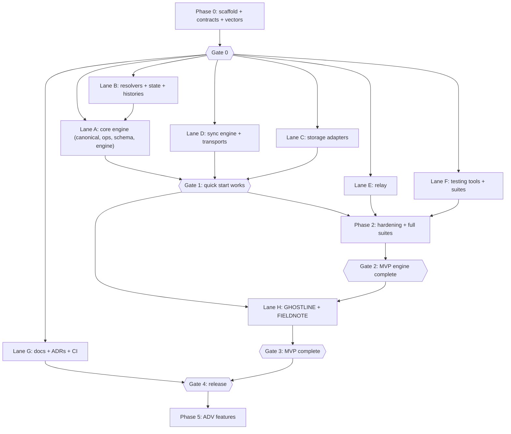

# Tasks: WEAVE, an Offline-First Application Foundation

This is the ordered, checkable task list for `requirements.md` (R1 to R20, D1 to D8, A1 to A7) and `design.md` (sections 1 to 19). Task IDs are stable. A task is finished only when its **Done when** line is true and its tests pass; an independent reviewer then checks the actual code (R15.7).

## How to read this list

- Every task has the same five fields: **Owner**, **Paths** (exact files or globs the owner may change), **Depends**, **Req** and **Done when**. A task marked **review-only** changes no product files; its **Paths** name exactly what the reviewer reads, and the only file it may write is its own review report under `docs/reviews/<task id>.md` (owned by Testing and QA).
- **Owner** is one of the workstreams in design 18.2. An agent edits only the paths its workstream owns, in its own branch or worktree. A task that needs a path owned by someone else asks that owner, or the Architecture owner reassigns the path in `OWNERS`. Cross-package tests live in `tests/**` (Testing and QA); a package's own tests belong to that package's owner. Defects found by a test are fixed by the owner of the code.
- **Depends** lists tasks that must be merged first. Tasks with no unfinished dependency run in parallel.
- `[MVP]` tasks are the hackathon scope. `[ADV]` tasks are in Phase 5 and start only after Gate 4.
- Paths are relative to `C:\Users\ashwi\Desktop\WEAVE`.

## Phases, gates and parallel lanes

| Phase | Purpose | Gate that closes it |
|---|---|---|
| 0 | Repository, tooling, contracts, vectors | **Gate 0**: contract freeze |
| 1 | Core, state, storage, sync, relay, testing tools (parallel lanes) | **Gate 1**: engine usable (in-memory quick start works) |
| 2 | Integration: file, IndexedDB, HTTP and relay hardening, full MVP suites | **Gate 2**: MVP engine complete |
| 3 | Applications GHOSTLINE and FIELDNOTE (start at Gate 1, finish after Gate 2) | **Gate 3**: MVP complete |
| 4 | Documentation, ADRs, CI matrix, packaging, release review | **Gate 4**: release |
| 5 | [ADV] optional features, one review each | per feature |

After Gate 0, lanes A to G run at the same time. Inside lane A the record-writing tasks (T1.A5, T1.A6, T1.A7) wait for lane B (`deriveRecord`, conflict history, operation history); lane D's sync engine waits for `applyIncoming` (T1.A6), but its pure parts (retry, prefix selection, in-process transport, HTTP client) do not.

---

## Phase 0: repository, tooling, contracts (Gate 0)

- [x] **T0.1 Initialize the repository and root tooling [MVP]**
  - Owner: Security and release.
  - Paths: `.gitignore`, `LICENSE`, `OWNERS`, `package.json`, `package-lock.json`, `tsconfig.base.json`, `.nvmrc`, `.editorconfig`, `.prettierrc`, `eslint.config.js`.
  - Depends: none. Req: R19.1, R19.2, R20.1 to R20.4, design 1.1, 1.2.
  - Steps: confirm with `git rev-parse --show-toplevel` that the current repository is the one in the home directory, then run `git init` in `C:\Users\ashwi\Desktop\WEAVE` so WEAVE has its own repository (the parent repository is not touched); MIT `LICENSE`; `.gitignore` must **not** list `.kiro`; npm workspaces for `packages/*` and `apps/*`; Node 22 pinned in `.nvmrc` and `engines`; strict TypeScript base (`strict`, `exactOptionalPropertyTypes`, `noUncheckedIndexedAccess`, ES2022, ESM); ESLint with `typescript-eslint` and the restricted-globals rules of design 2 (`Date.now`, `new Date`, `performance.now`, `Math.random`); Prettier; root scripts `build`, `typecheck`, `lint`, `format:check`, `test`, `check:boundaries`, `check:license`, `audit`, `bench`, `dev:*`, `demo:*`; `OWNERS` mirrors design 18.2 verbatim.
  - Done when: `npm ci`, `npm run lint` and `npm run typecheck` pass on an empty workspace on Windows; `git status` shows `.kiro` tracked; the repository root is the WEAVE folder.

- [x] **T0.2 Package skeletons [MVP]**
  - Owner: package-specific owners, as listed under Paths (each owner edits only its own package files).
  - Paths:
    - Core engine: `packages/core/package.json`, `packages/core/tsconfig.json`, `packages/core/README.md`.
    - Storage and data: `packages/storage/package.json`, `packages/storage/tsconfig.json`, `packages/storage/README.md`.
    - Synchronization: `packages/transport/package.json`, `packages/transport/tsconfig.json`, `packages/transport/README.md`.
    - Relay: `packages/relay/package.json`, `packages/relay/tsconfig.json`.
    - Testing and QA: `packages/testing/package.json`, `packages/testing/tsconfig.json`, `packages/testing/README.md`.
  - Depends: T0.1. Req: R9.4, R11.4, R14a.1, R20.1, design 1.2.
  - Steps: `exports` maps (`@weave/core`, `@weave/core/protocol`; `@weave/storage/memory|file|indexeddb`; `@weave/transport/in-process|http`), project references, empty entry files, `"license": "MIT"`, zero runtime `dependencies`.
  - Done when: `npm run build` builds all empty packages; a browser-targeted import of `@weave/storage/indexeddb` pulls no `node:*` module.

- [x] **T0.3 Contract types and interfaces (frozen at Gate 0) [MVP]**
  - Owner: Architecture and research.
  - Paths: `packages/core/src/contracts/**`.
  - Depends: T0.2. Req: design 3.2, 3.4, 5.2, 6.0, 7.1, 7.5, 8.1, 9, 18.2; R10.1, R11.1.
  - Content: `JsonValue`, `ReplicaId`, `OpId`, `VersionVector`, `OpPayload`, `Op`, `ErrorCode`, `WeaveError`, `WeaveEvent`, `Logger`, `Clock`, `Random` (with `randomBytes`), `Resolver`, `FrontierEntry`, `DerivedRecord` (with `conflictHistoryIds`), `ConflictRecord`, **`OpHistoryEntry`**, `MutationRecord`, `PeerEntry`, `StorageAdapter`, `StorageTx`, `SyncEndpoint` with all request and response types, `Support`, `BlockedOrigin`, `Rejection`, `SyncResult`, `ReplicaStatus`, `WriteOptions` (required `mutationId`), `WriteResult`, `RecordView`, the `Replica` and `Collection` interfaces (signatures only, including **`collection.history(recordId)`**), `applyIncoming` signature, the **`SyncHost`** interface (accessors the sync engine needs), and the storage key constants of design 3.4.
  - Done when: everything compiles under `strict`; compile-time tests (`// @ts-expect-error`) show that `create(...)` without `mutationId` is a type error; Architecture owner and one reviewer sign off. **Contract freeze.**

- [x] **T0.4 Canonical test vectors and an independent reference [MVP]**
  - Owner: Core engine (vectors) and Testing and QA (independent cross-check).
  - Paths: `packages/core/test/canonical/vectors.json` (Core engine); `tests/canonical-reference/**` (Testing and QA).
  - Depends: T0.1. Req: D7, R15.10, design 4.
  - Content: vectors (input, expected canonical text, expected SHA-256) covering the official RFC 8785 examples, property names U+E000 and U+10000 (UTF-16 order differs from UTF-8 order), `-0`, `1e21`, `0.1`, nested and empty containers, set-union output, and rejected values. Testing and QA writes a second canonicalizer in plain JavaScript with no shared code and reproduces every expected value.
  - Done when: both implementations agree on every vector; the file is committed.

- [x] **T0.5 CI skeleton and quality scripts [MVP]**
  - Owner: Security and release.
  - Paths: `.github/workflows/ci.yml`, `scripts/check-boundaries.mjs`, `scripts/check-license.mjs`, `scripts/bench.mjs` (stub), `scripts/fixtures/**`.
  - Depends: T0.1. Req: R15.5, R16.6, R14a.1, design 2, 18.1.
  - Steps: matrix Ubuntu, Windows, macOS on Node 22; steps `npm ci`, lint, format check, typecheck, build, test, boundaries, license, audit; `check-boundaries` uses the TypeScript compiler API and enforces: core imports no `node:*` module and no other package; the relay imports no resolver, schema or migration module; apps import only public entry points and contain none of `lamport`, `context`, `sha256`, `canonical`, `versionVector`, `frontier`; no `Math.random` in `packages/*/src`.
  - Done when: CI is green on an empty workspace on all three systems; the boundary script fails on deliberately bad fixtures in `scripts/fixtures/**` (tested).

- [x] **T0.6 Steering documents and hooks [MVP]**
  - Owner: Security and release.
  - Paths: `.kiro/steering/**`, `.kiro/hooks/**`.
  - Depends: T0.1. Req: R19.2, design 17.
  - Content: `product.md`, `tech.md` (determinism rules: no wall clock or randomness in the engine; the `mutationId` contract), `structure.md` (ownership and boundaries); hooks: lint and typecheck on `*.ts` save, unit tests before commit, a reminder to update traceability when `requirements.md` or `design.md` changes.
  - Done when: files exist, are committed, and the hooks run on a sample edit.

- [x] **T0.7 Initial ADRs and architecture overview [MVP]**
  - Owner: Architecture and research.
  - Paths: `docs/adr/0001-*.md`, `docs/adr/0002-*.md`, `docs/adr/0003-*.md`, `docs/adr/0011-*.md`, `docs/adr/0012-*.md`, `docs/architecture.md`, `docs/protocol.md`, `docs/diagrams/**`.
  - Depends: T0.3. Req: R17.1 to R17.4, design 16.
  - Done when: ADR-0001 holds the comparison of state and operation CRDTs, event sourcing, timestamp LWW, server-authoritative sync and peer-to-peer versus relay, and states what WEAVE adopts and does not adopt; the component diagram and protocol sketch exist.

- [x] **T0.8 Gate 0 review [MVP], review-only**
  - Owner: independent reviewer agent (Testing and QA).
  - Paths (read): everything produced by T0.1 to T0.7; (write): `docs/reviews/T0.8.md` (Testing and QA owns `docs/reviews/**`).
  - Depends: T0.1 to T0.7. Req: design 18.3.
  - Done when: the reviewer reads the actual files, runs `npm ci && npm run build && npm run lint`, confirms the contracts match design sections 3 to 9 and R1 to R20, and every finding is fixed. **Gate 0 passes.**

---

## Phase 1: parallel lanes (Gate 1)

### Lane A: core engine (Core engine owner)

- [x] **T1.A1 Canonical codec and hashing [MVP]**
  - Owner: Core engine.
  - Paths: `packages/core/src/canonical/**`, `packages/core/test/canonical/**`.
  - Depends: T0.3, T0.4. Req: D7, R2.8, R16.1, design 4.
  - Implement `assertSupported` (JSON-path errors, depth and size limits, `-0`), `encodeCanonical` (RFC 8785, UTF-16 key order, ES number form), `sha256Hex` (platform crypto), `compareUtf8`, and the hash helpers (op, state, op-set, conflict-view, mutation payload).
  - Done when: all vectors pass in Node (the Chromium run is T2.8); property tests show key-order independence and rejection of every unsupported type.

- [x] **T1.A2 Randomness and mutation IDs [MVP]**
  - Owner: Core engine.
  - Paths: `packages/core/src/ops/random.ts`, `packages/core/test/ops/random.test.ts`.
  - Depends: T0.3. Req: R5.4, R10.2, design 7.1.
  - Implement `platformRandom` (chunked `getRandomValues`), `randomFloat(random)` (unsigned big-endian, 53 bits), `newMutationId(random)` (16 bytes as 26 base32 characters), and the default `Clock`. The seeded generator is T1.F1.
  - Done when: the fixed-vector tests of design 12.3 pass (`80 00 00 00 00 00 00 00` gives 0.5; `00 00 00 00 00 00 08 00` gives 2^-53; the reversed bytes differ; all zero gives 0; all `0xFF` gives (2^53-1)/2^53; property test `0 <= x < 1`); `newMutationId` output matches `[A-Za-z0-9_.:-]{1,128}`.

- [x] **T1.A3 Ops, vectors and ordering [MVP]**
  - Owner: Core engine.
  - Paths: `packages/core/src/ops/**` (all files except `random.ts`), `packages/core/test/ops/**`.
  - Depends: T1.A1, **T1.A2** (replica and record ID generation use `Random`). Req: D1 to D4, R2.1 to R2.3, R2.7, design 3.1 to 3.3.
  - Implement replica, record and op ID generation from an injected `Random`, `buildOp` (seq, lamport and context from accepted ops only), `verifyOpLine` (strict structure, canonical form, D7, hash recomputation; `restore` gives `NOT_SUPPORTED`), version-vector helpers (merge, compare, covers), `happensBefore`, `isConcurrent`, `compareD4`.
  - Done when: unit and property tests pass, including clock independence (R2.4), `restore` rejection, and IDs reproducible from a seeded `Random`.

- [x] **T1.A4 Schema, field builders, migrations [MVP]**
  - Owner: Core engine.
  - Paths: `packages/core/src/schema/**`, `packages/core/test/schema/**`.
  - Depends: T0.3, T1.A1, T1.B1 (resolver names). Req: R8.1 to R8.5, R8.8, R6.4, R6.5, design 5.1, 5.3.
  - Implement `defineCollection`, `f.string|number|boolean|json|set|rank`, type inference (`InferRecord`), local-write validation, received-op validation of present fields, the migration chain with deep-frozen inputs, `SCHEMA_DOWNGRADE` detection helpers, `max-rank` configuration checks.
  - Done when: type-level tests pass; the migration tests of design 5.3 (repeatability, chain, cross-replica, frozen-input mutation) pass.

- [x] **T1.A5 Replica open, write path, queries, operation history wiring [MVP]**
  - Owner: Core engine.
  - Paths: `packages/core/src/engine/replica.ts`, `packages/core/src/engine/open.ts`, `packages/core/src/engine/write.ts`, `packages/core/src/engine/read.ts`, `packages/core/test/engine/**` (write, open, read, history tests).
  - Depends: T1.A2, T1.A3, T1.A4, T1.B2, **T1.B3**, **T1.B4**, T1.C1. Req: R1, R2, R2.5, R3.1, R3.2, R5.4, R6.8, R10.4, design 6.0, 7.1, 7.2, 3.4.
  - Implement `createReplica`, replica ID persistence, `meta/state`, `meta/schema` (upgrade rebuild in one transaction, `MIGRATION_FAILED`, `SCHEMA_DOWNGRADE`), the per-replica mutex, `create`/`update`/`delete` with **mandatory `mutationId`** (runtime validation, `mut/` record, `MUTATION_ID_REUSED`, `replayed`), the commit-counter check and retry, `get`, `query`, `subscribe`, `close`, **`collection.history(recordId)`** (reads the `rop/` index and calls `buildOpHistory`), and the wiring of `replica.sync` and `replica.endpoint()` to the sync engine through `SyncHost`. Every write computes `deriveRecord` and the **conflict history IDs (T1.B3) and stores `conflictHistoryIds` in the same transaction as `rec/`, `op/`, `rop/`, `mut/` and `meta/state`.**
  - Done when: the idempotency tests of design 12.3 pass (crash after commit before the response with `failAfterCommit`, payload mismatch, missing `mutationId`, concurrent identical calls); a test reads `conflictHistoryIds` from storage after a write that creates and then supersedes a conflict; the operation-history tests (a) to (g) of design 12.3 pass through the public call; offline-write and restart tests pass.

- [x] **T1.A6 `applyIncoming`: validation, prefix rule, buffer, promotion [MVP]**
  - Owner: Core engine.
  - Paths: `packages/core/src/engine/apply.ts`, `packages/core/src/engine/buffer.ts`, `packages/core/test/engine/apply*.test.ts`.
  - Depends: T1.A5, T1.B2, **T1.B3**. Req: R2.6, R2.7, R4.7, R4.10, R5.1 to R5.3, R16.1, R16.2, design 7.3, 3.5.
  - Implement Phase A1 to A3 (generic checks, application-schema check, three-step identity: conflict scan, collapse, existing check across `op/` and `pend/`), Phase B (per-origin prefix, `SCHEMA_TOO_NEW`, gaps into `pend/` insert-if-absent, the **promotion path**), Phase C (one transaction with identity re-check, commit-counter check, promotion list, `rop/` and `rec/` updates **including `conflictHistoryIds` computed by T1.B3 in the same transaction**, vector and `maxLamport`), the open-time invariant check, and the buffer reset on schema change.
  - Done when: all tests of design 12.3 for pending identity, copies inside a batch, pending promotion (including crash atomicity), validation atomicity and R15.11 (all four cases) pass; a test shows that a conflict created and superseded inside one received batch is present in `conflictHistoryIds` after commit.

- [x] **T1.A7 Rebuild, hashes, status, diagnostics, logging [MVP]**
  - Owner: Core engine.
  - Paths: `packages/core/src/engine/rebuild.ts`, `packages/core/src/engine/hashes.ts`, `packages/core/src/engine/status.ts`, `packages/core/src/diagnostics/**`, `packages/core/test/diagnostics/**`, `packages/core/test/engine/rebuild*.test.ts`.
  - Depends: T1.A5, T1.A6, T1.B2, **T1.B3**. Req: R6.13, R7.4, R12.1 to R12.4, design 7.4, 7.5.
  - Implement `rebuild()` (recomputes `rec/` **and `conflictHistoryIds` through T1.B3**), `hashes()`, `status()`, the typed `WeaveEvent` stream, the logger hook (default no-op).
  - Done when: for **every R12 field**, this task is complete on its own, without waiting for the sync engine (T1.D3 depends on this task and adds the live checks): (R12.4) `hashes()` returns the state, op-set and conflict-view hashes and equal op sets give equal values; (R7.4, R6.13) `rebuild()` leaves all three hashes, the conflict view, the history log, `conflictHistoryIds` and the operation history unchanged; (R12.3) `status()` returns `pendingOps` per peer (accepted ops not covered by that peer's `ackVector`), `pendingBuffer` (ops in `pend/`, not accepted), the acknowledged vector per registered peer, `lastSyncWall` per peer (informational), the last result per peer including `partial` with blocked origins and the required schema version per origin, and `state`, using peer entries written through storage fixtures; the transitions `idle`, `syncing`, `failed` and the real `lastResult` and `lastSyncWall` after live syncs are asserted later by T1.D3, not here; (R12.1) each event type is emitted by its source and tested: `op.applied`, `op.duplicate`, `op.buffered` and `conflict.new` (carrying `conflictId`) here, `sync.start`, `batch.sent`, `batch.received`, `retry` and `error` in T1.D3; (R12.2) a custom logger receives every event with the documented payload shape, and with no logger configured nothing is written to the console or any sink (a spy on `console` and on the logger hook proves it).

- [x] **T1.A8 Conflict notifications and repair [MVP]**
  - Owner: Core engine.
  - Paths: `packages/core/src/engine/notify.ts`, `packages/core/test/engine/notify*.test.ts`.
  - Depends: T1.A6, T1.B3. Req: D8, R5.5, R6.11, R15.13, design 6.1.
  - Implement mark-then-emit using `conflictHistoryIds`, the startup repair pass over `rec/`, and events carrying the conflict status.
  - Done when: the crash tests of design 12.3 pass (a conflict created and superseded in one batch with a crash before marking, then restart; a second crash between marking and emitting; no ID emitted twice).

- [x] **T1.A9 Public entry point and API documentation [MVP]**
  - Owner: Core engine.
  - Paths: `packages/core/src/index.ts`, `packages/core/test/api/**`.
  - Depends: T1.A5, T1.A7, T1.A8, **T1.B3**, **T1.B4**, **T1.D3** (the `sync` and `endpoint` members it exports). Req: R11.1 to R11.4, design 7.1.
  - Done when: only the public API is exported (`createReplica`, `defineCollection`, `f`, `newMutationId`, `platformRandom`, `randomFloat`, and the public types including `OpHistoryEntry` and `ConflictRecord`); an API-surface snapshot test fails on any unintended export; every conflict API (`conflicts.current`, `conflicts.history`) and `collection.history` is reachable from the entry point; `typedoc` builds without warnings.

### Lane B: resolvers, state derivation and histories (Conflict resolution owner)

- [x] **T1.B1 Built-in resolvers [MVP]**
  - Owner: Conflict resolution.
  - Paths: `packages/core/src/resolvers/**`, `packages/core/test/resolvers/**`.
  - Depends: T0.3. Req: R6.3 to R6.6, design 5.2.
  - Implement `last-writer-wins`, `max`, `min`, `set-union`, `max-rank` as functions of entry metadata only, never of array position.
  - Done when: the direct-call property tests of design 12.2 pass (all permutations up to six entries, random shuffles above, reverse-D4 and interleaved orders, random rank maps, set-union output order).

- [x] **T1.B2 `deriveRecord` [MVP]**
  - Owner: Conflict resolution.
  - Paths: `packages/core/src/state/derive.ts`, `packages/core/test/state/derive*.test.ts`.
  - Depends: T0.3, T1.B1, T1.A1, T1.A3 (`isConcurrent`, `compareD4`), and the migration function interface from T0.3 (a stub is acceptable until T1.A4 lands). Req: D5, D6, R6.1, R6.2, R6.7, R6.8, design 6.
  - Implement the eight steps (sort, delete rule, migration, `maxCtx` frontier, resolve, field conflict IDs, delete conflict IDs using the shared concurrency helper, visible fields).
  - Done when: unit tests cover concurrent and sequential edits, delete versus concurrent set, `set` after delete, and non-transitive contexts; the order-independence property passes.

- [x] **T1.B3 Conflict view, history log and history IDs [MVP]**
  - Owner: Conflict resolution.
  - Paths: `packages/core/src/state/conflicts.ts`, `packages/core/src/state/history.ts`, `packages/core/test/state/conflicts*.test.ts`, `packages/core/test/state/history*.test.ts`.
  - Depends: T1.B2. Req: D8, R6.2, R6.11 to R6.13, R7.5, design 6.1.
  - Implement the current view, the history replay in D4 order with `open` and `superseded` status, and the function that returns **all conflict IDs of a record's history (open and superseded)** for storage as `conflictHistoryIds`, so that the engine tasks T1.A5, T1.A6 and T1.A7 can store them in the same transaction as `rec/`.
  - Done when: the current view, history replay, `conflictHistoryIds` and the supersession test (R15.14) pass, including delivery in different orders.

- [x] **T1.B4 Record operation history function [MVP]**
  - Owner: Conflict resolution.
  - Paths: `packages/core/src/state/opHistory.ts`, `packages/core/test/state/opHistory*.test.ts`.
  - Depends: T0.3, T1.A3 (`isConcurrent`, `compareD4`). Req: R2.5, D3, D4, design 6.0.
  - Implement the pure `buildOpHistory(ops)` returning `OpHistoryEntry[]` in D4 order with `concurrentWith` computed in both directions without assuming transitivity.
  - Done when: unit tests cover sequential histories (empty `concurrentWith`), concurrent pairs, mixed histories (A and B concurrent, C after both, D concurrent with C only), the non-transitive case, deleted-record histories, and a property test that any arrival order of the same op set gives the same list.

### Lane C: storage adapters (Storage and data owner)

- [x] **T1.C1 Memory adapter and conformance suite [MVP]**
  - Owner: Storage and data.
  - Paths: `packages/storage/src/memory/**`, `packages/storage/test/memory/**`, `packages/testing/src/storage/**`.
  - Depends: T0.3. Req: R9.1, R9.3, design 9, 9.2.
  - Implement the memory adapter, `runStorageConformance(factory)` (atomicity including aborted transactions, durability across reopen, scan order and prefixes, snapshot reads, large batches, serialized transactions), and `crashingStorage(wrapped, { failAfterWrites, failAfterCommit })`.
  - Done when: the memory adapter passes the suite.

- [x] **T1.C2 File adapter: journal, snapshot, scan [MVP]**
  - Owner: Storage and data.
  - Paths: `packages/storage/src/file/journal.ts`, `packages/storage/src/file/snapshot.ts`, `packages/storage/src/file/manifest.ts`, `packages/storage/src/file/index.ts`, `packages/storage/test/file/journal*.test.ts`, `packages/storage/test/file/rotation*.test.ts`.
  - Depends: T1.C1. Req: R9.6, R10.4, design 9.1.
  - Implement the 32-byte header with `headerCheck`, the SHA-256 trailer, generations and `MANIFEST` with epoch, the read-only scan D1 to D6, the decision procedure, the no-write rule, the ordered writes of open step 5, rotation with six failpoints, and the narrow `onCorruptTail: { truncateAt }` option.
  - Done when: every journal and rotation test of design 9.1 passes: cuts at every byte offset (1 to 31 fail closed with `partial-header`, 32 onward truncated), the length corrupted in all five forms, damage to payload, trailer, header, magic, epoch and txId, mid-log damage, zero-filled tail, byte-for-byte preservation of data files on every failed open, operator truncation accepted and refused cases, rotation failpoints, an old journal beside a newer snapshot, repeated restarts.

- [x] **T1.C3 File adapter: locking, recovery guard, manual recovery [MVP]**
  - Owner: Storage and data.
  - Paths: `packages/storage/src/file/lock.ts`, `packages/storage/src/file/hostid.ts`, `packages/storage/test/file/lock*.test.ts`, `packages/storage/test/file/recovery*.test.ts`.
  - Depends: T1.C2. Req: R9.6(d) to (f), R15.17, R15.20, design 9.1 (locking).
  - Implement `hostId` as `{hostname, bootId, pidNamespace}` with the reliable or unproven rule, `LOCK` with `wx`, the open procedure with `LOCK.recovery` (guard first, revalidation of the observed nonce, ordinary-open refusal and post-create re-check, a guard that is never removed automatically), `STORAGE_LOCKED`, `STORAGE_LOCK_LOST` (nonce re-read before every write), epochs, and no override option.
  - Done when: the lock tests of design 9.1 pass: live holder refused whatever its age; different or unproven `hostId` refused; Linux takeover; Windows and macOS refusal; the reviewed takeover interleaving; an N-process race with a writer counter at every failpoint; guard behaviors; a static test that no public option or CLI flag overrides a lock; and the **manual recovery script test** (six leftover combinations, the guide's six steps followed literally with the guard kept until last, the reverse-order control, the negative tests, and the manual-cleanup concurrency test where ordinary openers receive `STORAGE_LOCKED` throughout) passes once T4.2 provides the guide text it executes.

- [x] **T1.C4 IndexedDB adapter [MVP]**
  - Owner: Storage and data.
  - Paths: `packages/storage/src/indexeddb/**`, `packages/storage/test/indexeddb/**`.
  - Depends: T1.C1. Req: R9.1, R9.3, design 9.
  - Implement one object store `kv`, one IDB transaction per call (strict durability where supported), a Web Lock per database, and a transaction function that awaits only `tx` calls (enforced by a lint rule for this folder).
  - Done when: it passes `runStorageConformance` in Chromium (the Playwright run is T2.8).

### Lane D: sync engine and transports (Synchronization owner)

- [x] **T1.D1 Retry policy and `withRetry` [MVP]**
  - Owner: Synchronization.
  - Paths: `packages/core/src/sync/retry.ts`, `packages/core/test/sync/retry*.test.ts`.
  - Depends: T0.3, T1.A2. Req: R10.2, R10.3, R15.21, design 8.4.
  - Done when: seeded-random tests (using the generator from T1.F1 or a local stub of the same `Random` shape) assert exact delay sequences including the cap; stubbed minimum and maximum `randomFloat` give 0 and just under `min(cap, base * 2^n)`; retryable and non-retryable classification works; a static check shows no `Math.random`.

- [x] **T1.D2 Schema-aware prefix selection [MVP]**
  - Owner: Synchronization.
  - Paths: `packages/core/src/sync/select.ts`, `packages/core/test/sync/select*.test.ts`.
  - Depends: T0.3. Req: R4.6, R4.10, design 8.3.
  - Done when: unit tests show that an unsupported op stops its origin (later supported ops are withheld, not skipped), other origins are unaffected, `'*'` support accepts everything, and `origins` filtering works.

- [x] **T1.D3 Sync engine `replica.sync` [MVP]**
  - Owner: Synchronization.
  - Paths: `packages/core/src/sync/engine.ts`, `packages/core/src/sync/host.ts`, `packages/core/src/protocol.ts`, `packages/core/test/sync/engine*.test.ts`.
  - Depends: T1.A6, T1.A7, T1.D1, T1.D2. Req: R4.1, R4.2, R4.5 to R4.7, R3.5, R12.1, R12.3, design 8.1, 8.2.
  - Implement the pull loop with per-origin isolation retry, `ack` after commit, the push loop with **one origin per request** and per-origin rejection handling, the **stable double read** (`L_start`, `E`, `L_end`) with `maxRounds` and `NOT_SETTLED`, `SyncResult` (`complete`, `partial`, `failed`, `blocked`, `rejectedOrigins`, `promoted`, `settled`), peer registry updates, `replica.endpoint()`, and the sync events (`sync.start`, `batch.sent`, `batch.received`, `retry`, `error`).
  - Done when: scenario tests of design 12.3 pass (interrupted sync, bounded batches, the verification-baseline cases a to d, push-side isolation, R15.11 end to end); `status().state` moves `idle` to `syncing` to `idle` or `failed`; `lastResult` and per-peer `ackVector` are correct after live syncs; **`lastSyncWall` is written only by a `complete` sync**: a test runs a complete sync (timestamp T1 recorded from the fake clock), then a `partial` sync (`PEER_SCHEMA_OLDER`), a `partial` sync (`NOT_SETTLED`) and a `failed` sync, and shows that `lastSyncWall` still equals T1 while `lastResult` shows each newer result, and that a later complete sync moves it to the new time; every sync event has a test with a custom logger; **type-level tests** show that the `SyncResult` union of design 7.1 rejects a `partial` result without a `code`, a `PEER_SCHEMA_OLDER` result with an empty `blocked` list, and a `NOT_SETTLED` result with blocked origins, and runtime tests produce `NOT_SETTLED` (a hook that changes the endpoint every round) and `PEER_SCHEMA_OLDER` with the documented fields and priority (`failed` over `PEER_SCHEMA_OLDER` over `NOT_SETTLED`).

- [x] **T1.D4 In-process transport and fault-injecting endpoint [MVP]**
  - Owner: Synchronization.
  - Paths: `packages/transport/src/in-process/**`, `packages/transport/test/in-process/**`, `packages/testing/src/transport/**`.
  - Depends: T0.3. Req: R9.2, R9.3, design 8.1.
  - Implement the in-process endpoint wrapper, `FaultyEndpoint` (seeded drop, duplicate, reorder, delay, truncate, hook points), and `runTransportConformance`.
  - Done when: the in-process transport passes the transport suite.

- [x] **T1.D5 HTTP transport client [MVP]**
  - Owner: Synchronization.
  - Paths: `packages/transport/src/http/**`, `packages/transport/test/http/**`.
  - Depends: T0.3, T1.D4. Req: R9.2, R4a.1, R4a.10, design 8.1, 10.1.
  - Implement the `fetch` client for `/v1/pull`, `/v1/push` (NDJSON), `/v1/ack`, token support, and error mapping to `TRANSPORT_ERROR` with retryability.
  - Done when: it passes the transport suite against a stub server (the run against the real relay is T2.3).

### Lane E: relay (Relay owner)

- [x] **T1.E1 RelayCore [MVP]**
  - Owner: Relay.
  - Paths: `packages/relay/src/core/**`, `packages/relay/test/core/**`, `packages/relay/test/ack/**`.
  - Depends: T0.3, T1.A1, T1.A3 (verify functions via `@weave/core/protocol`), T1.C1. Req: R4a.2 to R4a.8, R2.7, R16.1, R16.2, design 10.2, 10.3.
  - Implement registration, push (Phases A1 and A3 with the three-step identity check, contiguity, single transaction, durable-before-acknowledge, a single in-process queue, transaction re-check), pull (prefix rule from envelope fields only, `origins`, `limit: 0`), ack, `relay/vector`, the acknowledgement rules of design 10.3, byte-for-byte storage of op lines.
  - Done when: unit tests cover the ack cases (push-only, rejected push, pull-only, pull then ack, pull then crash, out-of-order and repeated acks, restart), opacity (no resolver, schema or migration import), and concurrent same-ID pushes with the queue and the re-check each disabled in turn.

- [x] **T1.E2 HTTP server, CLI, limits, token [MVP]**
  - Owner: Relay.
  - Paths: `packages/relay/src/server/**`, `packages/relay/src/cli.ts`, `packages/relay/test/server/**`, `packages/relay/README.md`.
  - Depends: T1.E1. Req: R4a.1, R4a.9, design 10.1.
  - Implement the `node:http` routes, NDJSON handling, body and op limits, the constant-time bearer-token check from `WEAVE_RELAY_TOKEN`, `WEAVE_RELAY_DATA`, `WEAVE_RELAY_PORT`, the health route, graceful shutdown, and no token in logs.
  - Done when: `weave-relay --data <dir> --port <n>` starts and answers `/v1/health`; limit, auth and log-redaction tests pass.

### Lane F: testing tools (Testing and QA owner)

- [x] **T1.F1 Seeded random, simulator, generators [MVP]**
  - Owner: Testing and QA.
  - Paths: `packages/testing/src/simulator/**`, `packages/testing/src/generators/**`, `packages/testing/src/faults/**`, `packages/testing/src/index.ts`, `packages/testing/test/**`.
  - Depends: T0.3. Req: R15.2, R15.21, design 12.2.
  - Implement `seededRandom(seed)` (SplitMix64, implements `Random`), a simulator that really runs replicas (write, sync in random pairs, go offline, upgrade) so contexts and Lamport values are genuine, fast-check arbitraries for ops, frontiers and batches, and a fake clock and scheduler.
  - Done when: determinism tests show that the same seed gives the same bytes and the same history; the simulator can drive two replicas to equal hashes once T1.A5 and T1.D3 land.

- [x] **T1.F2 Cross-package property and scenario suites [MVP]**
  - Owner: Testing and QA.
  - Paths: `tests/property/**`, `tests/integration/**`.
  - Depends: T1.F1, T1.A6, T1.D3. Req: R15.1 to R15.4, R7, design 12.2, 12.3.
  - Implement the properties (idempotency, order independence, convergence, clock independence, canonical encoding, conflict-view equality, supersession, rebuild equality, batch atomicity, operation-history equality) and the scenario tests that span packages.
  - Done when: all pass in CI with fixed seeds, plus a nightly job with random seeds that prints the failing seed.

### Lane G: documentation

- [x] **T1.G1 README skeletons and quick start [MVP]**
  - Owner: Developer experience and documentation.
  - Paths: `README.md`, `CHANGELOG.md`, `docs/guides/custom-storage.md`, `docs/guides/custom-transport.md`, `docs/guides/custom-resolver.md`, `docs/guides/migrations.md`.
  - Depends: T0.3. Req: R11.2, R18.1 to R18.3.
  - Done when: the quick start (under 30 lines, using `replica.newMutationId()` or a fixed `mutationId`) is written and is run as a test by T1.G2.

- [x] **T1.G2 Quick-start test and Gate 1 review [MVP]**
  - Owner: Testing and QA.
  - Paths: `tests/quickstart/**`, `docs/reviews/T1.G2.md`.
  - Depends: T1.A5, T1.A6, T1.A9, T1.D3, T1.D4, T1.C1, T1.G1. Req: R11.2, design 18.3 Gate 1.
  - Done when: the README quick start runs as a test (two replicas on `memoryStorage()`, a write with a `mutationId`, `b.sync(a.endpoint())` returns `complete`, hashes equal); an independent reviewer reads the code of lanes A to D and confirms. **Gate 1 passes.**

---

## Phase 2: integration and hardening (Gate 2)

- [x] **T2.1 Core and state full test pass [MVP]**
  - Owner: Core engine (tests under `packages/core/test/engine/**`) and Conflict resolution (tests under `packages/core/test/state/**` and `packages/core/test/resolvers/**`); each fixes its own defects.
  - Paths: `packages/core/test/engine/**`, `packages/core/test/state/**`, `packages/core/test/resolvers/**`.
  - Depends: Gate 1. Req: R15.1 to R15.4, R15.8.
  - Done when: every test listed under lanes A and B passes and each owner records the coverage figures in its package README; no feature is marked complete without a test.

- [x] **T2.2 File adapter in the engine [MVP]**
  - Owner: Testing and QA, with defects fixed by Storage and data in `packages/storage/**`.
  - Paths: `tests/integration/file-adapter/**`.
  - Depends: T1.C2, T1.C3, T1.A6, T1.F2. Req: R9.3, R10.4, R15.17.
  - Done when: the full property and scenario suites also run against the file adapter, and crash-recovery tests with a killed child process pass with each operating system's expected behavior (Linux: takeover; Windows and macOS: `STORAGE_LOCKED`, then the documented manual recovery).

- [x] **T2.3 Relay end to end [MVP]**
  - Owner: Testing and QA, with defects fixed by Relay in `packages/relay/**` and Synchronization in `packages/transport/**`.
  - Paths: `tests/relay/**`.
  - Depends: T1.D5, T1.E2, T1.F1. Req: R4a.10, R15.1, R15.4, R15.11, R15.16, R15.18.
  - Done when: a real `weave-relay` process with the HTTP transport passes: three-replica convergence; kill -9 and restart losing nothing acknowledged; the relay concurrency test (identical hashes stored and acknowledged once, different hashes keep the first and fail the second with `INTEGRITY_CONFLICT`); schema-aware delivery through the relay (R15.11); push and pull isolation; token and limit tests; acknowledgement cases across restart.

- [x] **T2.4 Schema-evolution scenario [MVP]**
  - Owner: Testing and QA, with defects fixed by Core engine in `packages/core/src/schema/**` and `packages/core/src/engine/**`.
  - Paths: `tests/schema-evolution/**`.
  - Depends: T1.A4, T1.A6, T2.3. Req: R8.6, R14.5, R15.12.
  - Done when: v1 replicas upgrade to v2, derive equal state hashes, sync through the relay and converge; a v1-only replica receives only the readable prefix, reports `partial` / `PEER_SCHEMA_OLDER`, and converges after upgrade.

- [x] **T2.5 Notification and crash windows [MVP]**
  - Owner: Core engine.
  - Paths: `packages/core/test/engine/crash*.test.ts`.
  - Depends: T1.A8, T1.C1. Req: R15.13, R5.5.
  - Done when: all crash-window tests pass (before marking, after marking before emit, superseded-in-one-batch, restart repeated).

- [x] **T2.6 Performance [MVP]**
  - Owner: Security and release.
  - Paths: `scripts/bench.mjs`.
  - Depends: T1.D3, T1.C1. Req: R20.5, design 12.4.
  - Done when: 10,000 ops over 500 records apply in under 5 s and a 1,000-op difference syncs in under 2 s on the in-process transport; CI fails only past 3 times the target.

- [x] **T2.7 Threat model and security documentation [MVP]**
  - Owner: Security and release.
  - Paths: `docs/threat-model.md`.
  - Depends: T2.3. Req: R16.1 to R16.6, design 11.
  - Done when: the threat model lists the defenses and known limits of design 11 (including the compaction trust assumption and the over-claim limit), documents the relay token, and records that `npm audit` for production dependencies is clean (none exist).

- [x] **T2.10 Fuzz and malformed-input tests [MVP]**
  - Owner: Testing and QA.
  - Paths: `tests/fuzz/**`.
  - Depends: T2.3. Req: R16.1, R16.2, R4.7, R15.3.
  - Done when: a fuzz suite sends malformed lines, oversized bodies, non-canonical ops, wrong hashes, duplicate and conflicting IDs, and unsupported values to replicas and to the relay; nothing crashes, nothing is partially written, and the data files are unchanged after each rejected input.

- [x] **T2.8 Browser tests [MVP]**
  - Owner: Testing and QA.
  - Paths: `tests/browser/**` (including the Playwright config), `docs/reviews/T2.8.md` (only if findings exist).
  - Depends: T1.A1, T1.C4. Req: R15.10, R9.3.
  - Done when: Playwright in Chromium runs the canonical vectors with bytes and hashes identical to Node, and the IndexedDB adapter passes the storage conformance suite.

- [x] **T2.9 Independent review of lanes A to F [MVP], review-only**
  - Owner: independent reviewer agents (Testing and QA), one per lane.
  - Paths (read): `packages/core/**`, `packages/storage/**`, `packages/transport/**`, `packages/relay/**`, `packages/testing/**`, `tests/**`; (write): `docs/reviews/T2.9-<lane>.md`.
  - Depends: T2.1 to T2.8, T2.10. Req: R15.7, design 18.3 Gate 2.
  - Done when: each reviewer reads the actual code, runs the tests, records findings against `requirements.md`, and all findings are fixed. **Gate 2 passes.**

---

## Phase 3: applications (start at Gate 1, finish after Gate 2)

### GHOSTLINE (GHOSTLINE owner)

- [x] **T3.G1 GHOSTLINE model and logic [MVP]**
  - Owner: GHOSTLINE.
  - Paths: `apps/ghostline/src/model.ts`, `apps/ghostline/src/logic.ts`, `apps/ghostline/test/logic*.test.ts`.
  - Depends: Gate 1. Req: R13.1 to R13.5, design 13.1.
  - Collections `announcements` and `requests` with the resolvers of design 13.1; each user action gets one `mutationId` stored with the pending action before the call.
  - Done when: logic tests cover offline create, publish, claim conflict, tag union, delete versus edit, and a retry with the same `mutationId` returning `replayed`.

- [x] **T3.G2 GHOSTLINE UI and scripts [MVP]**
  - Owner: GHOSTLINE.
  - Paths: `apps/ghostline/index.html`, `apps/ghostline/vite.config.ts`, `apps/ghostline/package.json`, `apps/ghostline/tsconfig.json`, `apps/ghostline/src/app.ts`, `apps/ghostline/src/demo.ts`, `apps/ghostline/test/e2e/**`, `apps/ghostline/README.md`.
  - Depends: T3.G1, T2.3, T1.C4, T1.D5. Req: R13.5, R13.6, R14a, design 13.
  - Screens: announcements, requests with claim, notices panel built from `conflicts.current()` and `conflicts.history()`. `?device=` selects the replica. `npm run dev:ghostline` starts the relay and Vite; `npm run demo:ghostline` runs the three-device scripted demo (offline creation, two claims, two tag edits, delete versus edit, ordered syncs, equal hashes, notices printed, one repeated write with a stored `mutationId` printing `replayed: true`).
  - Done when: the demo asserts equal state hashes on all devices through the real relay; one Playwright smoke test passes.

### FIELDNOTE (FIELDNOTE owner)

- [x] **T3.F1 FIELDNOTE model, migration, logic [MVP]**
  - Owner: FIELDNOTE.
  - Paths: `apps/fieldnote/src/model.ts`, `apps/fieldnote/src/logic.ts`, `apps/fieldnote/test/logic*.test.ts`.
  - Depends: Gate 1. Req: R14.1 to R14.6, design 13.2.
  - Collections `inspections` (v1 and v2 with the `location` split migration) and `observations` with `max-rank` status and `max` severity; `mutationId` handling as in T3.G1.
  - Done when: logic tests cover concurrent field edits (merged), status conflict (more advanced status wins), severity conflict (higher wins), the migration, the conflict history view data, and operation history of an inspection.

- [x] **T3.F2 FIELDNOTE UI and scripts [MVP]**
  - Owner: FIELDNOTE.
  - Paths: `apps/fieldnote/index.html`, `apps/fieldnote/vite.config.ts`, `apps/fieldnote/package.json`, `apps/fieldnote/tsconfig.json`, `apps/fieldnote/src/app.ts`, `apps/fieldnote/src/demo.ts`, `apps/fieldnote/test/e2e/**`, `apps/fieldnote/README.md`.
  - Depends: T3.F1, T2.3, T2.4, T1.C4. Req: R14.3 to R14.7, design 13.2.
  - Screens: inspections list, inspection detail with observations, conflict history view. `npm run dev:fieldnote` and `npm run demo:fieldnote` (three workers, one offline for a long time; part 1 upgrades three v1 replicas to v2 and converges; part 2 shows a v1-only replica receiving the readable prefix with `partial / PEER_SCHEMA_OLDER`, then converging after upgrade).
  - Done when: the demo prints equal hashes through the real relay; one Playwright smoke test passes.

### Shared app checks

- [x] **T3.X1 Boundary and difference checks [MVP]**
  - Owner: Security and release for scripts and fixtures; Developer experience and documentation for the generated table file.
  - Paths: `scripts/check-boundaries.mjs`, `scripts/gen-differences.mjs`, `scripts/fixtures/**` (Security and release); `docs/app-differences.md` (Developer experience and documentation).
  - Depends: T3.G1, T3.F1, T0.5. Req: R14a.1, R14a.3.
  - Done when: `check-boundaries` passes on both apps; `gen-differences` prints the differences table from each app's `model.ts` resolver declarations and `docs/app-differences.md` equals its output (CI compares them); each row maps to a demo step output; the check fails on a fixture app that imports internals or contains sync or hashing identifiers.

- [ ] **T3.X2 Independent review of both apps [MVP], review-only**
  - Owner: independent reviewer agents (Testing and QA).
  - Paths (read): `apps/ghostline/**`, `apps/fieldnote/**`, `docs/app-differences.md`; (write): `docs/reviews/T3.X2.md`.
  - Depends: T3.G2, T3.F2, T3.X1, Gate 2. Req: R13, R14, R14a, design 18.3 Gate 3.
  - Done when: reviewers run both demos from a clean checkout, confirm the apps use no sync code outside WEAVE and show different workflows, and all findings are fixed. **Gate 3 passes.**

---

## Phase 4: documentation, packaging, release (Gate 4)

- [x] **T4.1 ADRs 0004 to 0010, 0013 and 0014 [MVP]**
  - Owner: Architecture and research.
  - Paths: `docs/adr/0004-*.md` to `docs/adr/0010-*.md`, `docs/adr/0013-*.md`, `docs/adr/0014-*.md`.
  - Depends: Gate 2. Req: R17.2, design 16.
  - Done when: every ADR listed in design 16 exists with context, options, decision and consequences, including ADR-0006 (with the compaction trust assumption), ADR-0007 (acknowledgement rules), ADR-0008 (all-or-nothing validation), ADR-0009 (journal format), ADR-0014 (`mutationId`).

- [ ] **T4.2 Guides, including storage recovery [MVP]**
  - Owner: Developer experience and documentation.
  - Paths: `docs/guides/custom-storage.md`, `docs/guides/custom-transport.md`, `docs/guides/custom-resolver.md`, `docs/guides/migrations.md`, `docs/guides/storage-recovery.md`.
  - Depends: Gate 2, T1.G1. Req: R18.3, R9.6(f).
  - Done when: `storage-recovery.md` holds the six-step manual recovery procedure (stop all, confirm no holder, back up, inspect, keep or create the guard and remove stale files and `LOCK` while it remains, remove the guard last, reopen and validate) and the corruption guidance; the T1.C3 script executes the guide's steps and passes.

- [ ] **T4.3 API docs and READMEs [MVP]**
  - Owner: Developer experience and documentation.
  - Paths: `README.md`, `CHANGELOG.md`, `typedoc.json`, `docs/api/**`.
  - Depends: T1.A9, T1.G1, Gate 3. Req: R11.3, R11.4, R18.1, R18.2.
  - Done when: every exported symbol is documented (including `collection.history`, `OpHistoryEntry`, `newMutationId`); the root README has purpose, install, quick start, architecture summary and links to both demos; READMEs for packages and apps (owned by their owners) exist and are linked; **`CHANGELOG.md` has the `0.1.0` release entry** listing the public API and the [ADV] features that are not implemented.

- [ ] **T4.4 Kiro Crew explanation and demo plan [MVP]**
  - Owner: Developer experience and documentation.
  - Paths: `docs/kiro-crew.md`, `docs/demo-plan.md`.
  - Depends: Gate 3. Req: R19.4, R19.5.
  - Done when: `kiro-crew.md` lists the workstreams, owners, dependency graph, gates and reviewer checks and which agents produced what; `demo-plan.md` has steps, expected output and a recording script.

- [ ] **T4.5 Disclosure and license check [MVP]**
  - Owner: Security and release.
  - Paths: `scripts/check-license.mjs`, `LICENSE`, `docs/disclosure.md`.
  - Depends: Gate 3. Req: R19.1, R19.6.
  - Done when: `docs/disclosure.md` states that no code existed before this project and notes the parent-repository situation (the root README links to it); `check:license` passes; every `package.json` has `license: MIT`; `.kiro` is tracked.

- [ ] **T4.6 Full CI matrix and reproducible build [MVP]**
  - Owner: Security and release.
  - Paths: `.github/workflows/ci.yml`, `scripts/**`, and the Git release tag `v0.1.0` (a ref, created by this task).
  - Depends: Gate 3, T4.3, T4.5. Req: R15.5, R19, R20.2, R20.3.
  - Done when: CI is green on Ubuntu, Windows and macOS (including the per-platform lock tests), Playwright on Ubuntu, benchmarks, audit, and a job that builds twice and compares output hashes; **the annotated tag `v0.1.0` exists on the commit that passed CI and contains the `CHANGELOG.md` entry from T4.3.** If T4.7 finds issues, they are fixed and this task's owner recreates the tag on the fixed commit before T4.7 records its pass.

- [ ] **T4.7 Final independent review [MVP], review-only**
  - Owner: independent reviewer agents (Testing and QA). This task changes no product file and creates no tag or changelog entry.
  - Paths (read): the whole repository from a clean clone at the tagged commit, including the `v0.1.0` tag (T4.6) and `CHANGELOG.md` (T4.3); (write): `docs/reviews/T4.7.md` only.
  - Depends: T4.1 to T4.6. Req: R15.7, requirements section 4.
  - Done when: reviewers confirm from a clean clone that `npm ci`, `build`, `test`, both demos and both apps run; every [MVP] criterion has a passing automated check; every [ADV] criterion is either passing or listed as "not implemented" in the README; the `v0.1.0` tag exists on the reviewed commit and `CHANGELOG.md` has its entry (produced by T4.6 and T4.3, only verified here); and `docs/reviews/T4.7.md` records no open findings. **Gate 4 passes.**

---

## Phase 5: [ADV] features (optional, after Gate 4)

Each task is its own gate with an independent review. **The order of requirements section 3 is mandatory and is encoded in the Depends fields: T5.1 -> T5.2 -> T5.3 -> T5.4 -> T5.5 -> T5.6 -> T5.7 -> T5.8 -> T5.9.** (T5.9 also depends on T5.4 directly.) Every task below ends with a `Review:` line: an independent reviewer agent (Testing and QA) reads the actual code, runs the tests, and writes `docs/reviews/<task id>.md`; the task is not merged until that report records no open findings. Testing and QA owns `docs/reviews/**`.

- [ ] **T5.1 [ADV] Compaction and `removePeer`**
  - Owner (non-overlapping parts):
    - Synchronization: `packages/core/src/sync/compaction.ts` and `packages/core/test/sync/compaction*.test.ts`.
    - Relay: `packages/relay/src/core/compaction.ts` and `packages/relay/test/compaction/**` (relay-side horizon and `NEEDS_SNAPSHOT`).
    - Storage and data: journal and storage changes that compaction needs, only inside `packages/storage/**`.
    - Architecture and research: the ADR-0006 text update (`docs/adr/0006-*.md`); no other owner edits it.
  - Paths: `packages/core/src/sync/compaction.ts`, `packages/relay/src/core/compaction.ts`, `packages/core/test/sync/compaction*.test.ts`, `packages/relay/test/compaction/**`, `docs/adr/0006-*.md` (text update by Architecture and research).
  - Depends: Gate 4. Req: R3.6 to R3.10, R3.13, R3.14, R15.9, design 10.3.
  - Done when: the horizon comes from relay-published acknowledgements; offline and never-acknowledging members count as zero; `NEEDS_SNAPSHOT` is returned for ops below `compactedThrough`; the durable removed list works; compaction is off by default; the trust-assumption text is in ADR-0006; all compaction tests pass.
  - Review: independent reviewer agent (Testing and QA); report `docs/reviews/T5.1.md`; the task merges only after the report records no open findings.

- [ ] **T5.2 [ADV] Snapshot bootstrap**
  - Owner (non-overlapping parts):
    - Synchronization: `packages/core/src/sync/snapshot.ts`, `packages/core/test/sync/snapshot*.test.ts`.
    - Relay: `packages/relay/src/core/snapshot.ts`, `packages/relay/test/snapshot/**`.
  - Paths: `packages/core/src/sync/snapshot.ts`, `packages/core/test/sync/snapshot*.test.ts` (Synchronization); `packages/relay/src/core/snapshot.ts`, `packages/relay/test/snapshot/**` (Relay).
  - Depends: T5.1. Req: R4.8.
  - Done when: a new or removed-and-rejoined replica bootstraps from a snapshot with tombstones and then continues normal sync to equal hashes.
  - Review: independent reviewer agent (Testing and QA); report `docs/reviews/T5.2.md`; the task merges only after the report records no open findings.

- [ ] **T5.3 [ADV] `restore` and `update-wins`**
  - Owner: Conflict resolution.
  - Paths: `packages/core/src/state/derive.ts` (step 2 and policy), `packages/core/src/state/restore.ts`, `packages/core/test/state/restore*.test.ts`.
  - Depends: Gate 4, T5.2. Req: R6.9, D6, R15.9.
  - Done when: both are deterministic functions of the op set, pass order-independence and convergence properties, and `restore` is accepted only with the feature enabled.
  - Review: independent reviewer agent (Testing and QA); report `docs/reviews/T5.3.md`; the task merges only after the report records no open findings.

- [ ] **T5.4 [ADV] Counter resolver and custom resolvers**
  - Owner: Conflict resolution.
  - Paths: `packages/core/src/resolvers/counter.ts`, `packages/core/src/resolvers/custom.ts`, `packages/core/src/resolvers/assert.ts`, `packages/core/test/resolvers/counter*.test.ts`, `packages/core/test/resolvers/custom*.test.ts`.
  - Depends: Gate 4, T1.B1, T5.3. Req: R6.10, R15.9.
  - Done when: the counter resolver, custom registration and the exported `assertResolverDeterministic` helper pass the direct-call permutation tests. (The GHOSTLINE counter is T5.9.)
  - Review: independent reviewer agent (Testing and QA); report `docs/reviews/T5.4.md`; the task merges only after the report records no open findings.

- [ ] **T5.5 [ADV] Held newer-schema ops**
  - Owner: Core engine.
  - Paths: `packages/core/src/engine/held.ts`, `packages/core/test/engine/held*.test.ts`.
  - Depends: Gate 4, T5.4. Req: R8.7.
  - Done when: newer-version ops are stored but excluded from visible state, a status field reports that an update is needed, and they apply after an upgrade with equal hashes.
  - Review: independent reviewer agent (Testing and QA); report `docs/reviews/T5.5.md`; the task merges only after the report records no open findings.

- [ ] **T5.6 [ADV] Authorization hook and authenticated identity**
  - Owner (non-overlapping parts):
    - Synchronization (replica side): `packages/core/src/sync/authorize.ts`, `packages/core/test/sync/authorize*.test.ts`.
    - Relay (relay side): `packages/relay/src/core/authorize.ts`, `packages/relay/test/authorize/**`.
  - Paths: `packages/core/src/sync/authorize.ts`, `packages/core/test/sync/authorize*.test.ts` (Synchronization); `packages/relay/src/core/authorize.ts`, `packages/relay/test/authorize/**` (Relay).
  - Depends: Gate 4, T5.5. Req: R16.3, R16.4.
  - Done when: a hook is called before applying or sending ops and can reject; ops claiming a replica ID the authenticated sender may not write as are rejected with a typed error and no change; tests cover allow, deny and identity mismatch on both sides.
  - Review: independent reviewer agent (Testing and QA); report `docs/reviews/T5.6.md`; the task merges only after the report records no open findings.

- [ ] **T5.7 [ADV] Peer ban**
  - Owner: Synchronization.
  - Paths: `packages/core/src/sync/ban.ts`, `packages/core/test/sync/ban*.test.ts`.
  - Depends: Gate 4, T5.6 (uses `rejectedOrigins`). Req: R10.5.
  - Done when: a peer that repeatedly sends invalid data is refused for a configurable period using the monotonic timer; valid peers are unaffected; tests use the fake scheduler.
  - Review: independent reviewer agent (Testing and QA); report `docs/reviews/T5.7.md`; the task merges only after the report records no open findings.

- [ ] **T5.8 [ADV] WebSocket transport and direct network sync**
  - Owner: Synchronization.
  - Paths: `packages/transport/src/websocket/**`, `packages/transport/test/websocket/**`.
  - Depends: Gate 4, T5.7. Req: R4.4, R9.5.
  - Done when: the WebSocket adapter passes the transport conformance suite; two replicas sync directly over the network with the same protocol and reach a verified `complete`.
  - Review: independent reviewer agent (Testing and QA); report `docs/reviews/T5.8.md`; the task merges only after the report records no open findings.

- [ ] **T5.9 [ADV] GHOSTLINE "me too" counter**
  - Owner: GHOSTLINE.
  - Paths: `apps/ghostline/src/model.ts`, `apps/ghostline/src/logic.ts`, `apps/ghostline/src/app.ts`, `apps/ghostline/test/counter*.test.ts`.
  - Depends: T5.4, T5.8. Req: R13.7.
  - Done when: requests carry a counter field using the counter resolver; concurrent "me too" taps from several devices sum correctly and converge; the app still passes the boundary check and the demo prints the counter.
  - Review: independent reviewer agent (Testing and QA); report `docs/reviews/T5.9.md`; the task merges only after the report records no open findings.

---

## Requirement coverage check

| Requirement | Tasks |
|---|---|
| R1 persistence | T1.A5, T1.C1, T1.C4 |
| R2.1 to R2.3 identity and metadata | T1.A2, T1.A3, T1.A5 |
| R2.4 clock independence | T1.A3, T1.F2 |
| **R2.5 record operation history** | **T0.3 (contract), T1.B4 (function), T1.A5 (`collection.history` wiring), T1.A9 (export), T1.F2 (equality property), T3.F1 (use in FIELDNOTE)** |
| R2.6 gaps and promotion | T1.A6, T2.1 |
| R2.7 identity and copies | T1.A6, T1.E1, T2.3 |
| R2.8 unsupported values | T1.A1, T1.A3 |
| R3.1 to R3.5 history, registry, acknowledgements | T1.A5, T1.D3, T1.E1 |
| R3.6 to R3.14 compaction (ADV) | T5.1 |
| R4.1 to R4.7 sync, verified point, isolation | T1.D2, T1.D3, T2.3 |
| R4.8 snapshot (ADV) | T5.2 |
| R4.10 schema-aware delivery | T1.D2, T1.D3, T2.3, T2.4 |
| R4a relay | T1.E1, T1.E2, T2.3 |
| R5.1 to R5.3 duplicates and order | T1.A6, T1.F2 |
| **R5.4 mandatory `mutationId` and helper** | **T1.A2 (`newMutationId`, `randomFloat`), T1.A5 (write path, `MUTATION_ID_REUSED`), T3.G1, T3.F1 (apps)** |
| R5.5 at-most-once notifications | T1.A8, T2.5 |
| R6.1 to R6.8 resolvers and delete rule | T1.B1, T1.B2 |
| R6.9 `restore`, `update-wins` (ADV) | T5.3 |
| R6.10 counter and custom resolvers (ADV) | T5.4 |
| R6.11 to R6.13 conflict view and history | T1.B3, T1.A7, T1.A8 |
| R7 convergence | T1.A7, T1.B3, T1.F2 |
| R8.1 to R8.5, R8.8 schema | T1.A4, T1.A5 |
| R8.6 scenario | T2.4, T3.F2 |
| R8.7 held ops (ADV) | T5.5 |
| R9.1 to R9.4 adapters | T1.C1, T1.C4, T1.D4, T1.D5 |
| R9.5 WebSocket (ADV) | T5.8 |
| R9.6 durable file adapter | T1.C2, T1.C3, T2.2, T4.2 |
| R10.1 error codes | T0.3, T1.A5, T1.A6, T1.C2, T1.C3 |
| R10.2, R10.3 retry and jitter | T1.A2, T1.D1, T1.D3 |
| R10.4 crash recovery | T1.A5, T1.C2, T2.2, T2.5 |
| R10.5 peer ban (ADV) | T5.7 |
| R11 API | T1.A9, T1.G1, T1.G2, T4.3 |
| **R12.1 structured events** | **T1.A7 (apply and conflict events), T1.D3 (sync, batch and retry events)** |
| **R12.2 logger behavior** | **T1.A7 (custom logger, silent default)** |
| **R12.3 status** | **T1.A7 (all fields from fixtures), T1.D3 (live `state`, `lastResult`; `lastSyncWall` written only by a complete sync, with the partial and failed cases tested)** |
| R12.4 hashes | T1.A7 |
| R13.1 to R13.6 GHOSTLINE | T3.G1, T3.G2 |
| R13.7 counter (ADV) | T5.4 (resolver), **T5.9 (GHOSTLINE counter)** |
| R14.1 to R14.7 FIELDNOTE | T3.F1, T3.F2 |
| R14a shared engine and differences | T3.X1, T3.X2 |
| R15.1 to R15.4 test suites | T1.F1, T1.F2, T2.1, T2.3 |
| R15.5, R15.6 CI and review | T0.5, T4.6, all review-only tasks |
| R15.7 independent review of actual code | T0.8, T1.G2, T2.9, T3.X2, T4.7 and the `Review:` line of every Phase 5 task (reports under `docs/reviews/**`) |
| R15.8 coverage stated, nothing complete without tests | T2.1 (coverage recorded in package READMEs), T4.7 (reviewers confirm every [MVP] criterion has a passing automated check) |
| R15.9 advanced-feature tests | T5.1 (compaction), T5.3 (`restore`, `update-wins`), T5.4 (counter and custom resolvers, `assertResolverDeterministic`) |
| R15.10 canonical vectors | T0.4, T1.A1, T2.8 |
| R15.11 schema-aware delivery test | T1.A6, T1.D3, T2.3 |
| R15.12 migration tests | T1.A4, T2.4 |
| R15.13 notification crash tests | T1.A8, T2.5 |
| R15.14 supersession | T1.B3, T1.F2 |
| R15.15 idempotency tests | T1.A5 |
| R15.16 push-side isolation | T1.D3, T2.3 |
| R15.17 file-adapter failure tests | T1.C2, T1.C3, T2.2 |
| R15.18 pending-identity and relay concurrency | T1.A6, T1.E1, T2.3 |
| R15.19 pending promotion | T1.A6 |
| **R15.20 recovery and cleanup concurrency** | **T1.C3 (script, guard-last order, reverse-order control, openers refused throughout), T4.2 (guide), T2.2** |
| **R15.21 randomness and jitter tests** | **T1.A2 (`randomFloat`, `newMutationId`), T1.D1 (exact retry delays), T1.F1 (`seededRandom`), T0.5 (no `Math.random` check)** |
| R16.1, R16.2 validation and hashes | T1.A3, T1.E1, T2.10 |
| R16.3, R16.4 authorization (ADV) | T5.6 |
| R16.5, R16.6 secrets and audit | T0.5, T2.7 |
| R17 ADRs and diagrams | T0.7, T4.1 |
| R18 docs | T1.G1, T4.2, T4.3 |
| R19 packaging | T0.1, T0.6, T4.4, T4.5 |
| R20 build and performance | T0.1, T0.2, T2.6, T4.6 |
