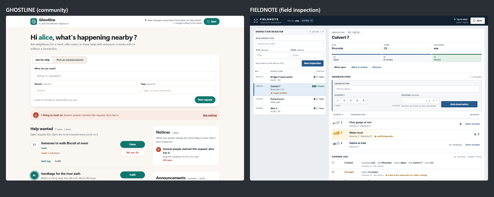
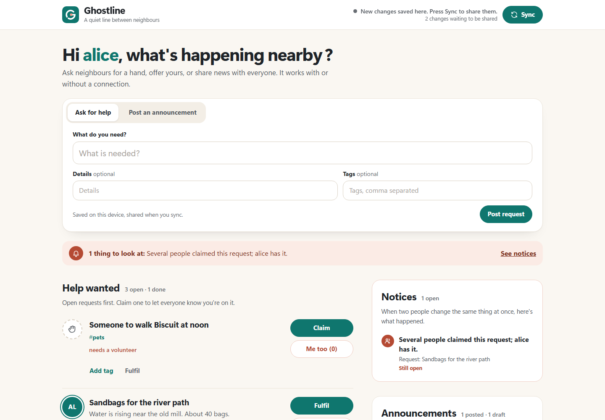
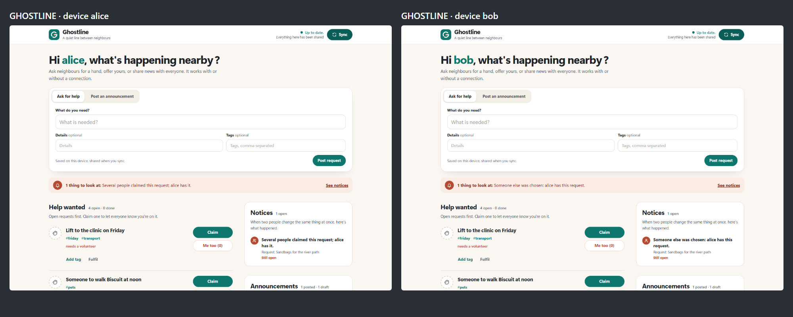
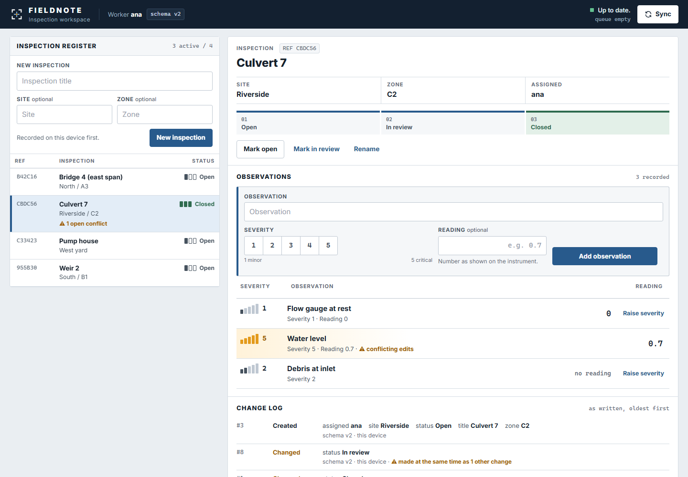
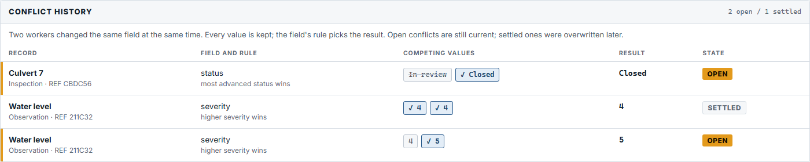
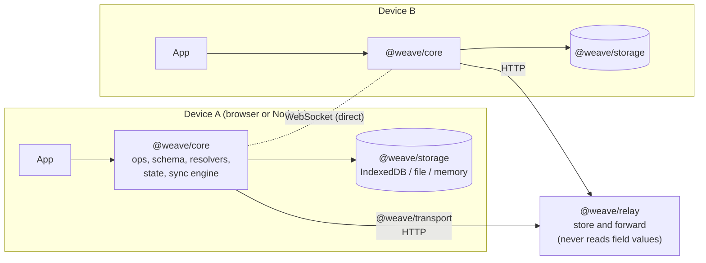

# WEAVE

**An offline-first TypeScript foundation for applications that need to keep working without a
network and synchronize changes when connectivity returns.**

Independent devices and records → exchanged changes → reconciled shared state.

Each device keeps a full local copy of its data and records every change as an immutable,
hash-protected operation. When devices meet, directly or through a small relay, they exchange the
operations the other side lacks. Every device then derives the same state from the same set of
operations, whatever order they arrived in, so no server has to decide who wins.



_The two demonstration apps, GHOSTLINE (community coordination) and FIELDNOTE (field
inspections), running on WEAVE in a browser. Real screenshots from this repository._

## Why WEAVE

Apps used in places with poor or no connectivity (a flood, a field site, a basement) usually
either stop working offline or let devices drift apart and lose changes when they reconnect.
Getting this right means solving the same hard problems every time: idempotent retries, ordering
without trusted clocks, merging concurrent edits, schema changes across devices that upgrade at
different times, and crash-safe local storage.

WEAVE packages those answers as a small library with explicit guarantees:

- **Deterministic.** State is a pure function of the accepted operations. Arrival order and wall
  clocks never change the result.
- **Idempotent.** Every write carries a caller-supplied `mutationId`, so a retry after a crash or
  a timeout never creates a second change.
- **Verified sync.** A sync reports `complete` only when both sides were checked to hold the same
  operations, not just because no error occurred.
- **Conflicts stay visible.** Concurrent edits are merged by a fixed rule per field, and the
  competing values are kept in a conflict history the app can show.
- **No runtime dependencies.** The shipped packages depend on nothing outside this repository.

**Who it is for:** TypeScript developers building local-first web or Node.js apps for small
groups (a neighbourhood, a team, a field crew) that must work offline and converge reliably.

**Maturity:** an early-stage project (version 0.x). The core guarantees are covered by property,
fuzz, crash and end-to-end tests, but WEAVE has not been used in production and its APIs may still
change. See [Project status](#project-status) and [Known limitations](#known-limitations).

## Contents

- [Quick start](#quick-start)
- [Features](#features)
- [The demonstration apps](#the-demonstration-apps)
- [Architecture](#architecture)
- [Project structure](#project-structure)
- [Compatibility and upgrades](#compatibility-and-upgrades)
- [Project status](#project-status)
- [Known limitations](#known-limitations)
- [Documentation](#documentation)
- [Contributing](#contributing)
- [License](#license)

## Quick start

**Prerequisites:** [Node.js](https://nodejs.org/) 22 or later (the repository pins 22 in
`.nvmrc`), npm, and Git. WEAVE is distributed as source from this repository; the packages are
not published to npm (see [Project status](#project-status)).

```sh
git clone https://github.com/realwarp/weave.git
cd weave
npm ci
npm run build
npm test
```

Run a demonstration app (each starts a local relay on port 8787 and the app on port 5173):

```sh
npm run dev:ghostline   # then open http://127.0.0.1:5173/?device=alice and ?device=bob
npm run dev:fieldnote   # then open http://127.0.0.1:5173/?device=ana and ?device=ben
```

Stop an app with **Ctrl+C**. Both use the same ports, so run one at a time. The
[getting started guide](docs/guides/getting-started.md) covers headless demos, browser tests,
other ports and troubleshooting.

Use the library: two replicas, one write, one sync.

```ts
import { createReplica, defineCollection, f } from '@weave/core';
import { memoryStorage } from '@weave/storage/memory';

const notes = defineCollection({
  name: 'notes',
  version: 1,
  fields: {
    title: f.string({ required: true }),
    tags: f.set(f.string()),
    status: f.rank(['open', 'done']),
  },
});

const a = await createReplica({ storage: memoryStorage(), collections: [notes] });
const b = await createReplica({ storage: memoryStorage(), collections: [notes] });

// One mutationId per user intent: store it with the intent and reuse it on every retry.
const { recordId } = await a
  .collection(notes)
  .create({ title: 'Fix the gate', tags: ['urgent'], status: 'open' }, { mutationId: a.newMutationId() });

const result = await b.sync(a.endpoint());
console.log(result.status); // 'complete'
console.log((await b.collection(notes).get(recordId))?.value.title); // 'Fix the gate'
console.log(JSON.stringify(await a.hashes()) === JSON.stringify(await b.hashes())); // true
```

This snippet is run as a test (`tests/quickstart`), so it stays correct. To sync through a relay
instead, start one with `node packages/relay/dist/cli.js --data ./relay-data --port 8787` (after
`npm run build`; stop it with Ctrl+C) and pass `httpTransport({ baseUrl: 'http://127.0.0.1:8787' })`
from `@weave/transport/http` to `sync`.
More in the [core API guide](docs/guides/core-api.md).

## Features

Implemented and tested. Features marked **opt-in** are off unless you turn them on.

| Area                     | What WEAVE does                                                                                                                                                                                      | Docs                                                                     |
| ------------------------ | ---------------------------------------------------------------------------------------------------------------------------------------------------------------------------------------------------- | ------------------------------------------------------------------------ |
| Local-first storage      | Memory, file (Node.js; checksummed journal with locking) and IndexedDB (browser) adapters. Every change is one atomic transaction.                                                                   | [`@weave/storage`](packages/storage/README.md)                           |
| Synchronization          | Version-vector exchange of exactly the missing operations, with retry and backoff, and a verified sync point.                                                                                       | [ADR-0010](docs/adr/0010-transport-and-sync.md), [protocol](docs/protocol.md) |
| Offline operation        | Writes never need a connection; the app syncs whenever a peer or relay is reachable.                                                                                                                 | [Architecture](docs/architecture.md)                                     |
| Conflict handling        | Per-field deterministic resolvers: `last-writer-wins` (Lamport order), `max`, `min`, `set-union`, `max-rank`. Conflicts are kept in `replica.conflicts`.                                             | [Resolver guide](docs/guides/custom-resolver.md)                         |
| Counter and custom resolvers (opt-in) | `f.counter()` sums every device's changes; `f.custom()` with `defineResolver()` gives a field its own pure rule; `assertResolverDeterministic()` tests it.                               | [Resolver guide](docs/guides/custom-resolver.md)                         |
| Schema evolution         | Versioned collections with pure migrations. Old ops are upgraded on read and never rewritten; a peer is only sent ops it can read (`PEER_SCHEMA_OLDER`). Opt-in: hold newer-schema ops until upgrade. | [Migrations guide](docs/guides/migrations.md)                            |
| Deletes and restore (opt-in) | Delete wins by default; per collection, `restore` and an `update-wins` policy.                                                                                                                    | [ADR-0006](docs/adr/0006-deletes-and-compaction.md)                      |
| Compaction and snapshots (opt-in) | Discard operations every member has acknowledged; bring new or returning devices up to date from a verified snapshot.                                                                    | [`@weave/relay`](packages/relay/README.md), [ADR-0015](docs/adr/0015-phase-5-contract-additions.md) |
| Storage recovery         | The file adapter fails closed on damage and never takes over a lock it cannot prove stale. A documented, tested manual recovery procedure.                                                           | [Storage recovery](docs/guides/storage-recovery.md)                      |
| Transports               | In-process, HTTP (to the relay) and WebSocket (direct device-to-device, Node.js server).                                                                                                             | [`@weave/transport`](packages/transport/README.md)                       |
| Relay                    | A durable store-and-forward server and `weave-relay` CLI. It verifies and stores operations but never reads field values.                                                                           | [`@weave/relay`](packages/relay/README.md)                               |
| Access control (opt-in)  | A shared bearer token; optional per-secret identities on the relay; an `authorize` hook; peer bans.                                                                                                  | [Threat model](docs/threat-model.md)                                     |

## The demonstration apps

Both apps use only WEAVE's public API. They contain no sync, hashing or encoding code of their
own. [How their data models differ](docs/app-differences.md).

### GHOSTLINE: community coordination

Neighbours post requests for help and announcements. Others claim and fulfil requests, add tags,
or tap "Me too". When two people claim the same request at the same time, every device picks the
same claimant and the other person gets a notice. [App README](apps/ghostline/README.md).





### FIELDNOTE: field inspections

Workers record inspections and observations with a severity and an optional numeric reading,
move each inspection from open to in review to closed, and see every concurrent edit and how it was
resolved. It also demonstrates a schema upgrade (v1 `location` becomes v2 `site` and `zone`) and a
device that has not upgraded yet. [App README](apps/fieldnote/README.md).





Headless versions of both, with a real relay process and several devices on file storage:
`npm run demo:ghostline` and `npm run demo:fieldnote`.

## Architecture



1. An app writes through `@weave/core`. Each write becomes one operation, hashed over its
   canonical encoding and stored in one atomic transaction by a `@weave/storage` adapter.
2. The app's state is derived from the stored operations by a pure function.
3. `replica.sync(endpoint)` exchanges the missing operations with an endpoint: another replica, a
   relay over HTTP, or another device over WebSocket. Each side validates a whole batch before
   applying any of it.
4. Concurrent edits to a field are merged by that field's resolver, the same way on every device.

| Path                 | Role                                                                                                                      |
| -------------------- | ------------------------------------------------------------------------------------------------------------------------- |
| `packages/core`      | Operations, canonical encoding (RFC 8785) and SHA-256, schemas and migrations, resolvers, state derivation, engine, sync engine. Imports nothing outside itself. |
| `packages/storage`   | Storage adapters: `memory`, `file` (Node.js) and `indexeddb` (browser).                                                   |
| `packages/transport` | Transports: `in-process`, `http` and `websocket` (client, plus a Node.js server for direct sync).                        |
| `packages/relay`     | The relay server, its HTTP routes and the `weave-relay` CLI. Semantically opaque: no resolvers, schemas or migrations.    |
| `packages/testing`   | Development only: conformance suites, simulator, fault injection, fake clock and generators.                              |
| `apps/ghostline`     | Community coordination demo app (browser UI, scripted demo, tests).                                                       |
| `apps/fieldnote`     | Field inspection demo app (browser UI, schema migration, scripted demo, tests).                                           |

More: [architecture overview](docs/architecture.md), [component diagram](docs/diagrams/components.md),
[sync sequence](docs/diagrams/sync-sequence.md), [protocol](docs/protocol.md) and the
[decision records](docs/adr/).

## Project structure

```text
weave/
├── packages/
│   ├── core/          engine; src/contracts holds the public types
│   ├── storage/       memory, file and IndexedDB adapters
│   ├── transport/     in-process, HTTP and WebSocket transports
│   ├── relay/         relay server and weave-relay CLI
│   └── testing/       conformance suites, simulator, fault injection (dev only)
├── apps/
│   ├── ghostline/     community coordination app (src/, test/, test/e2e/)
│   └── fieldnote/     field inspection app (src/, test/, test/e2e/)
├── tests/             cross-package property, integration, fuzz, relay and browser tests
├── scripts/           dev server, demos, benchmarks and repository checks
├── docs/              guides, ADRs, diagrams, threat model, review reports
├── .kiro/             the specification (requirements, design, tasks), steering and hooks
└── .github/workflows/ CI (every push and PR) and nightly property runs
```

Each package also has its own README. The full specification that WEAVE was built from is in
`.kiro/specs/mission-build-weave-an-offline-first/`.

## Compatibility and upgrades

- **Runtime:** Node.js 22 or later; IndexedDB tested in Chromium. The shipped packages are ESM only.
- **Versions:** the repository is at version 0.2.0. The latest tag is `v0.1.0`; the `v0.2.0` tag and
  release have not been created yet. Details of every change are in the [CHANGELOG](CHANGELOG.md).
- **Upgrading from 0.1.0:** a 0.1.0 store opens in place; no migration is needed, and stored
  `mutationId`s still replay. Upgrade every device and the relay before turning on any 0.2.0
  feature: a 0.1.0 peer rejects `restore` ops (`NOT_SUPPORTED`), and it cannot define counter or
  custom fields or a `deletes` policy, so it would apply an `update-wins` collection's ordinary ops
  with delete-wins rules and derive a different state.
- **Downgrading is not supported** once any 0.2.0 feature has written to a store. 0.1.0 does not
  detect the newer data: it opens the store without an error but can silently derive a different
  state. For example, after a `restore` op is stored, 0.1.0 at first still shows the restored
  record, and once `rebuild()` runs it ignores the restore and the record reads as deleted. Keep a
  copy of your 0.1.0 data before turning on new features if you may need to go back.
- **App schemas:** a collection's `version` rises when its fields change, with a migration for each
  step. A device on an older schema receives each origin's operations only up to the first one it
  cannot read, and its sync reports `partial` with `PEER_SCHEMA_OLDER` until it upgrades. See the
  [migrations guide](docs/guides/migrations.md).

## Project status

| Status                 | What                                                                                                                                                                                                                                  |
| ---------------------- | ------------------------------------------------------------------------------------------------------------------------------------------------------------------------------------------------------------------------------------- |
| Implemented and tested | Everything in [Features](#features). CI runs lint, formatting, build, test type checks, the unit, property, fuzz, integration and relay end-to-end suites on Ubuntu, Windows and macOS, plus browser tests, both app demos, benchmarks and a reproducible-build check. |
| Opt-in (0.2.0)         | Compaction and `removePeer`, snapshots, `restore` and `update-wins`, counter and custom resolvers, holding newer-schema ops, authorization and identities, peer bans, WebSocket transport. Each is off by default; see [ADR-0015](docs/adr/0015-phase-5-contract-additions.md) for every addition and its limits. |
| Not implemented        | Mixed-version writing (holding newer ops is supported, writing under an older schema while peers run a newer one is not), per-record authorization, encryption at rest, a WebSocket route on the relay, TLS termination.            |
| Distribution           | Source only, from this repository. The packages are not on npm: the `@weave` npm scope belongs to another account, so they cannot be published under these names.                                                                    |

## Known limitations

- **Trust model.** Compaction and snapshot archives assume members follow the acknowledgement
  protocol; they are not safe against a malicious member that over-claims.
- **Access control is coarse.** With only the shared token, any client holding it can read every
  operation on the relay. Authorization decisions are per request and per origin, not per record,
  and the relay's admin routes accept any valid secret. Peer bans are in memory and keyed by the
  claimed replica ID.
- **No transport security of its own.** Put TLS (HTTPS / `wss://`) in front of the relay and the
  WebSocket server across networks. The WebSocket server has no connection cap or idle timeout.
- **Storage growth.** With compaction on, `mut/` keeps one small entry per local write for the life
  of the replica, so retries stay idempotent; there is no expiry.
- **File locks on Windows and macOS.** If a process using the file adapter is killed, its lock stays
  and must be cleared with the [storage recovery guide](docs/guides/storage-recovery.md). WEAVE
  never breaks a lock it cannot prove stale.
- **Development tooling** has open `npm audit` advisories (Vitest 2, Vite, TypeDoc). None of it
  ships in a package; `npm audit --omit=dev` reports 0 vulnerabilities.

The full picture is in the [threat model](docs/threat-model.md).

## Documentation

Start at the [documentation index](docs/README.md). The most used pages:

- [Getting started](docs/guides/getting-started.md): install, run, test, troubleshoot
- [Core API](docs/guides/core-api.md): replicas, collections, writes, sync and status
- Guides: [custom resolvers](docs/guides/custom-resolver.md), [migrations](docs/guides/migrations.md),
  [custom storage](docs/guides/custom-storage.md), [custom transport](docs/guides/custom-transport.md),
  [storage recovery](docs/guides/storage-recovery.md)
- [Architecture](docs/architecture.md), [protocol](docs/protocol.md),
  [threat model](docs/threat-model.md), [decision records](docs/adr/)
- API reference: `npm run docs:api` writes it to `docs/api/`

## Contributing

Bug reports and pull requests are welcome. Read [CONTRIBUTING.md](CONTRIBUTING.md) for the
development setup, the checks every change must pass and the project's rules (no runtime
dependencies, determinism, a required `mutationId` on every write).

How the project was built, with Kiro and Kiro Crew from an approved specification, is described in
[docs/kiro-crew.md](docs/kiro-crew.md) and [docs/disclosure.md](docs/disclosure.md).

## License

MIT. See [LICENSE](LICENSE).
