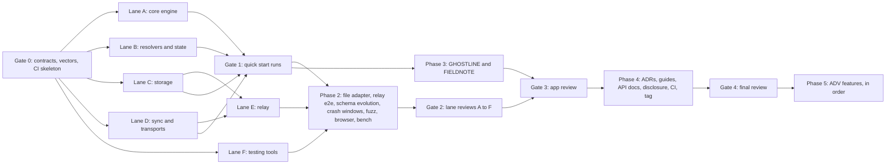

# How WEAVE was built with Kiro and Kiro Crew

WEAVE was planned as a Kiro spec and then built by Kiro agents run through Kiro Crew, which adds
background sub-agents, scheduled wake-ups and multi-step orchestration on top of Kiro. This page
records how the work was split, who checked it, and which agents produced what.

## 1. Spec first

The specification in `.kiro/specs/mission-build-weave-an-offline-first/` was written and approved
before any code: `requirements.md` (MVP and [ADV] criteria), `design.md` (data model, algorithms,
storage format, protocol, ownership) and `tasks.md` (68 tasks with paths, dependencies and a
"Done when" line each). Many review rounds with the user settled the hard choices (mandatory
`mutationId`, all-or-nothing validation, acknowledgement rules, the journal format, lock takeover,
the verified sync point). Steering files in `.kiro/steering/` (`product.md`, `tech.md`,
`structure.md`) and hooks in `.kiro/hooks/` carried the rules into every agent session.

## 2. Workstreams and owners

Every path has exactly one owner (design 18.2, `OWNERS`). An agent changes only its own paths.

| Workstream                             | Owns (summary)                                                                 |
| -------------------------------------- | ------------------------------------------------------------------------------ |
| Architecture and research              | `.kiro/specs/**`, `docs/adr/**`, architecture and protocol docs, `packages/core/src/contracts/**` (frozen after Gate 0) |
| Core engine                            | `packages/core/src/{canonical,ops,schema,engine}/**`, `index.ts`, their tests   |
| Conflict resolution                    | `packages/core/src/{resolvers,state}/**` and tests                             |
| Synchronization                        | `packages/core/src/sync/**`, `protocol.ts`, `packages/transport/**`, transport test tools |
| Storage and data                       | `packages/storage/**`, storage test tools                                      |
| Relay                                  | `packages/relay/**`                                                            |
| Testing and QA                         | simulator, faults, generators, `tests/**`, `docs/reviews/**`                    |
| GHOSTLINE                              | `apps/ghostline/**`                                                            |
| FIELDNOTE                              | `apps/fieldnote/**`                                                            |
| Developer experience and documentation | `README.md`, `CHANGELOG.md`, `docs/guides/**`, `docs/demo-plan.md`, this file, `docs/app-differences.md`, `docs/api/**` |
| Security and release                   | `.github/**`, `scripts/**`, `LICENSE`, `OWNERS`, threat model, disclosure, root config |

The workstreams meet only at the frozen contract types (`Resolver`, `DerivedRecord`,
`StorageAdapter`, `SyncEndpoint`, `SyncHost`, `applyIncoming`), so lanes could proceed in parallel.

## 3. Dependency graph and gates

| Gate | Passes when                                                                                      | Report                            |
| ---- | ------------------------------------------------------------------------------------------------ | --------------------------------- |
| 0    | Contracts frozen, canonical vectors and independent reference, CI skeleton                         | `docs/reviews/T0.8.md`            |
| 1    | The README quick start runs as a test: two replicas, one write, `complete`, equal hashes         | `docs/reviews/T1.G2.md`           |
| 2    | Relay over HTTP, all adapters pass conformance, all engine suites pass, six lane reviews pass    | `docs/reviews/T2.9-*.md`, `T2.9-resolution.md` |
| 3    | Both apps run on the real relay, boundary and difference checks pass, apps reviewed              | `docs/reviews/T3.X2.md`, `T3.X2-resolution.md` |
| 4    | Docs, disclosure, CI green on three operating systems, tag `v0.1.0`, final review                | `docs/reviews/T4.7.md`            |

## 4. What reviewers checked

Reviewer agents were independent: they started without the builder's context, read the actual
code, ran the commands themselves and wrote only their report file. A builder's summary was never
accepted as evidence (R15.7). Each report lists the commands with exit codes, a findings table with
file and line, the requirement each finding touches, and a single verdict line. FAIL was reserved
for a blocker or major defect with a concrete reproduction.

Findings were then checked against the code by the builder. Real ones were fixed (for example, at
Gate 3 the form intent keys were moved into `localStorage` so a re-submit after a reload replays
instead of creating a duplicate). Claims that did not hold were answered with evidence (at Gate 1
a reviewer's "blocker" on `mutationId` validation was refuted by the existing runtime test, and the
reviewer withdrew it after re-running it). Each disposition is recorded in the `*-resolution.md`
files.

## 5. Which agents produced what

| Agent role                                   | Produced                                                                                           |
| -------------------------------------------- | -------------------------------------------------------------------------------------------------- |
| Spec agent (Kiro spec workflow)              | `requirements.md`, `design.md`, `tasks.md`, revised through the user's review rounds              |
| Orchestrating build agent (Kiro, via Kiro Crew) | Phase 0 scaffold, contracts and CI; the core engine, resolvers and state; the memory and file adapters, locking and recovery; the IndexedDB adapter; the sync engine and transports; the relay; the simulator and all cross-package suites; both apps; ADRs, guides, threat model and this documentation |
| First-wave parallel builder sub-agents       | Early drafts of core, storage, transport and testing modules. Their output did not compile under the strict settings and one draft edited a frozen contract, so all of it was reverted or rewritten by the orchestrating agent. Lesson kept: verify every sub-agent change before accepting it. |
| Documentation sub-agents (four, disjoint files) | TSDoc comments on exported symbols (task T4.3), verified by a comment-free compile that must be byte-identical before and after |
| Independent reviewer sub-agents              | Gate 1, the six Gate 2 lane reviews, the Gate 3 app review (from a clean worktree), and the Gate 4 final review |

Kiro Crew's role was orchestration: running reviewers and documentation workers in the background
in parallel, waking the build agent on a schedule to continue the task list, and keeping the
reviewers' context separate from the builder's.
